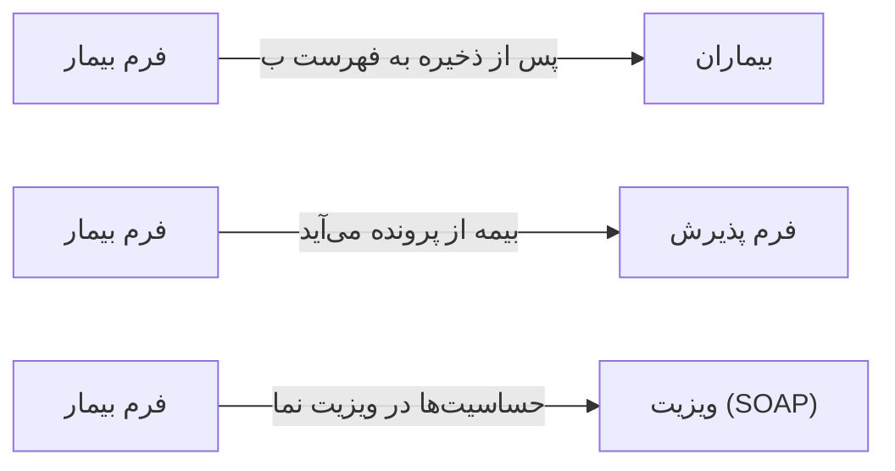

# 👥 فرم بیمار — `PatientFormWindow`

> [بیماران] · کهن‌الگوی `form-std` (فرم استاندارد) · آیکون `Icon.UserPlus`

| پیوند | نشانی |
|---|---|
| وایرفریمِ زنده | [`01-wireframes-html/PatientFormWindow.html`](../01-wireframes-html/PatientFormWindow.html) |
| View | [`03-views/PatientFormWindow.xaml`](../03-views/PatientFormWindow.xaml) |
| ViewModel | [`04-viewmodels/PatientFormViewModel.cs`](../04-viewmodels/PatientFormViewModel.cs) |

**ایجاد یا ویرایش پرونده بیمار**

## 📝 شرح

فیلدها بر اساس نقشِ خود اندازه گرفته‌اند: نام/نام‌خانوادگی/کدملی/جنسیت هر یک ۳ ستون از ۱۲؛ نشانی و حساسیت‌ها عرض کامل.

## 🖼 چیدمان

```
┌──────────────────────────────────────────────────────────────────┐
│  سربرگ: فرم بیمار                                                  │
├──────────────────────────────────────────────────────────────────┤
│  شبکه‌ی ۱۲ ستونه — پهنای هر فیلد متناسب با کارکردش                │
  │ FirstNa │ LastNam │ Nationa │ Gender  │
  │ BirthDa │ Marital │ Occupat │ Educati │
  │ Phone   │ HomePho │ Email   │ Emergen │
  │ Provinc │ City                      │
  │ Address                            │
  │ InsuranceI │ InsuranceN │ InsuranceE │
  │ BloodTy │ Weight  │ Height  │ Chronic │
  │ Allergies                          │

├──────────────────────────────────────────────────────────────────┤
│                                    [انصراف]  [ذخیره]             │
└──────────────────────────────────────────────────────────────────┘
```

## 📋 فیلدها

> پهنا بر پایه‌ی شبکه‌ی ۱۲ ستونه است: «بزرگیِ عنصر متناسب با کارکرد».

| بخش | آیکون | فیلد | برچسب | نوع | پهنا (از ۱۲) | الزامی | مقدارِ نمونه |
|---|---|---|---|---|:--:|:--:|---|
| **اطلاعات هویتی** | `Icon.IdCard` | `FirstName` | نام | TextBox | 3/۱۲ | بله | سارا |
|  | `Icon.IdCard` | `LastName` | نام خانوادگی | TextBox | 3/۱۲ | بله | احمدی |
|  | `Icon.IdCard` | `NationalId` | کد ملی | TextBox | 3/۱۲ | بله | ۰۰۱۲۳۴۵۶۷۸ |
|  | `Icon.IdCard` | `Gender` | جنسیت | ComboBox | 3/۱۲ | بله | زن |
|  | `Icon.IdCard` | `BirthDate` | تاریخ تولد | DatePicker | 3/۱۲ | خیر | ۱۳۶۲/۰۷/۱۹ |
|  | `Icon.IdCard` | `MaritalStatus` | وضعیت تأهل | ComboBox | 3/۱۲ | خیر | متأهل |
|  | `Icon.IdCard` | `Occupation` | شغل | TextBox | 3/۱۲ | خیر | کارمند |
|  | `Icon.IdCard` | `Education` | تحصیلات | ComboBox | 3/۱۲ | خیر | کارشناسی |
| **اطلاعات تماس** | `Icon.Phone` | `Phone` | موبایل | TextBox | 3/۱۲ | بله | ۰۹۱۴۴۲۲۰۴۳۰ |
|  | `Icon.Phone` | `HomePhone` | تلفن ثابت | TextBox | 3/۱۲ | خیر | ۰۴۱-۳۴۴۳۶۱۴۱ |
|  | `Icon.Phone` | `Email` | رایانامه | TextBox | 3/۱۲ | خیر | info@ea-fixer.ir |
|  | `Icon.Phone` | `EmergencyContact` | شماره اضطراری | TextBox | 3/۱۲ | خیر | ۰۹۱۴۴۲۲۰۴۳۰ |
|  | `Icon.Phone` | `Province` | استان | ComboBox | 3/۱۲ | خیر | آذربایجان شرقی |
|  | `Icon.Phone` | `City` | شهر | ComboBox | 3/۱۲ | خیر | تبریز |
|  | `Icon.Phone` | `Address` | نشانی کامل | TextBox (چندخطی) | 12/۱۲ | خیر | تبریز، خیابان ولیعصر، کوچه گلستان، پلاک ۱۲ |
| **اطلاعات بیمه و بالینی** | `Icon.ShieldCheck` | `InsuranceId` | بیمه پایه | ComboBox | 4/۱۲ | خیر | تأمین اجتماعی |
|  | `Icon.ShieldCheck` | `InsuranceNumber` | شماره بیمه | TextBox | 4/۱۲ | خیر | ۱۲۳۴۵۶۷۸۹۰ |
|  | `Icon.ShieldCheck` | `InsuranceExpiry` | تاریخ اعتبار | DatePicker | 4/۱۲ | خیر | ۱۴۰۵/۰۳/۳۱ |
|  | `Icon.ShieldCheck` | `BloodType` | گروه خونی | ComboBox | 3/۱۲ | خیر | O+ |
|  | `Icon.ShieldCheck` | `Weight` | وزن (کیلوگرم) | TextBox (عددی) | 3/۱۲ | خیر | ۶۵ |
|  | `Icon.ShieldCheck` | `Height` | قد (سانتی‌متر) | TextBox (عددی) | 3/۱۲ | خیر | ۱۶۵ |
|  | `Icon.ShieldCheck` | `ChronicDiseases` | بیماری‌های مزمن | ComboBox | 3/۱۲ | خیر | دیابت |
|  | `Icon.ShieldCheck` | `Allergies` | حساسیت‌های دارویی | TextBox (چندخطی) | 12/۱۲ | خیر | پنی‌سیلین — واکنش پوستی شدید |

## ⚡ اقدام‌ها

| فرمان | برچسب | آیکون | سبک |
|---|---|---|---|
| `SaveCommand` | ذخیره | `Icon.Save` | اصلی |
| `SaveNewCommand` | ذخیره و جدید | `Icon.Plus` | ثانویه |
| `CancelCommand` | انصراف | `—` | بی‌زمینه |

## 🔗 ارتباطات

| مبدأ | مقصد | نوعِ پیوند |
|---|---|---|
| فرم بیمار | بیماران | پس از ذخیره به فهرست بازمی‌گردد |
| فرم بیمار | فرم پذیرش | بیمه از پرونده می‌آید |
| فرم بیمار | ویزیت (SOAP) | حساسیت‌ها در ویزیت نمایش داده می‌شود |



---

این فایل با `tools/gen_wireframes_md.py` ساخته شده است.
