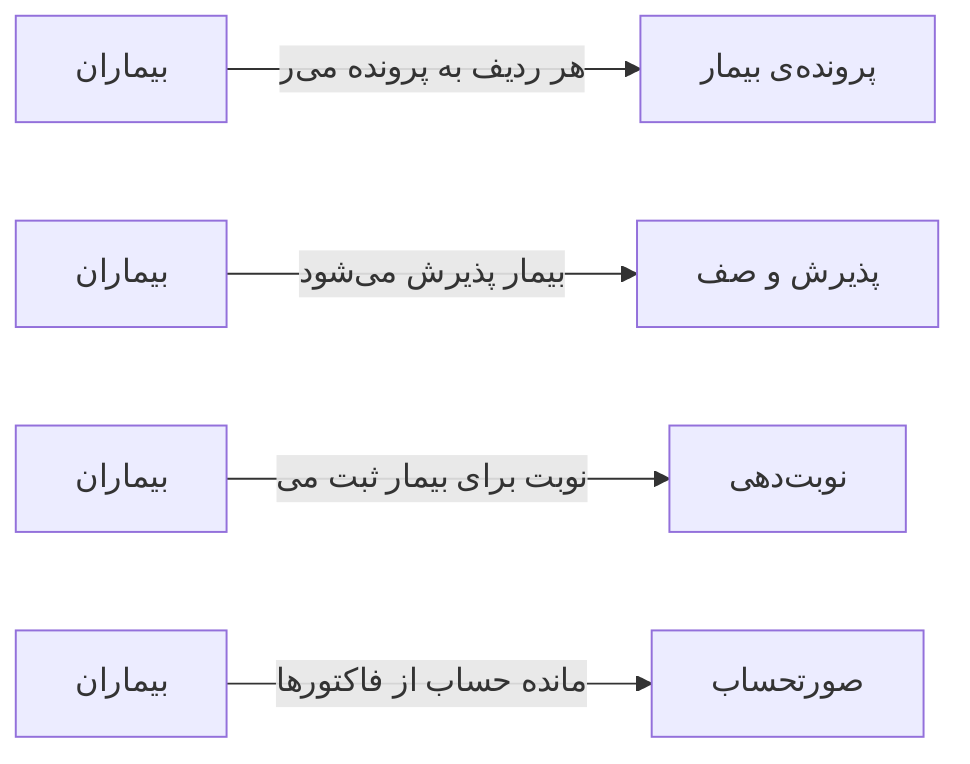

# 👥 بیماران — `PatientsView`

> [بیماران] · کهن‌الگوی `list-detail` (لیست + جزئیات) · آیکون `Icon.Users`

| پیوند | نشانی |
|---|---|
| وایرفریمِ زنده | [`01-wireframes-html/PatientsView.html`](../01-wireframes-html/PatientsView.html) |
| View | [`03-views/PatientsView.xaml`](../03-views/PatientsView.xaml) |
| ViewModel | [`04-viewmodels/PatientsViewModel.cs`](../04-viewmodels/PatientsViewModel.cs) |

**مدیریت پرونده‌ها و جستجوی بیماران**

## 🖼 چیدمان

```
┌──────────────────────────────────────────────────┬───────────────┐
│  سربرگ: بیماران                                     │               │
├──────────────────────────────────────────────────┤  خلاصه        │
│  ┌────────┐ ┌────────┐ ┌────────┐ ┌────────┐     │               │
│  │ شاخص ۱ │ │ شاخص ۲ │ │ شاخص ۳ │ │ شاخص ۴ │     │  کلید: مقدار  │
│  └────────┘ └────────┘ └────────┘ └────────┘     │  کلید: مقدار  │
├──────────────────────────────────────────────────┤  کلید: مقدار  │
│  [جستجو……] [فیلتر ▾]         [＋ جدید] [⟳]       │  …            │
├──────────────────────────────────────────────────┤               │
│  جدول                                            │               │
│  ┌────────┬──────────────┬───────┬───────┐        │               │
│  │ ستون   │ ستون         │ ستون  │ وضعیت │        │               │
│  ├────────┼──────────────┼───────┼───────┤        │               │
│  │ داده ۱ │ …            │ …     │ نشان  │        │               │
│  └────────┴──────────────┴───────┴───────┘        │               │
├──────────────────────────────────────────────────┤               │
│  نمایش ۱ تا ۲۵ از ۱۲۴۵            [◀] [▶]        │               │
└──────────────────────────────────────────────────┴───────────────┘
```

## 📊 شاخص‌های کلیدی

| آیکون | شاخص | مقدار | روند | رنگِ تاکیدی |
|---|:--:|:--:|:--:|---|
| `Icon.Users` | کل بیماران | **۲,۸۴۱** | +۳٪ | teal |
| `Icon.UserPlus` | جدید این ماه | **۱۲۷** | +۱۸٪ | green |
| `Icon.CircleCheck` | پرونده فعال | **۲,۶۰۳** | — | blue |
| `Icon.Archive` | بایگانی‌شده | **۲۳۸** | −۲٪ | amber |

## 🔍 فیلترها

| # | برچسب | نوع | پهنا | مقدارِ نمونه | گزینه‌ها |
|:--:|---|---|:--:|---|---|
| 1 | جستجو | `search` | w-xl | نام، کد ملی یا موبایل… | — |
| 2 | شعبه | `combo` | w-md | همه شعب | همه شعب، مرکزی، شعبه ۲ |
| 3 | وضعیت | `combo` | w-sm | فعال | فعال، غیرفعال، بایگانی |
| 4 | جنسیت | `combo` | w-sm | همه | همه، زن، مرد |
| 5 | از تاریخ | `date` | w-md | ۱۴۰۴/۰۱/۰۱ | — |

## 📐 ستون‌های جدول

| # | عنوان | اتصال | نوع | عرض | تراز |
|:--:|---|---|---|:--:|:--:|
| 1 | کد پرونده | `Code` | متن | 104px | Right |
| 2 | نام بیمار | `FullName` | شخص | * | Right |
| 3 | کد ملی | `NationalId` | عدد | 118px | Left |
| 4 | موبایل | `Phone` | عدد | 124px | Left |
| 5 | سن | `Age` | عدد | 58px | Center |
| 6 | جنسیت | `Gender` | متن | 74px | Center |
| 7 | آخرین ویزیت | `LastVisit` | تاریخ | 118px | Right |
| 8 | مانده | `Balance` | مبلغ | 110px | Left |
| 9 | وضعیت | `Status` | نشان | 96px | Center |

## 🧪 دادهٔ نمونه

| 1 | 2 | 3 | 4 | 5 | 6 | 7 | 8 | 9 |
|:--:|:--:|:--:|:--:|:--:|:--:|:--:|:--:|:--:|
| P-۱۰۲۴ | سارا احمدی | ۰۰۱-۲۳۴۵۶۷-۸ | ۰۹۱۴۴۲۲۰۴۳۰ | 42 | زن | ۱۴۰۴/۰۷/۱۲ | ۰ | `فعال` |
| P-۱۰۲۵ | محمد رضایی | ۰۰۲-۳۴۵۶۷۸-۹ | ۰۹۱۴۴۲۲۰۴۳۰ | 35 | مرد | ۱۴۰۴/۰۷/۱۰ | ۱۸۰,۰۰۰ | `فعال` |
| P-۱۰۲۶ | فاطمه کریمی | ۰۰۳-۴۵۶۷۸۹-۰ | ۰۹۱۴۴۲۲۰۴۳۰ | 28 | زن | ۱۴۰۴/۰۶/۲۸ | ۰ | `فعال` |
| P-۱۰۲۷ | علی حسینی | ۰۰۴-۵۶۷۸۹۰-۱ | ۰۹۱۴۴۲۲۰۴۳۰ | 61 | مرد | ۱۴۰۴/۰۵/۱۴ | ۰ | `بایگانی` |
| P-۱۰۲۸ | زهرا موسوی | ۰۰۵-۶۷۸۹۰۱-۲ | ۰۹۱۴۴۲۲۰۴۳۰ | 19 | زن | ۱۴۰۴/۰۷/۱۸ | ۴۵,۰۰۰ | `فعال` |

## 📌 پانلِ کناری

**خلاصه پرونده** (آیکون `Icon.IdCard`)

| کلید | مقدار |
|---|---|
| کد پرونده | P-۱۰۲۴ |
| نام | سارا احمدی |
| کد ملی | ۰۰۱-۲۳۴۵۶۷-۸ |
| سن/جنسیت | ۴۲ سال · زن |
| بیمه | تأمین اجتماعی |
| موبایل | ۰۹۱۴۴۲۲۰۴۳۰ |
| آخرین ویزیت | ۱۴۰۴/۰۷/۱۲ |
| مانده حساب | ۰ تومان |

## ⚡ اقدام‌ها

| فرمان | برچسب | آیکون | سبک |
|---|---|---|---|
| `NewCommand` | بیمار جدید | `Icon.UserPlus` | اصلی |
| `ExportCommand` | خروجی Excel | `Icon.FileSpreadsheet` | ثانویه |
| `PrintCommand` | چاپ کارت | `Icon.Printer` | ثانویه |

## 🔗 ارتباطات

| مبدأ | مقصد | نوعِ پیوند |
|---|---|---|
| بیماران | پرونده‌ی بیمار | هر ردیف به پرونده می‌رود |
| بیماران | پذیرش و صف | بیمار پذیرش می‌شود |
| بیماران | نوبت‌دهی | نوبت برای بیمار ثبت می‌شود |
| بیماران | صورتحساب | مانده حساب از فاکتورها |



---

این فایل با `tools/gen_wireframes_md.py` ساخته شده است.
