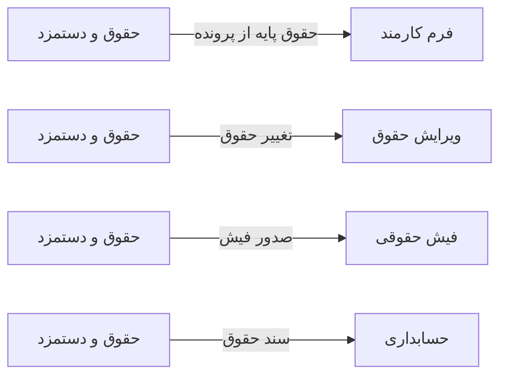

# 💰 حقوق و دستمزد — `PayrollView`

> [مالی] · کهن‌الگوی `list-dense` (لیستِ فشرده) · آیکون `Icon.Banknote`

| پیوند | نشانی |
|---|---|
| وایرفریمِ زنده | [`01-wireframes-html/PayrollView.html`](../01-wireframes-html/PayrollView.html) |
| View | [`03-views/PayrollView.xaml`](../03-views/PayrollView.xaml) |
| ViewModel | [`04-viewmodels/PayrollViewModel.cs`](../04-viewmodels/PayrollViewModel.cs) |

**محاسبه و پرداخت حقوق پرسنل**

## 🖼 چیدمان

```
┌──────────────────────────────────────────────────────────────────┐
│  سربرگ: حقوق و دستمزد                                              │
├──────────────────────────────────────────────────────────────────┤
│  ┌────────┐ ┌────────┐ ┌────────┐ ┌────────┐                     │
│  │ شاخص ۱ │ │ شاخص ۲ │ │ شاخص ۳ │ │ شاخص ۴ │                     │
│  └────────┘ └────────┘ └────────┘ └────────┘                     │
├──────────────────────────────────────────────────────────────────┤
│  [جستجو…………] [فیلتر ▾] [فیلتر ▾]        [＋ جدید] [⟳] [⤓]      │
├──────────────────────────────────────────────────────────────────┤
│  جدول                                                            │
│  ┌──────────┬────────────────────┬────────┬────────┬────────┐    │
│  │ ستون     │ ستون               │ ستون   │ ستون   │ وضعیت  │    │
│  ├──────────┼────────────────────┼────────┼────────┼────────┤    │
│  │ دادهٔ ۱   │ …                  │ …      │ …      │ نشان   │    │
│  │ دادهٔ ۲   │ …                  │ …      │ …      │ نشان   │    │
│  └──────────┴────────────────────┴────────┴────────┴────────┘    │
├──────────────────────────────────────────────────────────────────┤
│  نمایش ۱ تا ۲۵ از ۱۲۴۵                         [◀] [▶]           │
└──────────────────────────────────────────────────────────────────┘
```

## 📊 شاخص‌های کلیدی

| آیکون | شاخص | مقدار | روند | رنگِ تاکیدی |
|---|:--:|:--:|:--:|---|
| `Icon.Users` | پرسنل | **۳۴** | — | teal |
| `Icon.Banknote` | جمع حقوق ماه | **۱۸۵,۰۰۰,۰۰۰** | +۵٪ | green |
| `Icon.HandCoins` | اضافه‌کار | **۱۲,۴۰۰,۰۰۰** | — | blue |
| `Icon.TrendingDown` | کسورات | **۲۱,۳۰۰,۰۰۰** | — | amber |

## 🔍 فیلترها

| # | برچسب | نوع | پهنا | مقدارِ نمونه | گزینه‌ها |
|:--:|---|---|:--:|---|---|
| 1 | دوره | `combo` | w-md | مهر ۱۴۰۴ | — |
| 2 | دپارتمان | `combo` | w-md | همه | — |
| 3 | جستجو | `search` | w-lg | نام پرسنل… | — |

## 📐 ستون‌های جدول

| # | عنوان | اتصال | نوع | عرض | تراز |
|:--:|---|---|---|:--:|:--:|
| 1 | کد | `Code` | متن | 92px | Right |
| 2 | پرسنل | `Employee` | شخص | * | Right |
| 3 | دپارتمان | `Department` | متن | 130px | Right |
| 4 | حقوق پایه | `Base` | مبلغ | 116px | Left |
| 5 | اضافه‌کار | `Overtime` | مبلغ | 108px | Left |
| 6 | کسورات | `Deductions` | مبلغ | 108px | Left |
| 7 | خالص پرداختی | `Net` | مبلغ | 124px | Left |
| 8 | وضعیت | `Status` | نشان | 108px | Center |

## 🧪 دادهٔ نمونه

| 1 | 2 | 3 | 4 | 5 | 6 | 7 | 8 |
|:--:|:--:|:--:|:--:|:--:|:--:|:--:|:--:|
| E-۱۰۰۱ | مریم نوری | پذیرش | ۱۲,۰۰۰,۰۰۰ | ۸۰۰,۰۰۰ | ۱,۲۰۰,۰۰۰ | ۱۱,۶۰۰,۰۰۰ | `پرداخت شده` |
| E-۱۰۰۲ | احمد صادقی | پذیرش | ۱۲,۰۰۰,۰۰۰ | ۴۰۰,۰۰۰ | ۱,۱۰۰,۰۰۰ | ۱۱,۳۰۰,۰۰۰ | `پرداخت شده` |
| E-۱۰۰۳ | دکتر موسوی | درمان | ۴۵,۰۰۰,۰۰۰ | ۲,۰۰۰,۰۰۰ | ۴,۵۰۰,۰۰۰ | ۴۲,۵۰۰,۰۰۰ | `در انتظار` |

## ⚡ اقدام‌ها

| فرمان | برچسب | آیکون | سبک |
|---|---|---|---|
| `CalculateCommand` | محاسبه | `Icon.Calculator` | اصلی |
| `PayslipCommand` | فیش حقوقی | `Icon.FileText` | ثانویه |
| `PayCommand` | ثبت پرداخت | `Icon.HandCoins` | ok |
| `ExportCommand` | خروجی | `Icon.FileSpreadsheet` | ثانویه |

## 🔗 ارتباطات

| مبدأ | مقصد | نوعِ پیوند |
|---|---|---|
| حقوق و دستمزد | فرم کارمند | حقوق پایه از پرونده |
| حقوق و دستمزد | ویرایش حقوق | تغییر حقوق |
| حقوق و دستمزد | فیش حقوقی | صدور فیش |
| حقوق و دستمزد | حسابداری | سند حقوق |



---

این فایل با `tools/gen_wireframes_md.py` ساخته شده است.
