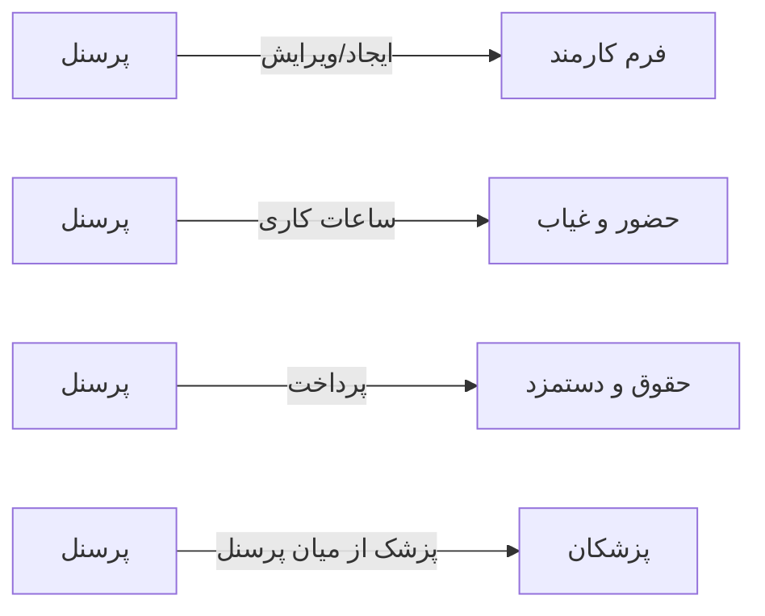

# 🧑‍💼 پرسنل — `PersonnelView`

> [منابع انسانی] · کهن‌الگوی `list-detail` (لیست + جزئیات) · آیکون `Icon.Users`

| پیوند | نشانی |
|---|---|
| وایرفریمِ زنده | [`01-wireframes-html/PersonnelView.html`](../01-wireframes-html/PersonnelView.html) |
| View | [`03-views/PersonnelView.xaml`](../03-views/PersonnelView.xaml) |
| ViewModel | [`04-viewmodels/PersonnelViewModel.cs`](../04-viewmodels/PersonnelViewModel.cs) |

**مدیریت پرونده‌های پرسنلی**

## 🖼 چیدمان

```
┌──────────────────────────────────────────────────┬───────────────┐
│  سربرگ: پرسنل                                       │               │
├──────────────────────────────────────────────────┤  خلاصه        │
│  ┌────────┐ ┌────────┐ ┌────────┐ ┌────────┐     │               │
│  │ شاخص ۱ │ │ شاخص ۲ │ │ شاخص ۳ │ │ شاخص ۴ │     │  کلید: مقدار  │
│  └────────┘ └────────┘ └────────┘ └────────┘     │  کلید: مقدار  │
├──────────────────────────────────────────────────┤  کلید: مقدار  │
│  [جستجو……] [فیلتر ▾]         [＋ جدید] [⟳]       │  …            │
├──────────────────────────────────────────────────┤               │
│  جدول                                            │               │
│  ┌────────┬──────────────┬───────┬───────┐        │               │
│  │ ستون   │ ستون         │ ستون  │ وضعیت │        │               │
│  ├────────┼──────────────┼───────┼───────┤        │               │
│  │ داده ۱ │ …            │ …     │ نشان  │        │               │
│  └────────┴──────────────┴───────┴───────┘        │               │
├──────────────────────────────────────────────────┤               │
│  نمایش ۱ تا ۲۵ از ۱۲۴۵            [◀] [▶]        │               │
└──────────────────────────────────────────────────┴───────────────┘
```

## 📊 شاخص‌های کلیدی

| آیکون | شاخص | مقدار | روند | رنگِ تاکیدی |
|---|:--:|:--:|:--:|---|
| `Icon.Users` | کل پرسنل | **۳۴** | +۲ | teal |
| `Icon.Briefcase` | دپارتمان‌ها | **۱۷** | — | blue |
| `Icon.CircleCheck` | فعال | **۳۲** | — | green |
| `Icon.CircleX` | غیرفعال | **۲** | — | rose |

## 🔍 فیلترها

| # | برچسب | نوع | پهنا | مقدارِ نمونه | گزینه‌ها |
|:--:|---|---|:--:|---|---|
| 1 | جستجو | `search` | w-xl | نام، کد پرسنلی یا ملی… | — |
| 2 | دپارتمان | `combo` | w-md | همه | همه، پذیرش، درمان، مالی، پشتیبانی |
| 3 | وضعیت | `combo` | w-sm | فعال | فعال، غیرفعال |

## 📐 ستون‌های جدول

| # | عنوان | اتصال | نوع | عرض | تراز |
|:--:|---|---|---|:--:|:--:|
| 1 | کد | `Code` | متن | 88px | Right |
| 2 | نام | `Name` | شخص | * | Right |
| 3 | سمت | `Position` | متن | 150px | Right |
| 4 | دپارتمان | `Department` | متن | 118px | Right |
| 5 | موبایل | `Phone` | عدد | 124px | Left |
| 6 | تاریخ استخدام | `HireDate` | تاریخ | 124px | Right |
| 7 | وضعیت | `Status` | نشان | 96px | Center |

## 🧪 دادهٔ نمونه

| 1 | 2 | 3 | 4 | 5 | 6 | 7 |
|:--:|:--:|:--:|:--:|:--:|:--:|:--:|
| E-۱۰۰۱ | مریم نوری | کارشناس پذیرش | پذیرش | ۰۹۱۴۴۲۲۰۴۳۰ | ۱۴۰۱/۰۲/۱۵ | `فعال` |
| E-۱۰۰۲ | احمد صادقی | مسئول پذیرش | پذیرش | ۰۹۱۴۴۲۲۰۴۳۰ | ۱۴۰۰/۰۸/۰۱ | `فعال` |
| E-۱۰۰۳ | دکتر موسوی | متخصص داخلی | درمان | ۰۹۱۴۴۲۲۰۴۳۰ | ۱۳۹۸/۰۴/۱۰ | `فعال` |
| E-۱۰۰۴ | لیلا حسنی | حسابدار | مالی | ۰۹۱۴۴۲۲۰۴۳۰ | ۱۴۰۲/۰۱/۲۰ | `فعال` |

## 📌 پانلِ کناری

**خلاصه پرونده** (آیکون `Icon.IdCard`)

| کلید | مقدار |
|---|---|
| کد پرسنلی | E-۱۰۰۱ |
| نام | مریم نوری |
| کد ملی | ۰۰۹-۸۷۶۵۴۳-۲ |
| سمت | کارشناس پذیرش |
| دپارتمان | پذیرش |
| موبایل | ۰۹۱۴۴۲۲۰۴۳۰ |
| تاریخ استخدام | ۱۴۰۱/۰۲/۱۵ |
| حقوق پایه | ۱۲,۰۰۰,۰۰۰ |

## ⚡ اقدام‌ها

| فرمان | برچسب | آیکون | سبک |
|---|---|---|---|
| `NewCommand` | پرسنل جدید | `Icon.UserPlus` | اصلی |
| `EditCommand` | ویرایش | `Icon.Pencil` | ثانویه |
| `SalaryCommand` | ویرایش حقوق | `Icon.Banknote` | ثانویه |
| `ExportCommand` | خروجی | `Icon.FileSpreadsheet` | ثانویه |

## 🔗 ارتباطات

| مبدأ | مقصد | نوعِ پیوند |
|---|---|---|
| پرسنل | فرم کارمند | ایجاد/ویرایش |
| پرسنل | حضور و غیاب | ساعات کاری |
| پرسنل | حقوق و دستمزد | پرداخت |
| پرسنل | پزشکان | پزشک از میان پرسنل |



---

این فایل با `tools/gen_wireframes_md.py` ساخته شده است.
