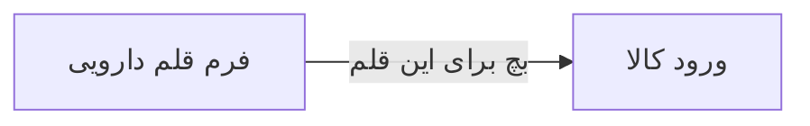

# 🧪 فرم قلم دارویی — `PharmacyItemFormWindow`

> [داروخانه] · کهن‌الگوی `form-std` (فرم استاندارد) · آیکون `Icon.PackagePlus`

| پیوند | نشانی |
|---|---|
| وایرفریمِ زنده | [`01-wireframes-html/PharmacyItemFormWindow.html`](../01-wireframes-html/PharmacyItemFormWindow.html) |
| View | [`03-views/PharmacyItemFormWindow.xaml`](../03-views/PharmacyItemFormWindow.xaml) |
| ViewModel | [`04-viewmodels/PharmacyItemFormViewModel.cs`](../04-viewmodels/PharmacyItemFormViewModel.cs) |

**تعریف یا ویرایش قلم دارویی**

## 🖼 چیدمان

```
┌──────────────────────────────────────────────────────────────────┐
│  سربرگ: فرم قلم دارویی                                             │
├──────────────────────────────────────────────────────────────────┤
│  شبکه‌ی ۱۲ ستونه — پهنای هر فیلد متناسب با کارکردش                │
  │ Code    │ Name          │ GenericNam │
  │ Kind    │ Categor │ Form    │ Unit    │
  │ MinStoc │ SalePri │ Purchas │ TaxRate │
  │ Barcode          │ IrcCode          │
  │ RequiresPrescrip │ IsNarcotic       │

├──────────────────────────────────────────────────────────────────┤
│                                    [انصراف]  [ذخیره]             │
└──────────────────────────────────────────────────────────────────┘
```

## 📋 فیلدها

> پهنا بر پایه‌ی شبکه‌ی ۱۲ ستونه است: «بزرگیِ عنصر متناسب با کارکرد».

| بخش | آیکون | فیلد | برچسب | نوع | پهنا (از ۱۲) | الزامی | مقدارِ نمونه |
|---|---|---|---|---|:--:|:--:|---|
| **شناسه قلم** | `Icon.Package` | `Code` | کد قلم | TextBox | 3/۱۲ | بله | D-۱۰۰۵ |
|  | `Icon.Package` | `Name` | نام تجاری | TextBox | 5/۱۲ | بله | سفکسیم ۴۰۰ کپسول |
|  | `Icon.Package` | `GenericName` | نام ژنریک | TextBox | 4/۱۲ | بله | Cefixime |
|  | `Icon.Package` | `Kind` | نوع قلم | ComboBox | 3/۱۲ | بله | دارو |
|  | `Icon.Package` | `Category` | گروه دارویی | ComboBox | 3/۱۲ | خیر | آنتی‌بیوتیک |
|  | `Icon.Package` | `Form` | شکل دارویی | ComboBox | 3/۱۲ | خیر | کپسول |
|  | `Icon.Package` | `Unit` | واحد | ComboBox | 3/۱۲ | خیر | عدد |
| **موجودی و قیمت** | `Icon.Coins` | `MinStock` | حد سفارش | TextBox (عددی) | 3/۱۲ | خیر | ۵۰ |
|  | `Icon.Coins` | `SalePrice` | قیمت فروش | TextBox | 3/۱۲ | خیر | ۶۵,۰۰۰ |
|  | `Icon.Coins` | `PurchasePrice` | قیمت خرید | TextBox | 3/۱۲ | خیر | ۵۲,۰۰۰ |
|  | `Icon.Coins` | `TaxRate` | درصد مالیات | TextBox (عددی) | 3/۱۲ | خیر | ۹ |
|  | `Icon.Coins` | `Barcode` | بارکد | TextBox + بارکدخوان | 6/۱۲ | خیر | ۶۲۶۰۱۰۷۰۰۱۲۳۴ |
|  | `Icon.Coins` | `IrcCode` | کد IRC | TextBox | 6/۱۲ | خیر | ۱۲۳۴۵۶۷۸۹۰ |
|  | `Icon.Coins` | `RequiresPrescription` | نیازمند نسخه | CheckBox | 6/۱۲ | خیر | True |
|  | `Icon.Coins` | `IsNarcotic` | داروی مخدر | CheckBox | 6/۱۲ | خیر | False |

## ⚡ اقدام‌ها

| فرمان | برچسب | آیکون | سبک |
|---|---|---|---|
| `SaveCommand` | ذخیره | `Icon.Save` | اصلی |
| `CancelCommand` | انصراف | `—` | بی‌زمینه |

## 🔗 ارتباطات

| مبدأ | مقصد | نوعِ پیوند |
|---|---|---|
| فرم قلم دارویی | ورود کالا | بچ برای این قلم |



---

این فایل با `tools/gen_wireframes_md.py` ساخته شده است.
