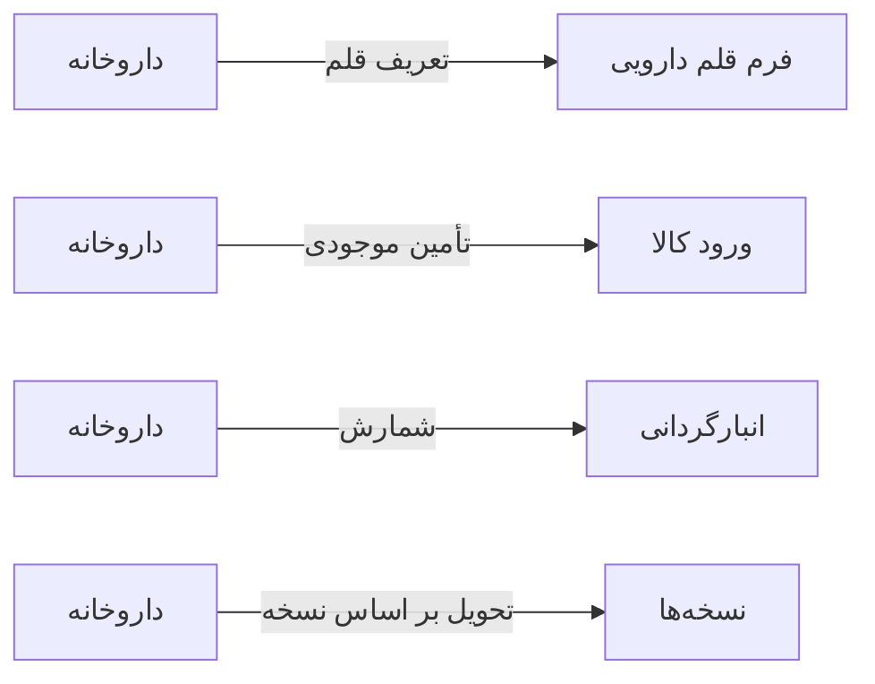

# 🧪 داروخانه — `PharmacyView`

> [داروخانه] · کهن‌الگوی `pos` (صندوق فروش) · آیکون `Icon.Pill`

| پیوند | نشانی |
|---|---|
| وایرفریمِ زنده | [`01-wireframes-html/PharmacyView.html`](../01-wireframes-html/PharmacyView.html) |
| View | [`03-views/PharmacyView.xaml`](../03-views/PharmacyView.xaml) |
| ViewModel | [`04-viewmodels/PharmacyViewModel.cs`](../04-viewmodels/PharmacyViewModel.cs) |

**تحویل نسخه و فروشِ دارو با الگوی FEFO**

## 📝 شرح

ستون چپ: کاتالوگِ داروها با جستجوی بارکد. ستون راست: سبدِ تحویل با جمع مبالغ؛ الگوی FEFO بچ نزدیک‌تر به انقضا را اول مصرف می‌کند.

## 🖼 چیدمان

```
┌──────────────────────────────────────────────┬────────────────────┐
│  سربرگ: داروخانه                                  │   🛒 سبدِ فروش     │
├──────────────────────────────────────────────┤                    │
│  ┌────────┐ ┌────────┐ ┌────────┐             │  قلم ۱            │
│  │ شاخص ۱ │ │ شاخص ۲ │ │ شاخص ۳ │             │  قلم ۲            │
│  └────────┘ └────────┘ └────────┘             │  …                 │
├──────────────────────────────────────────────┤                    │
│  جدولِ داروها                                ├──────────────────────┤
│  ┌────┬────────┬──────┬──────┬───────┐        │  جمع کل: …         │
│  │ کد │ نام    │ بچ   │ موجود│ قیمت  │        │                    │
│  └────┴────────┴──────┴──────┴───────┘        │                    │
└──────────────────────────────────────────────┴────────────────────┘
```

## 📊 شاخص‌های کلیدی

| آیکون | شاخص | مقدار | روند | رنگِ تاکیدی |
|---|:--:|:--:|:--:|---|
| `Icon.Package` | اقلام موجود | **۴۲۸** | — | teal |
| `Icon.TriangleAlert` | زیر حد سفارش | **۱۷** | +۳ | amber |
| `Icon.CalendarX` | نزدیک انقضا | **۲۹** | +۵ | rose |
| `Icon.Banknote` | فروش امروز | **۵,۸۴۰,۰۰۰** | +۱۴٪ | green |

## 🔍 فیلترها

| # | برچسب | نوع | پهنا | مقدارِ نمونه | گزینه‌ها |
|:--:|---|---|:--:|---|---|
| 1 | جستجو | `search` | w-xl | نام دارو یا بارکد… | — |
| 2 | گروه دارویی | `combo` | w-md | همه | — |
| 3 | فقط موجود | `check` | — | True | — |

## 📐 ستون‌های جدول

| # | عنوان | اتصال | نوع | عرض | تراز |
|:--:|---|---|---|:--:|:--:|
| 1 | کد | `Code` | متن | 92px | Right |
| 2 | نام دارو | `Name` | متن | * | Right |
| 3 | نام ژنریک | `Generic` | متن | 150px | Right |
| 4 | بچ | `Batch` | عدد | 92px | Center |
| 5 | موجودی | `Stock` | عدد | 92px | Center |
| 6 | قیمت | `Price` | مبلغ | 104px | Left |
| 7 | انقضا | `Expiry` | تاریخ | 108px | Right |
| 8 | وضعیت | `Status` | نشان | 104px | Center |

## 🧪 دادهٔ نمونه

| 1 | 2 | 3 | 4 | 5 | 6 | 7 | 8 |
|:--:|:--:|:--:|:--:|:--:|:--:|:--:|:--:|
| D-۱۰۰۱ | آموکسی‌سیلین ۵۰۰ کپسول | Amoxicillin | A-۲۲ | ۳۲۰ | ۴۵,۰۰۰ | ۱۴۰۵/۰۲/۱۵ | `کافی` |
| D-۱۰۰۲ | امپرازول ۲۰ کپسول | Omeprazole | B-۱۴ | ۸ | ۳۲,۰۰۰ | ۱۴۰۴/۱۱/۰۸ | `کمبود` |
| D-۱۰۰۳ | متفورمین ۵۰۰ قرص | Metformin | C-۳۱ | ۵۴۰ | ۲۸,۰۰۰ | ۱۴۰۵/۰۶/۲۰ | `کافی` |
| D-۱۰۰۴ | آسپرین ۸۰ قرص | Aspirin | D-۰۷ | ۶۲ | ۱۸,۰۰۰ | ۱۴۰۴/۰۸/۰۱ | `نزدیک انقضا` |

## ⚡ اقدام‌ها

| فرمان | برچسب | آیکون | سبک |
|---|---|---|---|
| `DispenseCommand` | تحویل نسخه | `Icon.PackageCheck` | اصلی |
| `StockInCommand` | ورود کالا | `Icon.PackagePlus` | ثانویه |
| `StocktakeCommand` | انبارگردانی | `Icon.ClipboardCheck` | ثانویه |

## 🔗 ارتباطات

| مبدأ | مقصد | نوعِ پیوند |
|---|---|---|
| داروخانه | فرم قلم دارویی | تعریف قلم |
| داروخانه | ورود کالا | تأمین موجودی |
| داروخانه | انبارگردانی | شمارش |
| داروخانه | نسخه‌ها | تحویل بر اساس نسخه |



---

این فایل با `tools/gen_wireframes_md.py` ساخته شده است.
