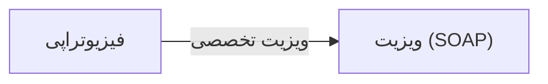

# 🩺 فیزیوتراپی — `PhysiotherapyView`

> [ویزیت] · کهن‌الگوی `detail-tabs` (جزئیاتِ تب‌دار) · آیکون `Icon.Accessibility`

| پیوند | نشانی |
|---|---|
| وایرفریمِ زنده | [`01-wireframes-html/PhysiotherapyView.html`](../01-wireframes-html/PhysiotherapyView.html) |
| View | [`03-views/PhysiotherapyView.xaml`](../03-views/PhysiotherapyView.xaml) |
| ViewModel | [`04-viewmodels/PhysiotherapyViewModel.cs`](../04-viewmodels/PhysiotherapyViewModel.cs) |

**برنامه تمرینی و پیگیری جلسات فیزیوتراپی**

## 🖼 چیدمان

```
┌──────────────────────────────────────────────────────────────────┐
│  سربرگ: فیزیوتراپی                                                 │
├──────────────────────────────────────────────────────────────────┤
│  فیلدهای سربرگ روی شبکه‌ی ۱۲ ستونه                                │
├──────────────────────────────────────────────────────────────────┤
│  تب ۱  │  تب ۲  │  تب ۳  │  تب ۴  │  تب ۵  │  تب ۶  │             │
├────────┴────────┴────────┴────────┴────────┴────────┴───────────┤
│                                                                  │
│  محتوای تب                                                       │
│  ┌──────────────────────────────────────────────────────────┐    │
│  │ جدول یا فرمِ مربوط به تب                                 │    │
│  └──────────────────────────────────────────────────────────┘    │
└──────────────────────────────────────────────────────────────────┘
```

## 🗂 تب‌ها

| # | عنوان | آیکون | شمارنده |
|:--:|---|---|:--:|
| 1 | جلسات | `Icon.CalendarDays` | — |
| 2 | ارزیابی درد | `Icon.Activity` | — |
| 3 | برنامه تمرینی | `Icon.ListChecks` | — |

## 📋 فیلدها

> پهنا بر پایه‌ی شبکه‌ی ۱۲ ستونه است: «بزرگیِ عنصر متناسب با کارکرد».

| بخش | آیکون | فیلد | برچسب | نوع | پهنا (از ۱۲) | الزامی | مقدارِ نمونه |
|---|---|---|---|---|:--:|:--:|---|
| **ارزیابی درد** | `Icon.Activity` | `PainLevel` | نمره درد (۰ تا ۱۰) | TextBox (عددی) | 4/۱۲ | خیر | ۴ |
|  | `Icon.Activity` | `PainLocation` | محل درد | ComboBox | 4/۱۲ | خیر | کمر |
|  | `Icon.Activity` | `Sessions` | تعداد جلسات | TextBox (عددی) | 4/۱۲ | خیر | ۱۲ |

## 📐 ستون‌های جدول

| # | عنوان | اتصال | نوع | عرض | تراز |
|:--:|---|---|---|:--:|:--:|
| 1 | جلسه | `Session` | عدد | 86px | Center |
| 2 | تاریخ | `Date` | تاریخ | 112px | Right |
| 3 | نمره درد | `Pain` | عدد | 104px | Center |
| 4 | برنامه تمرینی | `Exercise` | متن | * | Right |
| 5 | وضعیت | `Status` | نشان | 112px | Center |

## 🧪 دادهٔ نمونه

| 1 | 2 | 3 | 4 | 5 |
|:--:|:--:|:--:|:--:|:--:|
| ۱ | ۱۴۰۴/۰۷/۱۲ | ۷ | کشش کمر · ۳ نوبت ۱۵ تایی | `انجام شد` |
| ۲ | ۱۴۰۴/۰۷/۱۴ | ۶ | تقویت عضلات مرکزی | `انجام شد` |
| ۳ | ۱۴۰۴/۰۷/۱۶ | ۵ | الکتروتراپی · گرمادرمانی | `انجام شد` |
| ۴ | ۱۴۰۴/۰۷/۱۸ | ۴ | کشش + تقویت پیشرفته | `برنامه‌ریزی شده` |

## ⚡ اقدام‌ها

| فرمان | برچسب | آیکون | سبک |
|---|---|---|---|
| `SaveCommand` | ذخیره | `Icon.Save` | اصلی |
| `NewSessionCommand` | جلسه جدید | `Icon.Plus` | ثانویه |

## 🔗 ارتباطات

| مبدأ | مقصد | نوعِ پیوند |
|---|---|---|
| فیزیوتراپی | ویزیت (SOAP) | ویزیت تخصصی |



---

این فایل با `tools/gen_wireframes_md.py` ساخته شده است.
