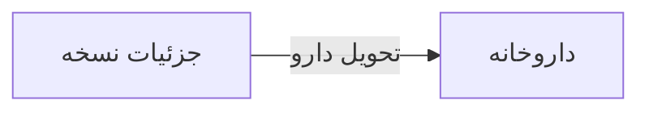

# 💊 جزئیات نسخه — `PrescriptionDetailWindow`

> [نسخه] · کهن‌الگوی `dialog` (دیالوگ) · آیکون `Icon.FileSearch`

| پیوند | نشانی |
|---|---|
| وایرفریمِ زنده | [`01-wireframes-html/PrescriptionDetailWindow.html`](../01-wireframes-html/PrescriptionDetailWindow.html) |
| View | [`03-views/PrescriptionDetailWindow.xaml`](../03-views/PrescriptionDetailWindow.xaml) |
| ViewModel | [`04-viewmodels/PrescriptionDetailViewModel.cs`](../04-viewmodels/PrescriptionDetailViewModel.cs) |

**نمایش کامل نسخه و اقلام آن**

## 🖼 چیدمان

```
        ┌──────────────────────────────────────┐
        │               جزئیات نسخه               │
        ├──────────────────────────────────────┤
        │  ┌────────────────────────────────┐  │
        │  │ فیلد                          │  │
        │  └────────────────────────────────┘  │
        │  ┌────────────────────────────────┐  │
        │  │ فیلد                          │  │
        │  └────────────────────────────────┘  │
        ├──────────────────────────────────────┤
        │              [انصراف]  [تأیید]       │
        └──────────────────────────────────────┘
```

## 🔗 ارتباطات

| مبدأ | مقصد | نوعِ پیوند |
|---|---|---|
| جزئیات نسخه | داروخانه | تحویل دارو |



---

این فایل با `tools/gen_wireframes_md.py` ساخته شده است.
