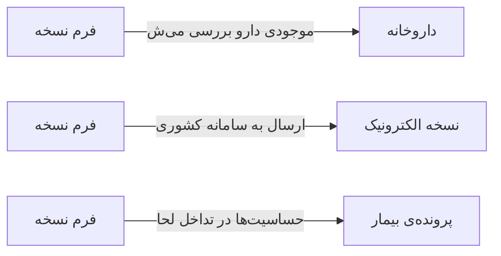

# 💊 فرم نسخه — `PrescriptionFormWindow`

> [نسخه] · کهن‌الگوی `form-lines` (فرمِ خطی) · آیکون `Icon.FilePlus`

| پیوند | نشانی |
|---|---|
| وایرفریمِ زنده | [`01-wireframes-html/PrescriptionFormWindow.html`](../01-wireframes-html/PrescriptionFormWindow.html) |
| View | [`03-views/PrescriptionFormWindow.xaml`](../03-views/PrescriptionFormWindow.xaml) |
| ViewModel | [`04-viewmodels/PrescriptionFormViewModel.cs`](../04-viewmodels/PrescriptionFormViewModel.cs) |

**ثبت نسخه با بررسی تداخل دارویی**

## 📝 شرح

جدول اقلام با ستون‌های دارو، دوز، تعداد دفعات، مدت و تعداد؛ سبدِ خلاصه در ستون چپ با جمع مبالغ.

## 🖼 چیدمان

```
┌──────────────────────────────────────────────────────────────────┐
│  سربرگ: فرم نسخه                                                   │
├──────────────────────────────────────────────────────────────────┤
│  شبکه‌ی ۱۲ ستونه — پهنای هر فیلد متناسب با کارکردش                │
  │ PatientId        │ DoctorI │ Date    │
  │ Diagnosis                          │
  │ Notes                              │
├──────────────────────────────────────────────────────────────────┤
│  تعداد اقلام …   جمع کل …   تخفیف …        قابل پرداخت: …       │

├──────────────────────────────────────────────────────────────────┤
│                                    [انصراف]  [ذخیره]             │
└──────────────────────────────────────────────────────────────────┘
```

## 📋 فیلدها

> پهنا بر پایه‌ی شبکه‌ی ۱۲ ستونه است: «بزرگیِ عنصر متناسب با کارکرد».

| بخش | آیکون | فیلد | برچسب | نوع | پهنا (از ۱۲) | الزامی | مقدارِ نمونه |
|---|---|---|---|---|:--:|:--:|---|
| **اطلاعات نسخه** | `Icon.FileText` | `PatientId` | بیمار | ComboBox | 6/۱۲ | بله | سارا احمدی — P-۱۰۲۴ |
|  | `Icon.FileText` | `DoctorId` | پزشک | ComboBox | 3/۱۲ | بله | دکتر موسوی |
|  | `Icon.FileText` | `Date` | تاریخ | DatePicker | 3/۱۲ | بله | ۱۴۰۴/۰۷/۱۹ |
|  | `Icon.FileText` | `Diagnosis` | تشخیص | ComboBox | 12/۱۲ | خیر | K21.9 — رفلاکس معده |
|  | `Icon.FileText` | `Notes` | توصیه‌ها | TextBox (چندخطی) | 12/۱۲ | خیر | یک ساعت پس از غذا مصرف شود |

## 🧾 جمع

| مورد | مقدار |
|---|---|
| تعداد اقلام | **۳ قلم** |
| جمع کل | **۲۴۵,۰۰۰** |
| تخفیف | **۰** |
| قابل پرداخت | **۲۴۵,۰۰۰** |

## ⚡ اقدام‌ها

| فرمان | برچسب | آیکون | سبک |
|---|---|---|---|
| `SaveCommand` | ذخیره نسخه | `Icon.Save` | اصلی |
| `CheckCommand` | بررسی تداخل | `Icon.ShieldAlert` | ثانویه |
| `SendCommand` | ارسال الکترونیک | `Icon.Send` | ثانویه |
| `CancelCommand` | انصراف | `—` | بی‌زمینه |

## 🔗 ارتباطات

| مبدأ | مقصد | نوعِ پیوند |
|---|---|---|
| فرم نسخه | داروخانه | موجودی دارو بررسی می‌شود |
| فرم نسخه | نسخه الکترونیک | ارسال به سامانه کشوری |
| فرم نسخه | پرونده‌ی بیمار | حساسیت‌ها در تداخل لحاظ می‌شود |



---

این فایل با `tools/gen_wireframes_md.py` ساخته شده است.
