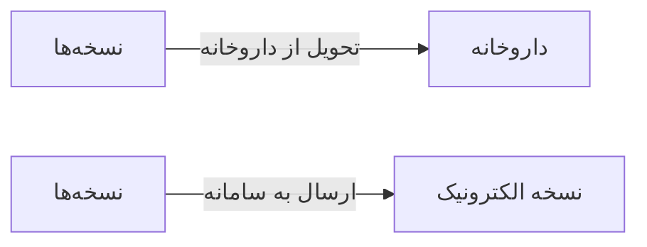

# 💊 نسخه‌ها — `PrescriptionsView`

> [نسخه] · کهن‌الگوی `list-dense` (لیستِ فشرده) · آیکون `Icon.FileText`

| پیوند | نشانی |
|---|---|
| وایرفریمِ زنده | [`01-wireframes-html/PrescriptionsView.html`](../01-wireframes-html/PrescriptionsView.html) |
| View | [`03-views/PrescriptionsView.xaml`](../03-views/PrescriptionsView.xaml) |
| ViewModel | [`04-viewmodels/PrescriptionsViewModel.cs`](../04-viewmodels/PrescriptionsViewModel.cs) |

**فهرست نسخه‌های صادرشده**

## 🖼 چیدمان

```
┌──────────────────────────────────────────────────────────────────┐
│  سربرگ: نسخه‌ها                                                    │
├──────────────────────────────────────────────────────────────────┤
├──────────────────────────────────────────────────────────────────┤
│  [جستجو…………] [فیلتر ▾] [فیلتر ▾]        [＋ جدید] [⟳] [⤓]      │
├──────────────────────────────────────────────────────────────────┤
│  جدول                                                            │
│  ┌──────────┬────────────────────┬────────┬────────┬────────┐    │
│  │ ستون     │ ستون               │ ستون   │ ستون   │ وضعیت  │    │
│  ├──────────┼────────────────────┼────────┼────────┼────────┤    │
│  │ دادهٔ ۱   │ …                  │ …      │ …      │ نشان   │    │
│  │ دادهٔ ۲   │ …                  │ …      │ …      │ نشان   │    │
│  └──────────┴────────────────────┴────────┴────────┴────────┘    │
├──────────────────────────────────────────────────────────────────┤
│  نمایش ۱ تا ۲۵ از ۱۲۴۵                         [◀] [▶]           │
└──────────────────────────────────────────────────────────────────┘
```

## 🔍 فیلترها

| # | برچسب | نوع | پهنا | مقدارِ نمونه | گزینه‌ها |
|:--:|---|---|:--:|---|---|
| 1 | جستجو | `search` | w-xl | نام بیمار یا کد نسخه… | — |
| 2 | پزشک | `combo` | w-md | همه | — |
| 3 | وضعیت | `combo` | w-md | همه | همه، صادر شده، تحویل شده، لغو شده |

## 📐 ستون‌های جدول

| # | عنوان | اتصال | نوع | عرض | تراز |
|:--:|---|---|---|:--:|:--:|
| 1 | کد نسخه | `Code` | متن | 108px | Right |
| 2 | بیمار | `Patient` | شخص | * | Right |
| 3 | پزشک | `Doctor` | متن | 148px | Right |
| 4 | تاریخ | `Date` | تاریخ | 112px | Right |
| 5 | اقلام | `Items` | عدد | 76px | Center |
| 6 | مبلغ | `Amount` | مبلغ | 112px | Left |
| 7 | وضعیت | `Status` | نشان | 112px | Center |

## 🧪 دادهٔ نمونه

| 1 | 2 | 3 | 4 | 5 | 6 | 7 |
|:--:|:--:|:--:|:--:|:--:|:--:|:--:|
| RX-۸۵۲۰ | سارا احمدی | دکتر موسوی | ۱۴۰۴/۰۷/۱۲ | ۳ | ۲۴۵,۰۰۰ | `تحویل شده` |
| RX-۸۵۲۱ | محمد رضایی | دکتر رضایی | ۱۴۰۴/۰۷/۱۲ | ۲ | ۱۸۰,۰۰۰ | `صادر شده` |
| RX-۸۵۲۲ | فاطمه کریمی | دکتر موسوی | ۱۴۰۴/۰۷/۱۱ | ۴ | ۳۱۰,۰۰۰ | `تحویل شده` |

## ⚡ اقدام‌ها

| فرمان | برچسب | آیکون | سبک |
|---|---|---|---|
| `NewCommand` | نسخه جدید | `Icon.Plus` | اصلی |
| `DispenseCommand` | تحویل دارو | `Icon.PackageCheck` | ok |
| `PrintCommand` | چاپ | `Icon.Printer` | ثانویه |

## 🔗 ارتباطات

| مبدأ | مقصد | نوعِ پیوند |
|---|---|---|
| نسخه‌ها | داروخانه | تحویل از داروخانه |
| نسخه‌ها | نسخه الکترونیک | ارسال به سامانه |



---

این فایل با `tools/gen_wireframes_md.py` ساخته شده است.
