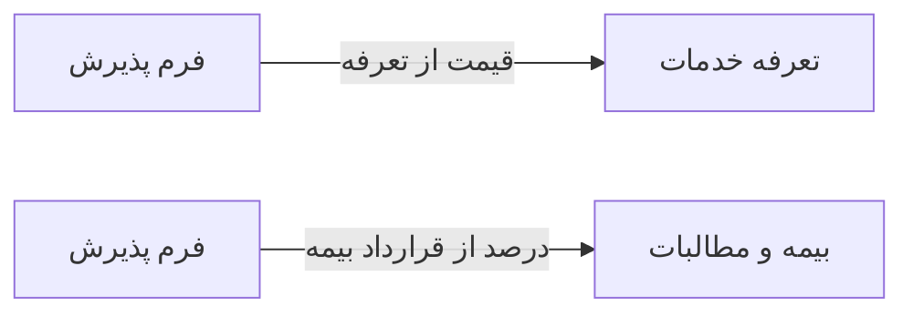

# 🎫 فرم پذیرش — `ReceptionFormWindow`

> [پذیرش] · کهن‌الگوی `form-std` (فرم استاندارد) · آیکون `Icon.ClipboardPlus`

| پیوند | نشانی |
|---|---|
| وایرفریمِ زنده | [`01-wireframes-html/ReceptionFormWindow.html`](../01-wireframes-html/ReceptionFormWindow.html) |
| View | [`03-views/ReceptionFormWindow.xaml`](../03-views/ReceptionFormWindow.xaml) |
| ViewModel | [`04-viewmodels/ReceptionFormViewModel.cs`](../04-viewmodels/ReceptionFormViewModel.cs) |

**ثبت پذیرش جدید**

## 🖼 چیدمان

```
┌──────────────────────────────────────────────────────────────────┐
│  سربرگ: فرم پذیرش                                                  │
├──────────────────────────────────────────────────────────────────┤
│  شبکه‌ی ۱۲ ستونه — پهنای هر فیلد متناسب با کارکردش                │
  │ PatientId        │ DoctorI │ Service │
  │ InsuranceI │ VisitType  │ RoomId     │
  │ BasePri │ Insuran │ Patient │ Discoun │
  │ Notes                              │

├──────────────────────────────────────────────────────────────────┤
│                                    [انصراف]  [ذخیره]             │
└──────────────────────────────────────────────────────────────────┘
```

## 📋 فیلدها

> پهنا بر پایه‌ی شبکه‌ی ۱۲ ستونه است: «بزرگیِ عنصر متناسب با کارکرد».

| بخش | آیکون | فیلد | برچسب | نوع | پهنا (از ۱۲) | الزامی | مقدارِ نمونه |
|---|---|---|---|---|:--:|:--:|---|
| **بیمار و خدمت** | `Icon.UserCheck` | `PatientId` | بیمار | ComboBox | 6/۱۲ | بله | سارا احمدی — P-۱۰۲۴ |
|  | `Icon.UserCheck` | `DoctorId` | پزشک | ComboBox | 3/۱۲ | بله | دکتر موسوی |
|  | `Icon.UserCheck` | `ServiceId` | خدمت | ComboBox | 3/۱۲ | بله | ویزیت عمومی |
|  | `Icon.UserCheck` | `InsuranceId` | بیمه | ComboBox | 4/۱۲ | خیر | تأمین اجتماعی |
|  | `Icon.UserCheck` | `VisitType` | نوع مراجعه | ComboBox | 4/۱۲ | خیر | نوبت‌دار |
|  | `Icon.UserCheck` | `RoomId` | اتاق | ComboBox | 4/۱۲ | خیر | اتاق ۲ |
| **مالی** | `Icon.Wallet` | `BasePrice` | تعرفه پایه | TextBox | 3/۱۲ | بله | ۲۵۰,۰۰۰ |
|  | `Icon.Wallet` | `InsuranceShare` | سهم بیمه | TextBox | 3/۱۲ | خیر | ۱۷۵,۰۰۰ |
|  | `Icon.Wallet` | `PatientShare` | سهم بیمار | TextBox | 3/۱۲ | بله | ۷۵,۰۰۰ |
|  | `Icon.Wallet` | `Discount` | تخفیف | TextBox | 3/۱۲ | خیر | ۰ |
|  | `Icon.Wallet` | `Notes` | توضیحات | TextBox (چندخطی) | 12/۱۲ | خیر | — |

## ⚡ اقدام‌ها

| فرمان | برچسب | آیکون | سبک |
|---|---|---|---|
| `SaveCommand` | ثبت پذیرش | `Icon.Check` | اصلی |
| `SavePayCommand` | ثبت و دریافت وجه | `Icon.HandCoins` | ok |
| `CancelCommand` | انصراف | `—` | بی‌زمینه |

## 🔗 ارتباطات

| مبدأ | مقصد | نوعِ پیوند |
|---|---|---|
| فرم پذیرش | تعرفه خدمات | قیمت از تعرفه |
| فرم پذیرش | بیمه و مطالبات | درصد از قرارداد بیمه |



---

این فایل با `tools/gen_wireframes_md.py` ساخته شده است.
