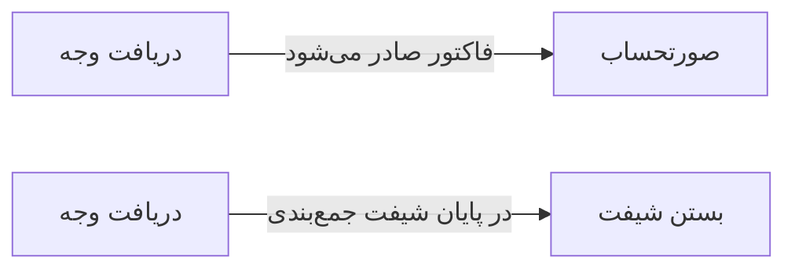

# 🎫 دریافت وجه — `ReceptionPayWindow`

> [پذیرش] · کهن‌الگوی `form-narrow` (فرمِ باریک) · آیکون `Icon.HandCoins`

| پیوند | نشانی |
|---|---|
| وایرفریمِ زنده | [`01-wireframes-html/ReceptionPayWindow.html`](../01-wireframes-html/ReceptionPayWindow.html) |
| View | [`03-views/ReceptionPayWindow.xaml`](../03-views/ReceptionPayWindow.xaml) |
| ViewModel | [`04-viewmodels/ReceptionPayViewModel.cs`](../04-viewmodels/ReceptionPayViewModel.cs) |

**تسویه حساب پذیرش**

## 🖼 چیدمان

```
            ┌──────────────────────────────┐
            │                  آیکون          │
            │            دریافت وجه           │
            ├──────────────────────────────┤
            │  ✓ ویژگیِ ۱                  │
            │  ✓ ویژگیِ ۲                  │
            │  ✓ ویژگیِ ۳                  │
            ├──────────────────────────────┤
            │  ┌────────────────────────┐  │
            │  │ فیلد                  │  │
            │  └────────────────────────┘  │
            │  ┌────────────────────────┐  │
            │  │ فیلد                  │  │
            │  └────────────────────────┘  │
            │  ☐ به خاطر بسپار             │
            ├──────────────────────────────┤
            │  [        ورود        ]      │
            └──────────────────────────────┘
```

## 📋 فیلدها

> پهنا بر پایه‌ی شبکه‌ی ۱۲ ستونه است: «بزرگیِ عنصر متناسب با کارکرد».

| بخش | آیکون | فیلد | برچسب | نوع | پهنا (از ۱۲) | الزامی | مقدارِ نمونه |
|---|---|---|---|---|:--:|:--:|---|
| **مبالغ** | `Icon.Wallet` | `Total` | جمع کل | TextBox | 6/۱۲ | خیر | ۲۵۰,۰۰۰ |
|  | `Icon.Wallet` | `Insurance` | سهم بیمه | TextBox | 6/۱۲ | خیر | ۱۷۵,۰۰۰ |
|  | `Icon.Wallet` | `PatientPay` | قابل پرداخت | TextBox | 6/۱۲ | بله | ۷۵,۰۰۰ |
|  | `Icon.Wallet` | `Discount` | تخفیف | TextBox | 6/۱۲ | خیر | ۰ |
|  | `Icon.Wallet` | `PayMethod` | شیوه پرداخت | ComboBox | 12/۱۲ | بله | نقد |
|  | `Icon.Wallet` | `Ref` | شماره پیگیری | TextBox | 12/۱۲ | خیر | — |

## ⚡ اقدام‌ها

| فرمان | برچسب | آیکون | سبک |
|---|---|---|---|
| `PayCommand` | ثبت پرداخت | `Icon.Check` | اصلی |
| `PrintCommand` | چاپ رسید | `Icon.Printer` | ثانویه |
| `CancelCommand` | انصراف | `—` | بی‌زمینه |

## 🔗 ارتباطات

| مبدأ | مقصد | نوعِ پیوند |
|---|---|---|
| دریافت وجه | صورتحساب | فاکتور صادر می‌شود |
| دریافت وجه | بستن شیفت | در پایان شیفت جمع‌بندی می‌شود |



---

این فایل با `tools/gen_wireframes_md.py` ساخته شده است.
