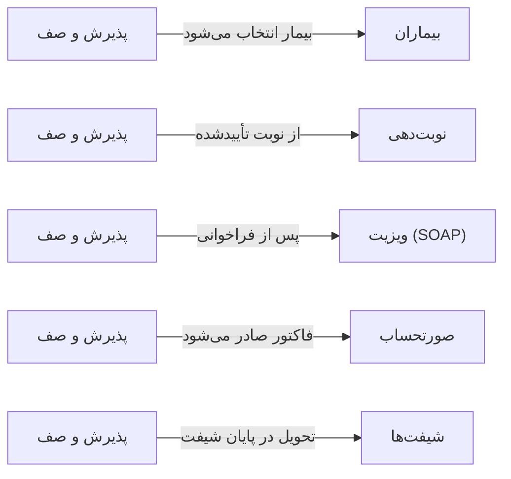

# 🎫 پذیرش و صف — `ReceptionsView`

> [پذیرش] · کهن‌الگوی `list-detail` (لیست + جزئیات) · آیکون `Icon.ClipboardList`

| پیوند | نشانی |
|---|---|
| وایرفریمِ زنده | [`01-wireframes-html/ReceptionsView.html`](../01-wireframes-html/ReceptionsView.html) |
| View | [`03-views/ReceptionsView.xaml`](../03-views/ReceptionsView.xaml) |
| ViewModel | [`04-viewmodels/ReceptionsViewModel.cs`](../04-viewmodels/ReceptionsViewModel.cs) |

**صف زندهٔ بیمارانِ پذیرش‌شده**

## 🖼 چیدمان

```
┌──────────────────────────────────────────────────┬───────────────┐
│  سربرگ: پذیرش و صف                                  │               │
├──────────────────────────────────────────────────┤  خلاصه        │
│  ┌────────┐ ┌────────┐ ┌────────┐ ┌────────┐     │               │
│  │ شاخص ۱ │ │ شاخص ۲ │ │ شاخص ۳ │ │ شاخص ۴ │     │  کلید: مقدار  │
│  └────────┘ └────────┘ └────────┘ └────────┘     │  کلید: مقدار  │
├──────────────────────────────────────────────────┤  کلید: مقدار  │
│  [جستجو……] [فیلتر ▾]         [＋ جدید] [⟳]       │  …            │
├──────────────────────────────────────────────────┤               │
│  جدول                                            │               │
│  ┌────────┬──────────────┬───────┬───────┐        │               │
│  │ ستون   │ ستون         │ ستون  │ وضعیت │        │               │
│  ├────────┼──────────────┼───────┼───────┤        │               │
│  │ داده ۱ │ …            │ …     │ نشان  │        │               │
│  └────────┴──────────────┴───────┴───────┘        │               │
├──────────────────────────────────────────────────┤               │
│  نمایش ۱ تا ۲۵ از ۱۲۴۵            [◀] [▶]        │               │
└──────────────────────────────────────────────────┴───────────────┘
```

## 📊 شاخص‌های کلیدی

| آیکون | شاخص | مقدار | روند | رنگِ تاکیدی |
|---|:--:|:--:|:--:|---|
| `Icon.Users` | در صف | **۱۲** | — | teal |
| `Icon.Clock` | میانگین انتظار | **۱۴ دقیقه** | −۶٪ | blue |
| `Icon.CircleCheck` | پذیرش امروز | **۴۸** | +۱۲٪ | green |
| `Icon.HandCoins` | دریافتی امروز | **۱۴,۲۰۰,۰۰۰** | +۱۹٪ | amber |

## 🔍 فیلترها

| # | برچسب | نوع | پهنا | مقدارِ نمونه | گزینه‌ها |
|:--:|---|---|:--:|---|---|
| 1 | جستجو | `search` | w-xl | نام یا کد پرونده… | — |
| 2 | پزشک | `combo` | w-md | همه پزشکان | — |
| 3 | وضعیت | `combo` | w-md | همه | همه، در انتظار، در حال ویزیت، اتمام، لغو |
| 4 | تاریخ | `date` | w-md | امروز | — |

## 📐 ستون‌های جدول

| # | عنوان | اتصال | نوع | عرض | تراز |
|:--:|---|---|---|:--:|:--:|
| 1 | نوبت | `QueueNo` | عدد | 64px | Center |
| 2 | بیمار | `Patient` | شخص | * | Right |
| 3 | پزشک | `Doctor` | متن | 150px | Right |
| 4 | خدمت | `Service` | متن | 150px | Right |
| 5 | بیمه | `Insurance` | متن | 120px | Right |
| 6 | ورود | `TimeIn` | تاریخ | 86px | Center |
| 7 | انتظار | `Wait` | عدد | 86px | Center |
| 8 | مبلغ | `Amount` | مبلغ | 112px | Left |
| 9 | وضعیت | `Status` | نشان | 104px | Center |

## 🧪 دادهٔ نمونه

| 1 | 2 | 3 | 4 | 5 | 6 | 7 | 8 | 9 |
|:--:|:--:|:--:|:--:|:--:|:--:|:--:|:--:|:--:|
| ۱۲ | سارا احمدی | دکتر موسوی | ویزیت عمومی | تأمین اجتماعی | ۰۹:۱۲ | ۱۸ دقیقه | ۲۵۰,۰۰۰ | `در انتظار` |
| ۱۳ | محمد رضایی | دکتر رضایی | ویزیت تخصصی | سلامت | ۰۹:۲۵ | ۵ دقیقه | ۴۰۰,۰۰۰ | `در حال ویزیت` |
| ۱۴ | فاطمه کریمی | دکتر موسوی | پیگیری | آزاد | ۰۹:۳۱ | ۲ دقیقه | ۱۵۰,۰۰۰ | `در انتظار` |
| ۱۱ | علی حسینی | دکتر کریمی | ویزیت عمومی | تأمین اجتماعی | ۰۸:۵۰ | ۰ | ۲۵۰,۰۰۰ | `اتمام` |
| ۱۰ | زهرا موسوی | دکتر رضایی | معاینه دوره‌ای | آزاد | ۰۸:۳۵ | ۰ | ۰ | `لغو` |

## 📌 پانلِ کناری

**خلاصه پذیرش** (آیکون `Icon.ClipboardCheck`)

| کلید | مقدار |
|---|---|
| شماره در صف | ۱۲ |
| بیمار | سارا احمدی |
| پزشک | دکتر موسوی |
| خدمت | ویزیت عمومی |
| بیمه | تأمین اجتماعی |
| سهم بیمه | ۱۷۵,۰۰۰ |
| سهم بیمار | ۷۵,۰۰۰ |
| زمان انتظار | ۱۸ دقیقه |

## ⚡ اقدام‌ها

| فرمان | برچسب | آیکون | سبک |
|---|---|---|---|
| `NewCommand` | پذیرش جدید | `Icon.UserPlus` | اصلی |
| `PayCommand` | دریافت وجه | `Icon.HandCoins` | ok |
| `CallCommand` | فراخوانی | `Icon.Megaphone` | ثانویه |
| `CancelCommand` | لغو | `Icon.X` | خطر |

## 🔗 ارتباطات

| مبدأ | مقصد | نوعِ پیوند |
|---|---|---|
| پذیرش و صف | بیماران | بیمار انتخاب می‌شود |
| پذیرش و صف | نوبت‌دهی | از نوبت تأییدشده |
| پذیرش و صف | ویزیت (SOAP) | پس از فراخوانی |
| پذیرش و صف | صورتحساب | فاکتور صادر می‌شود |
| پذیرش و صف | شیفت‌ها | تحویل در پایان شیفت |



---

این فایل با `tools/gen_wireframes_md.py` ساخته شده است.
