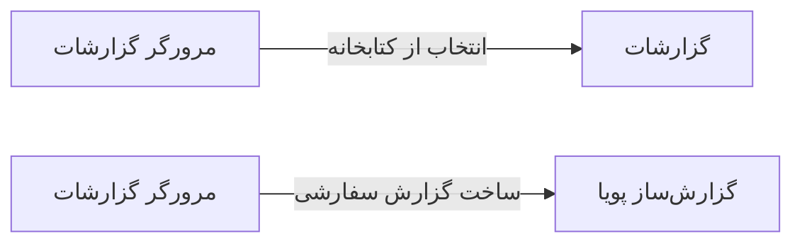

# 📊 مرورگر گزارشات — `ReportBrowserView`

> [گزارشات] · کهن‌الگوی `report` (گزارش) · آیکون `Icon.FileSearch`

| پیوند | نشانی |
|---|---|
| وایرفریمِ زنده | [`01-wireframes-html/ReportBrowserView.html`](../01-wireframes-html/ReportBrowserView.html) |
| View | [`03-views/ReportBrowserView.xaml`](../03-views/ReportBrowserView.xaml) |
| ViewModel | [`04-viewmodels/ReportBrowserViewModel.cs`](../04-viewmodels/ReportBrowserViewModel.cs) |

**مشاهده و خروجی گرفتن از گزارش‌ها**

## 📝 شرح

پنلِ راست: فیلترها و پارامترهای گزارش. پنلِ چپ: پیش‌نمایشِ کاغذیِ گزارش با هدر و صفحه‌بندی.

## 🖼 چیدمان

```
┌──────────────────────────────────────────────────────────────────┐
│  سربرگ: مرورگر گزارشات                                             │
├──────────────────────────────────────────────────────────────────┤
├──────────────────────────────────────────────────────────────────┤
│  [جستجو…………] [فیلتر ▾] [فیلتر ▾]        [＋ جدید] [⟳] [⤓]      │
├──────────────────────────────────────────────────────────────────┤
│  جدول                                                            │
│  ┌──────────┬────────────────────┬────────┬────────┬────────┐    │
│  │ ستون     │ ستون               │ ستون   │ ستون   │ وضعیت  │    │
│  ├──────────┼────────────────────┼────────┼────────┼────────┤    │
│  │ دادهٔ ۱   │ …                  │ …      │ …      │ نشان   │    │
│  │ دادهٔ ۲   │ …                  │ …      │ …      │ نشان   │    │
│  └──────────┴────────────────────┴────────┴────────┴────────┘    │
├──────────────────────────────────────────────────────────────────┤
│  نمایش ۱ تا ۲۵ از ۱۲۴۵                         [◀] [▶]           │
└──────────────────────────────────────────────────────────────────┘
```

## 🔍 فیلترها

| # | برچسب | نوع | پهنا | مقدارِ نمونه | گزینه‌ها |
|:--:|---|---|:--:|---|---|
| 1 | جستجو | `search` | w-xl | عنوان یا توضیح… | — |
| 2 | دسته | `combo` | w-md | همه | — |
| 3 | از تاریخ | `date` | w-md | ۱۴۰۴/۰۷/۰۱ | — |

## 📐 ستون‌های جدول

| # | عنوان | اتصال | نوع | عرض | تراز |
|:--:|---|---|---|:--:|:--:|
| 1 | گزارش | `Title` | متن | * | Right |
| 2 | دسته | `Category` | متن | 120px | Right |
| 3 | تهیه‌کننده | `Owner` | شخص | 150px | Right |
| 4 | تعداد اجرا | `Runs` | عدد | 96px | Center |
| 5 | وضعیت | `Status` | نشان | 104px | Center |

## 🧪 دادهٔ نمونه

| 1 | 2 | 3 | 4 | 5 |
|:--:|:--:|:--:|:--:|:--:|
| گزارش درآمد روزانه | مالی | سیستم | ۲۱۴ | `آماده` |
| گزارش ویزیت‌های پزشک | درمانی | سیستم | ۱۸۹ | `آماده` |
| گزارش موجودی داروخانه | عملیاتی | سیستم | ۱۵۶ | `آماده` |
| تحلیل روند بیماران جدید | درمانی | لیلا حسنی | ۳۱ | `پیش‌نویس` |

## ⚡ اقدام‌ها

| فرمان | برچسب | آیکون | سبک |
|---|---|---|---|
| `ExportPdfCommand` | خروجی PDF | `Icon.FileText` | اصلی |
| `ExportExcelCommand` | خروجی Excel | `Icon.FileSpreadsheet` | ثانویه |
| `PrintCommand` | چاپ | `Icon.Printer` | ثانویه |

## 🔗 ارتباطات

| مبدأ | مقصد | نوعِ پیوند |
|---|---|---|
| مرورگر گزارشات | گزارشات | انتخاب از کتابخانه |
| مرورگر گزارشات | گزارش‌ساز پویا | ساخت گزارش سفارشی |



---

این فایل با `tools/gen_wireframes_md.py` ساخته شده است.
