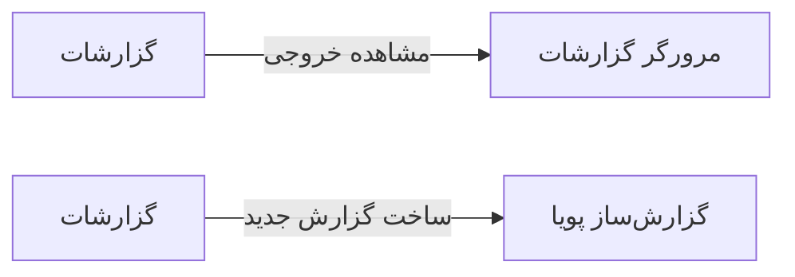

# 📊 گزارشات — `ReportsView`

> [گزارشات] · کهن‌الگوی `settings` (تنظیمات) · آیکون `Icon.ChartColumn`

| پیوند | نشانی |
|---|---|
| وایرفریمِ زنده | [`01-wireframes-html/ReportsView.html`](../01-wireframes-html/ReportsView.html) |
| View | [`03-views/ReportsView.xaml`](../03-views/ReportsView.xaml) |
| ViewModel | [`04-viewmodels/ReportsViewModel.cs`](../04-viewmodels/ReportsViewModel.cs) |

**کتابخانه گزارش‌های آماده**

## 📝 شرح

کتابخانه با دسته‌بندیِ سمت راست؛ هر گزارش کارت خود را با آیکون، عنوان، توضیح و زمان آخرین اجرا دارد.

## 🖼 چیدمان

```
┌──────────────────────────────────────────────────────────────────┐
│  سربرگ: گزارشات                                                    │
├────────────┬─────────────────────────────────────────────────────┤
│  بخش‌ها    │  تنظیمات                                            │
│            │                                                     │
│  ▸ بخش ۱   │  ┌──────────────┐ ┌──────────┐                     │
│    بخش ۲   │  │ فیلد         │ │ فیلد     │                     │
│    بخش ۳   │  └──────────────┘ └──────────┘                     │
│    بخش ۴   │  ┌───────────────────────────────────────────┐     │
│            │  │ فیلدِ تمام‌عرض                            │     │
│            │  └───────────────────────────────────────────┘     │
└────────────┴─────────────────────────────────────────────────────┘
```

## 🔍 فیلترها

| # | برچسب | نوع | پهنا | مقدارِ نمونه | گزینه‌ها |
|:--:|---|---|:--:|---|---|
| 1 | جستجو | `search` | w-xl | عنوان گزارش… | — |
| 2 | دسته | `combo` | w-md | همه | همه، مالی، درمانی، عملیاتی، پرسنلی |

## 📐 ستون‌های جدول

| # | عنوان | اتصال | نوع | عرض | تراز |
|:--:|---|---|---|:--:|:--:|
| 1 | گزارش | `Title` | متن | * | Right |
| 2 | دسته | `Category` | متن | 130px | Right |
| 3 | آخرین اجرا | `LastRun` | تاریخ | 130px | Right |
| 4 | قالب خروجی | `Format` | متن | 140px | Right |
| 5 | وضعیت | `Status` | نشان | 104px | Center |

## 🧪 دادهٔ نمونه

| 1 | 2 | 3 | 4 | 5 |
|:--:|:--:|:--:|:--:|:--:|
| گزارش درآمد روزانه | مالی | ۱۴۰۴/۰۷/۱۹ ۰۸:۰۰ | PDF · Excel | `آماده` |
| گزارش ویزیت‌های پزشک | درمانی | ۱۴۰۴/۰۷/۱۹ ۰۸:۰۰ | PDF · Excel | `آماده` |
| گزارش موجودی داروخانه | عملیاتی | ۱۴۰۴/۰۷/۱۸ ۲۳:۰۰ | Excel | `آماده` |
| گزارش مطالبات بیمه | مالی | ۱۴۰۴/۰۷/۱۸ ۲۳:۰۰ | PDF · Excel | `آماده` |
| گزارش حضور و غیاب | پرسنلی | ۱۴۰۴/۰۷/۱۹ ۰۸:۰۰ | Excel | `در حال اجرا` |
| گزارش عملکرد پزشکان | درمانی | ۱۴۰۴/۰۷/۱۷ ۲۳:۰۰ | PDF | `آماده` |

## ⚡ اقدام‌ها

| فرمان | برچسب | آیکون | سبک |
|---|---|---|---|
| `RunCommand` | اجرای گزارش | `Icon.Play` | اصلی |
| `ScheduleCommand` | زمان‌بندی | `Icon.Clock` | ثانویه |

## 🔗 ارتباطات

| مبدأ | مقصد | نوعِ پیوند |
|---|---|---|
| گزارشات | مرورگر گزارشات | مشاهده خروجی |
| گزارشات | گزارش‌ساز پویا | ساخت گزارش جدید |



---

این فایل با `tools/gen_wireframes_md.py` ساخته شده است.
