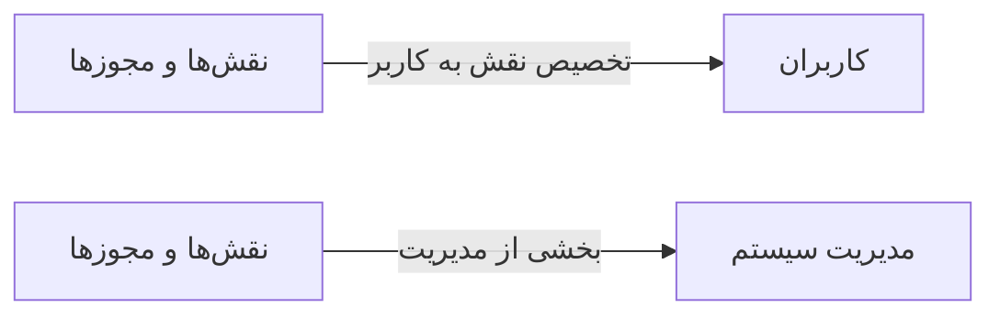

# 🧑‍💼 نقش‌ها و مجوزها — `RolePermissionView`

> [منابع انسانی] · کهن‌الگوی `split` (دوپنلی) · آیکون `Icon.ShieldCheck`

| پیوند | نشانی |
|---|---|
| وایرفریمِ زنده | [`01-wireframes-html/RolePermissionView.html`](../01-wireframes-html/RolePermissionView.html) |
| View | [`03-views/RolePermissionView.xaml`](../03-views/RolePermissionView.xaml) |
| ViewModel | [`04-viewmodels/RolePermissionViewModel.cs`](../04-viewmodels/RolePermissionViewModel.cs) |

**تعریف نقش و تخصیص مجوزها**

## 📝 شرح

ستون راست: فهرست نقش‌ها با شمار مجوز. ستون چپ: درخت مجوزها با گروه‌بندی ماژول و چک‌باکس.

## 🖼 چیدمان

```
┌──────────────────────────────────────────────┬────────────────────┐
│  سربرگ: نقش‌ها و مجوزها                           │                    │
├──────────────────────────────────────────────┤   ویزیتِ جاری      │
│  جدولِ نوبت‌ها                                │                    │
│  ┌────┬─────────────┬────────┬──────┬─────┐  │   بیمار: …         │
│  │ ن  │ بیمار      │ خدمت   │ ورود │ وضع │  │   سن: …            │
│  ├────┼─────────────┼────────┼──────┼─────┤  │   بیمه: …          │
│  │ ۱۲ │ …          │ …      │ …    │ نشان│  │   حساسیت: …        │
│  └────┴─────────────┴────────┴──────┴─────┘  │   …                 │
└──────────────────────────────────────────────┴────────────────────┘
```

## 🔍 فیلترها

| # | برچسب | نوع | پهنا | مقدارِ نمونه | گزینه‌ها |
|:--:|---|---|:--:|---|---|
| 1 | جستجو | `search` | w-xl | نام نقش یا مجوز… | — |
| 2 | ماژول | `combo` | w-md | همه | — |

## 📐 ستون‌های جدول

| # | عنوان | اتصال | نوع | عرض | تراز |
|:--:|---|---|---|:--:|:--:|
| 1 | ماژول | `Module` | متن | 170px | Right |
| 2 | مجوز | `Permission` | متن | * | Right |
| 3 | نقش‌های دارا | `Roles` | متن | 200px | Right |
| 4 | سطح | `Level` | نشان | 104px | Center |

## 🧪 دادهٔ نمونه

| 1 | 2 | 3 | 4 |
|:--:|:--:|:--:|:--:|
| بیماران | مشاهده فهرست بیماران | همه نقش‌ها | `پایه` |
| بیماران | ایجاد پرونده جدید | پذیرش · مدیر | `نوشتن` |
| بیماران | حذف پرونده | مدیر سیستم | `حساس` |
| مالی | صدور فاکتور | پذیرش · حسابدار | `نوشتن` |
| مالی | اعلام تراز دستی سند | حسابدار · مدیر | `حساس` |
| مالی | مشاهده گزارش مالی | حسابدار · مدیر | `پایه` |
| داروخانه | تحویل نسخه | داروخانه | `نوشتن` |
| داروخانه | ورود کالا | داروخانه · مدیر | `نوشتن` |
| سیستم | مدیریت کاربران و مجوزها | مدیر سیستم | `حساس` |

## 📌 پانلِ کناری

**نقش‌ها** (آیکون `Icon.Shield`)

| کلید | مقدار |
|---|---|
| مدیر سیستم | ۳۹ مجوز |
| پزشک | ۱۸ مجوز |
| پذیرش | ۱۲ مجوز |
| حسابدار | ۱۴ مجوز |
| پرستار | ۸ مجوز |

## ⚡ اقدام‌ها

| فرمان | برچسب | آیکون | سبک |
|---|---|---|---|
| `NewCommand` | نقش جدید | `Icon.Plus` | اصلی |
| `SaveCommand` | ذخیره مجوزها | `Icon.Save` | ok |

## 🔗 ارتباطات

| مبدأ | مقصد | نوعِ پیوند |
|---|---|---|
| نقش‌ها و مجوزها | کاربران | تخصیص نقش به کاربر |
| نقش‌ها و مجوزها | مدیریت سیستم | بخشی از مدیریت |



---

این فایل با `tools/gen_wireframes_md.py` ساخته شده است.
