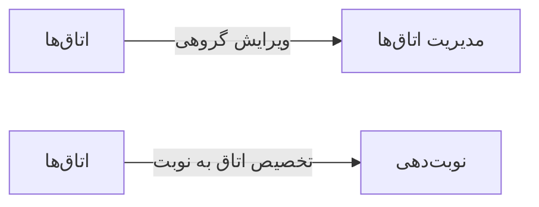

# 🎫 اتاق‌ها — `RoomsView`

> [پذیرش] · کهن‌الگوی `list-cards` (لیستِ کارتی) · آیکون `Icon.DoorOpen`

| پیوند | نشانی |
|---|---|
| وایرفریمِ زنده | [`01-wireframes-html/RoomsView.html`](../01-wireframes-html/RoomsView.html) |
| View | [`03-views/RoomsView.xaml`](../03-views/RoomsView.xaml) |
| ViewModel | [`04-viewmodels/RoomsViewModel.cs`](../04-viewmodels/RoomsViewModel.cs) |

**اتاق‌های معاینه و وضعیت اشغال**

## 🖼 چیدمان

```
┌──────────────────────────────────────────────────────────────────┐
│  سربرگ: اتاق‌ها                                                    │
├──────────────────────────────────────────────────────────────────┤
│  ┌───────────────┐ ┌───────────────┐ ┌───────────────┐           │
│  │ عنوان         │ │ عنوان         │ │ عنوان         │           │
│  │ زیرعنوان      │ │ زیرعنوان      │ │ زیرعنوان      │           │
│  │      [نشان]   │ │      [نشان]   │ │      [نشان]   │           │
│  └───────────────┘ └───────────────┘ └───────────────┘           │
└──────────────────────────────────────────────────────────────────┘
```

## 🔍 فیلترها

| # | برچسب | نوع | پهنا | مقدارِ نمونه | گزینه‌ها |
|:--:|---|---|:--:|---|---|
| 1 | شعبه | `combo` | w-md | همه | — |
| 2 | وضعیت | `combo` | w-sm | همه | همه، آزاد، اشغال |

## 📐 ستون‌های جدول

| # | عنوان | اتصال | نوع | عرض | تراز |
|:--:|---|---|---|:--:|:--:|
| 1 | اتاق | `Name` | متن | * | Right |
| 2 | شماره | `Number` | عدد | 86px | Center |
| 3 | پزشک مستقر | `Doctor` | متن | 160px | Right |
| 4 | وضعیت | `Status` | نشان | 112px | Center |

## 🧪 دادهٔ نمونه

| 1 | 2 | 3 | 4 |
|:--:|:--:|:--:|:--:|
| اتاق معاینه ۱ | ۱ | دکتر موسوی | `اشغال` |
| اتاق معاینه ۲ | ۲ | دکتر رضایی | `اشغال` |
| اتاق معاینه ۳ | ۳ | — | `آزاد` |
| اتاق تزریقات | ۴ | — | `آزاد` |

## ⚡ اقدام‌ها

| فرمان | برچسب | آیکون | سبک |
|---|---|---|---|
| `ManageCommand` | مدیریت اتاق‌ها | `Icon.Settings` | اصلی |
| `NewCommand` | اتاق جدید | `Icon.Plus` | ثانویه |

## 🔗 ارتباطات

| مبدأ | مقصد | نوعِ پیوند |
|---|---|---|
| اتاق‌ها | مدیریت اتاق‌ها | ویرایش گروهی |
| اتاق‌ها | نوبت‌دهی | تخصیص اتاق به نوبت |



---

این فایل با `tools/gen_wireframes_md.py` ساخته شده است.
