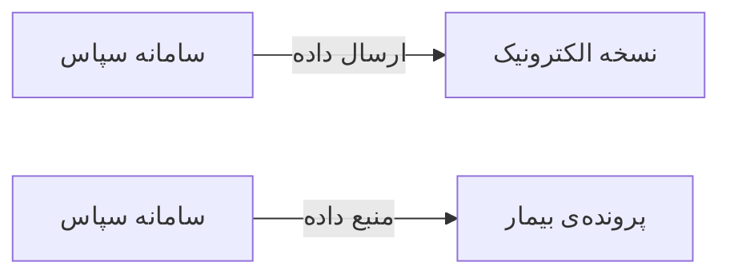

# 🏢 سامانه سپاس — `SepasView`

> [سازمانی] · کهن‌الگوی `detail-tabs` (جزئیاتِ تب‌دار) · آیکون `Icon.Link2`

| پیوند | نشانی |
|---|---|
| وایرفریمِ زنده | [`01-wireframes-html/SepasView.html`](../01-wireframes-html/SepasView.html) |
| View | [`03-views/SepasView.xaml`](../03-views/SepasView.xaml) |
| ViewModel | [`04-viewmodels/SepasViewModel.cs`](../04-viewmodels/SepasViewModel.cs) |

**یکپارچه‌سازی با سامانه سپاس**

## 🖼 چیدمان

```
┌──────────────────────────────────────────────────────────────────┐
│  سربرگ: سامانه سپاس                                                │
├──────────────────────────────────────────────────────────────────┤
│  فیلدهای سربرگ روی شبکه‌ی ۱۲ ستونه                                │
├──────────────────────────────────────────────────────────────────┤
│  تب ۱  │  تب ۲  │  تب ۳  │  تب ۴  │  تب ۵  │  تب ۶  │             │
├────────┴────────┴────────┴────────┴────────┴────────┴───────────┤
│                                                                  │
│  محتوای تب                                                       │
│  ┌──────────────────────────────────────────────────────────┐    │
│  │ جدول یا فرمِ مربوط به تب                                 │    │
│  └──────────────────────────────────────────────────────────┘    │
└──────────────────────────────────────────────────────────────────┘
```

## 🗂 تب‌ها

| # | عنوان | آیکون | شمارنده |
|:--:|---|---|:--:|
| 1 | تنظیمات اتصال | `Icon.Plug` | — |
| 2 | ارسال‌ها | `Icon.Send` | — |
| 3 | خطاها | `Icon.TriangleAlert` | — |

## 📋 فیلدها

> پهنا بر پایه‌ی شبکه‌ی ۱۲ ستونه است: «بزرگیِ عنصر متناسب با کارکرد».

| بخش | آیکون | فیلد | برچسب | نوع | پهنا (از ۱۲) | الزامی | مقدارِ نمونه |
|---|---|---|---|---|:--:|:--:|---|
| **اتصال** | `Icon.Link2` | `Endpoint` | نشانی سرویس | TextBox | 8/۱۲ | بله | https://sepas.example.ir/api |
|  | `Icon.Link2` | `Enabled` | فعال | CheckBox | 4/۱۲ | خیر | True |
|  | `Icon.Link2` | `Username` | نام کاربری | TextBox | 6/۱۲ | خیر | clinic_sahand |
|  | `Icon.Link2` | `Password` | رمز عبور | PasswordBox | 6/۱۲ | خیر | •••••••• |
|  | `Icon.Link2` | `Interval` | دوره ارسال | ComboBox | 6/۱۲ | خیر | روزانه |
|  | `Icon.Link2` | `LastSync` | آخرین همگام‌سازی | TextBox | 6/۱۲ | خیر | ۱۴۰۴/۰۷/۱۹ ۰۷:۰۰ |

## 📐 ستون‌های جدول

| # | عنوان | اتصال | نوع | عرض | تراز |
|:--:|---|---|---|:--:|:--:|
| 1 | زمان | `Time` | تاریخ | 150px | Right |
| 2 | نوع داده | `Type` | متن | 150px | Right |
| 3 | رکوردها | `Records` | عدد | 96px | Center |
| 4 | نتیجه | `Result` | نشان | 130px | Center |

## 🧪 دادهٔ نمونه

| 1 | 2 | 3 | 4 |
|:--:|:--:|:--:|:--:|
| ۱۴۰۴/۰۷/۱۹ ۰۷:۰۰ | ویزیت‌های روزانه | ۳۶ | `موفق` |
| ۱۴۰۴/۰۷/۱۸ ۰۷:۰۰ | ویزیت‌های روزانه | ۳۱ | `موفق` |
| ۱۴۰۴/۰۷/۱۷ ۰۷:۰۰ | نسخه‌های الکترونیک | ۲۸ | `خطا` |

## ⚡ اقدام‌ها

| فرمان | برچسب | آیکون | سبک |
|---|---|---|---|
| `SaveCommand` | ذخیره | `Icon.Save` | اصلی |
| `TestCommand` | تست اتصال | `Icon.Wifi` | ثانویه |
| `SyncNowCommand` | همگام‌سازی الآن | `Icon.RefreshCw` | ثانویه |

## 🔗 ارتباطات

| مبدأ | مقصد | نوعِ پیوند |
|---|---|---|
| سامانه سپاس | نسخه الکترونیک | ارسال داده |
| سامانه سپاس | پرونده‌ی بیمار | منبع داده |



---

این فایل با `tools/gen_wireframes_md.py` ساخته شده است.
