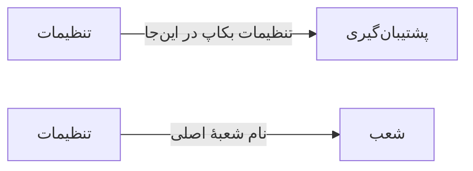

# 🏠 تنظیمات — `SettingsView`

> [پیشخوان] · کهن‌الگوی `settings` (تنظیمات) · آیکون `Icon.Settings`

| پیوند | نشانی |
|---|---|
| وایرفریمِ زنده | [`01-wireframes-html/SettingsView.html`](../01-wireframes-html/SettingsView.html) |
| View | [`03-views/SettingsView.xaml`](../03-views/SettingsView.xaml) |
| ViewModel | [`04-viewmodels/SettingsViewModel.cs`](../04-viewmodels/SettingsViewModel.cs) |

**تنظیمات سراسری برنامه**

## 🖼 چیدمان

```
┌──────────────────────────────────────────────────────────────────┐
│  سربرگ: تنظیمات                                                    │
├────────────┬─────────────────────────────────────────────────────┤
│  بخش‌ها    │  تنظیمات                                            │
│            │                                                     │
│  ▸ بخش ۱   │  ┌──────────────┐ ┌──────────┐                     │
│    بخش ۲   │  │ فیلد         │ │ فیلد     │                     │
│    بخش ۳   │  └──────────────┘ └──────────┘                     │
│    بخش ۴   │  ┌───────────────────────────────────────────┐     │
│            │  │ فیلدِ تمام‌عرض                            │     │
│            │  └───────────────────────────────────────────┘     │
└────────────┴─────────────────────────────────────────────────────┘
```

## 📋 فیلدها

> پهنا بر پایه‌ی شبکه‌ی ۱۲ ستونه است: «بزرگیِ عنصر متناسب با کارکرد».

| بخش | آیکون | فیلد | برچسب | نوع | پهنا (از ۱۲) | الزامی | مقدارِ نمونه |
|---|---|---|---|---|:--:|:--:|---|
| **عمومی** | `Icon.SlidersHorizontal` | `ClinicName` | نام درمانگاه | TextBox | 8/۱۲ | بله | درمانگاه تخصصی سهند |
|  | `Icon.SlidersHorizontal` | `ClinicPhone` | تلفن | TextBox | 4/۱۲ | خیر | ۰۴۱-۳۴۴۳۶۱۴۱ |
|  | `Icon.SlidersHorizontal` | `Address` | نشانی | TextBox (چندخطی) | 12/۱۲ | خیر | تبریز، خیابان ولیعصر، پلاک ۱۲۰ |
|  | `Icon.SlidersHorizontal` | `AutoBackup` | پشتیبان‌گیری خودکار هر شب | CheckBox | 6/۱۲ | خیر | True |
|  | `Icon.SlidersHorizontal` | `DarkTheme` | تم تاریک | CheckBox | 6/۱۲ | خیر | False |
| **مالی** | `Icon.Wallet` | `Currency` | واحد پول | ComboBox | 4/۱۲ | بله | تومان |
|  | `Icon.Wallet` | `TaxPercent` | درصد مالیات | TextBox (عددی) | 4/۱۲ | خیر | ۹ |
|  | `Icon.Wallet` | `DefaultInsurance` | بیمه پیش‌فرض | ComboBox | 4/۱۲ | خیر | آزاد |

## ⚡ اقدام‌ها

| فرمان | برچسب | آیکون | سبک |
|---|---|---|---|
| `SaveCommand` | ذخیره تنظیمات | `Icon.Save` | اصلی |
| `ResetCommand` | بازگردانی | `Icon.Undo2` | بی‌زمینه |

## 🔗 ارتباطات

| مبدأ | مقصد | نوعِ پیوند |
|---|---|---|
| تنظیمات | پشتیبان‌گیری | تنظیمات بکاپ در این‌جا |
| تنظیمات | شعب | نام شعبهٔ اصلی |



---

این فایل با `tools/gen_wireframes_md.py` ساخته شده است.
