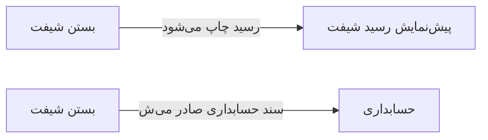

# 🎫 بستن شیفت — `ShiftCloseWindow`

> [پذیرش] · کهن‌الگوی `form-std` (فرم استاندارد) · آیکون `Icon.Lock`

| پیوند | نشانی |
|---|---|
| وایرفریمِ زنده | [`01-wireframes-html/ShiftCloseWindow.html`](../01-wireframes-html/ShiftCloseWindow.html) |
| View | [`03-views/ShiftCloseWindow.xaml`](../03-views/ShiftCloseWindow.xaml) |
| ViewModel | [`04-viewmodels/ShiftCloseViewModel.cs`](../04-viewmodels/ShiftCloseViewModel.cs) |

**جمع‌بندی مالی شیفت و بستن آن**

## 🖼 چیدمان

```
┌──────────────────────────────────────────────────────────────────┐
│  سربرگ: بستن شیفت                                                  │
├──────────────────────────────────────────────────────────────────┤
│  شبکه‌ی ۱۲ ستونه — پهنای هر فیلد متناسب با کارکردش                │
  │ CashCounte │ CashExpect │ Difference │
  │ Reason                             │

├──────────────────────────────────────────────────────────────────┤
│                                    [انصراف]  [ذخیره]             │
└──────────────────────────────────────────────────────────────────┘
```

## 📊 شاخص‌های کلیدی

| آیکون | شاخص | مقدار | روند | رنگِ تاکیدی |
|---|:--:|:--:|:--:|---|
| `Icon.HandCoins` | دریافتی نقد | **۳,۲۰۰,۰۰۰** | — | green |
| `Icon.CreditCard` | کارت‌خوان | **۲,۴۰۰,۰۰۰** | — | blue |
| `Icon.ShieldCheck` | سهم بیمه | **۶۰۰,۰۰۰** | — | teal |
| `Icon.Banknote` | جمع کل | **۶,۲۰۰,۰۰۰** | — | amber |

## 📋 فیلدها

> پهنا بر پایه‌ی شبکه‌ی ۱۲ ستونه است: «بزرگیِ عنصر متناسب با کارکرد».

| بخش | آیکون | فیلد | برچسب | نوع | پهنا (از ۱۲) | الزامی | مقدارِ نمونه |
|---|---|---|---|---|:--:|:--:|---|
| **مغایرت‌ها** | `Icon.TriangleAlert` | `CashCounted` | موجودی شمارش‌شده | TextBox | 4/۱۲ | بله | ۳,۱۵۰,۰۰۰ |
|  | `Icon.TriangleAlert` | `CashExpected` | موجودی مورد انتظار | TextBox | 4/۱۲ | خیر | ۳,۲۰۰,۰۰۰ |
|  | `Icon.TriangleAlert` | `Difference` | مغایرت | TextBox | 4/۱۲ | خیر | −۵۰,۰۰۰ |
|  | `Icon.TriangleAlert` | `Reason` | علت مغایرت | TextBox (چندخطی) | 12/۱۲ | خیر | پرداخت خردِ ثبت‌نشده در پایان شیفت |

## ⚡ اقدام‌ها

| فرمان | برچسب | آیکون | سبک |
|---|---|---|---|
| `CloseCommand` | بستن شیفت | `Icon.Lock` | اصلی |
| `PrintCommand` | چاپ رسید | `Icon.Printer` | ثانویه |
| `CancelCommand` | انصراف | `—` | بی‌زمینه |

## 🔗 ارتباطات

| مبدأ | مقصد | نوعِ پیوند |
|---|---|---|
| بستن شیفت | پیش‌نمایش رسید شیفت | رسید چاپ می‌شود |
| بستن شیفت | حسابداری | سند حسابداری صادر می‌شود |



---

این فایل با `tools/gen_wireframes_md.py` ساخته شده است.
