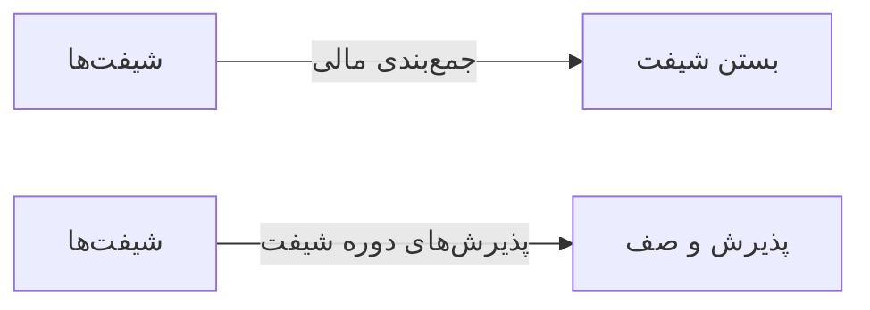

# 🎫 شیفت‌ها — `ShiftsView`

> [پذیرش] · کهن‌الگوی `list-dense` (لیستِ فشرده) · آیکون `Icon.Clock`

| پیوند | نشانی |
|---|---|
| وایرفریمِ زنده | [`01-wireframes-html/ShiftsView.html`](../01-wireframes-html/ShiftsView.html) |
| View | [`03-views/ShiftsView.xaml`](../03-views/ShiftsView.xaml) |
| ViewModel | [`04-viewmodels/ShiftsViewModel.cs`](../04-viewmodels/ShiftsViewModel.cs) |

**تعریف و مدیریت شیفت‌های کاری**

## 🖼 چیدمان

```
┌──────────────────────────────────────────────────────────────────┐
│  سربرگ: شیفت‌ها                                                    │
├──────────────────────────────────────────────────────────────────┤
├──────────────────────────────────────────────────────────────────┤
│  [جستجو…………] [فیلتر ▾] [فیلتر ▾]        [＋ جدید] [⟳] [⤓]      │
├──────────────────────────────────────────────────────────────────┤
│  جدول                                                            │
│  ┌──────────┬────────────────────┬────────┬────────┬────────┐    │
│  │ ستون     │ ستون               │ ستون   │ ستون   │ وضعیت  │    │
│  ├──────────┼────────────────────┼────────┼────────┼────────┤    │
│  │ دادهٔ ۱   │ …                  │ …      │ …      │ نشان   │    │
│  │ دادهٔ ۲   │ …                  │ …      │ …      │ نشان   │    │
│  └──────────┴────────────────────┴────────┴────────┴────────┘    │
├──────────────────────────────────────────────────────────────────┤
│  نمایش ۱ تا ۲۵ از ۱۲۴۵                         [◀] [▶]           │
└──────────────────────────────────────────────────────────────────┘
```

## 🔍 فیلترها

| # | برچسب | نوع | پهنا | مقدارِ نمونه | گزینه‌ها |
|:--:|---|---|:--:|---|---|
| 1 | وضعیت | `combo` | w-md | همه | همه، فعال، بسته، لغو |
| 2 | از تاریخ | `date` | w-md | ۱۴۰۴/۰۷/۰۱ | — |
| 3 | کاربر | `combo` | w-md | همه | — |

## 📐 ستون‌های جدول

| # | عنوان | اتصال | نوع | عرض | تراز |
|:--:|---|---|---|:--:|:--:|
| 1 | کد | `Code` | متن | 84px | Right |
| 2 | مسئول | `User` | شخص | 170px | Right |
| 3 | شروع | `Start` | تاریخ | 148px | Right |
| 4 | پایان | `End` | تاریخ | 148px | Right |
| 5 | پذیرش‌ها | `Receptions` | عدد | 94px | Center |
| 6 | مبلغ کل | `Total` | مبلغ | 124px | Left |
| 7 | وضعیت | `Status` | نشان | 96px | Center |

## 🧪 دادهٔ نمونه

| 1 | 2 | 3 | 4 | 5 | 6 | 7 |
|:--:|:--:|:--:|:--:|:--:|:--:|:--:|
| SH-۲۱۴ | مریم نوری | ۱۴۰۴/۰۷/۱۹ ۰۸:۰۰ | ۱۴۰۴/۰۷/۱۹ ۱۴:۰۰ | ۲۴ | ۶,۲۰۰,۰۰۰ | `فعال` |
| SH-۲۱۳ | احمد صادقی | ۱۴۰۴/۰۷/۱۸ ۱۴:۰۰ | ۱۴۰۴/۰۷/۱۸ ۲۰:۰۰ | ۱۹ | ۴,۸۵۰,۰۰۰ | `بسته` |
| SH-۲۱۲ | مریم نوری | ۱۴۰۴/۰۷/۱۸ ۰۸:۰۰ | ۱۴۰۴/۰۷/۱۸ ۱۴:۰۰ | ۲۱ | ۵,۴۰۰,۰۰۰ | `بسته` |

## ⚡ اقدام‌ها

| فرمان | برچسب | آیکون | سبک |
|---|---|---|---|
| `NewCommand` | شیفت جدید | `Icon.Plus` | اصلی |
| `CloseCommand` | بستن شیفت | `Icon.Lock` | ok |
| `DetailCommand` | جزئیات | `Icon.Eye` | ثانویه |

## 🔗 ارتباطات

| مبدأ | مقصد | نوعِ پیوند |
|---|---|---|
| شیفت‌ها | بستن شیفت | جمع‌بندی مالی |
| شیفت‌ها | پذیرش و صف | پذیرش‌های دوره شیفت |



---

این فایل با `tools/gen_wireframes_md.py` ساخته شده است.
