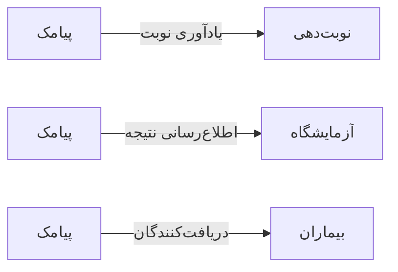

# 📣 پیامک — `SmsView`

> [ارتباطات] · کهن‌الگوی `detail-tabs` (جزئیاتِ تب‌دار) · آیکون `Icon.MessageSquare`

| پیوند | نشانی |
|---|---|
| وایرفریمِ زنده | [`01-wireframes-html/SmsView.html`](../01-wireframes-html/SmsView.html) |
| View | [`03-views/SmsView.xaml`](../03-views/SmsView.xaml) |
| ViewModel | [`04-viewmodels/SmsViewModel.cs`](../04-viewmodels/SmsViewModel.cs) |

**ارسال پیامک و مدیریت الگوها**

## 📝 شرح

شمارندهٔ نویسه‌ها و هزینهٔ تخمینی زیر جعبهٔ متن؛ متغیرهای الگو با دکمه‌های درج خودکار.

## 🖼 چیدمان

```
┌──────────────────────────────────────────────────────────────────┐
│  سربرگ: پیامک                                                      │
├──────────────────────────────────────────────────────────────────┤
│  فیلدهای سربرگ روی شبکه‌ی ۱۲ ستونه                                │
├──────────────────────────────────────────────────────────────────┤
│  تب ۱  │  تب ۲  │  تب ۳  │  تب ۴  │  تب ۵  │  تب ۶  │             │
├────────┴────────┴────────┴────────┴────────┴────────┴───────────┤
│                                                                  │
│  محتوای تب                                                       │
│  ┌──────────────────────────────────────────────────────────┐    │
│  │ جدول یا فرمِ مربوط به تب                                 │    │
│  └──────────────────────────────────────────────────────────┘    │
└──────────────────────────────────────────────────────────────────┘
```

## 📊 شاخص‌های کلیدی

| آیکون | شاخص | مقدار | روند | رنگِ تاکیدی |
|---|:--:|:--:|:--:|---|
| `Icon.Send` | ارسالی امروز | **۱۴۲** | +۲۱ | teal |
| `Icon.CircleCheck` | تحویل شده | **۱۳۶** | — | green |
| `Icon.CircleX` | ناموفق | **۶** | +۲ | rose |
| `Icon.Wallet` | هزینه امروز | **۴۲,۶۰۰** | — | amber |

## 🗂 تب‌ها

| # | عنوان | آیکون | شمارنده |
|:--:|---|---|:--:|
| 1 | ارسال جدید | `Icon.Send` | — |
| 2 | الگوها | `Icon.FileText` | — |
| 3 | گزارش ارسال | `Icon.ChartBar` | — |
| 4 | تنظیمات پنل | `Icon.Settings` | — |

## 📋 فیلدها

> پهنا بر پایه‌ی شبکه‌ی ۱۲ ستونه است: «بزرگیِ عنصر متناسب با کارکرد».

| بخش | آیکون | فیلد | برچسب | نوع | پهنا (از ۱۲) | الزامی | مقدارِ نمونه |
|---|---|---|---|---|:--:|:--:|---|
| **ارسال پیامک** | `Icon.Send` | `Recipients` | گیرندگان | ComboBox | 6/۱۲ | بله | بیماران امروز |
|  | `Icon.Send` | `TemplateId` | الگو | ComboBox | 6/۱۲ | خیر | یادآوری نوبت |
|  | `Icon.Send` | `ManualNumbers` | شماره‌های دستی | TextBox (چندخطی) | 6/۱۲ | خیر | — |
|  | `Icon.Send` | `Message` | متن پیام | TextBox (چندخطی) | 12/۱۲ | بله |  بیمار گرامی، نوبت شما فردا ساعت ۱۰:۳۰ نزد دکتر موسوی است. |
|  | `Icon.Send` | `SendAt` | زمان ارسال | DatePicker | 6/۱۲ | خیر | ۱۴۰۴/۰۷/۲۰ ۰۹:۰۰ |
|  | `Icon.Send` | `Provider` | پنل ارسال | ComboBox | 6/۱۲ | خیر | کاوه‌نگار |

## 📐 ستون‌های جدول

| # | عنوان | اتصال | نوع | عرض | تراز |
|:--:|---|---|---|:--:|:--:|
| 1 | زمان | `Time` | تاریخ | 150px | Right |
| 2 | گیرنده | `Recipient` | شخص | 170px | Right |
| 3 | الگو | `Template` | متن | 150px | Right |
| 4 | هزینه | `Cost` | مبلغ | 92px | Left |
| 5 | وضعیت | `Status` | نشان | 112px | Center |

## 🧪 دادهٔ نمونه

| 1 | 2 | 3 | 4 | 5 |
|:--:|:--:|:--:|:--:|:--:|
| ۱۴۰۴/۰۷/۱۹ ۰۹:۰۰ | سارا احمدی | یادآوری نوبت | ۳۰۰ | `تحویل شد` |
| ۱۴۰۴/۰۷/۱۹ ۰۹:۰۲ | محمد رضایی | یادآوری نوبت | ۳۰۰ | `تحویل شد` |
| ۱۴۰۴/۰۷/۱۹ ۰۹:۰۵ | فاطمه کریمی | نتیجه آزمایش | ۳۰۰ | `ناموفق` |

## ⚡ اقدام‌ها

| فرمان | برچسب | آیکون | سبک |
|---|---|---|---|
| `SendCommand` | ارسال | `Icon.Send` | اصلی |
| `PreviewCommand` | پیش‌نمایش | `Icon.Eye` | ثانویه |
| `SaveTemplateCommand` | ذخیره الگو | `Icon.Save` | ثانویه |

## 🔗 ارتباطات

| مبدأ | مقصد | نوعِ پیوند |
|---|---|---|
| پیامک | نوبت‌دهی | یادآوری نوبت |
| پیامک | آزمایشگاه | اطلاع‌رسانی نتیجه |
| پیامک | بیماران | دریافت‌کنندگان |



---

این فایل با `tools/gen_wireframes_md.py` ساخته شده است.
