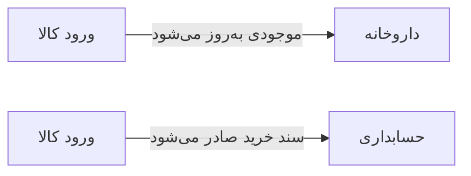

# 🧪 ورود کالا — `StockInFormWindow`

> [داروخانه] · کهن‌الگوی `form-lines` (فرمِ خطی) · آیکون `Icon.PackagePlus`

| پیوند | نشانی |
|---|---|
| وایرفریمِ زنده | [`01-wireframes-html/StockInFormWindow.html`](../01-wireframes-html/StockInFormWindow.html) |
| View | [`03-views/StockInFormWindow.xaml`](../03-views/StockInFormWindow.xaml) |
| ViewModel | [`04-viewmodels/StockInFormViewModel.cs`](../04-viewmodels/StockInFormViewModel.cs) |

**ثبت ورود دسته‌جمعی کالا به انبار**

## 🖼 چیدمان

```
┌──────────────────────────────────────────────────────────────────┐
│  سربرگ: ورود کالا                                                  │
├──────────────────────────────────────────────────────────────────┤
│  شبکه‌ی ۱۲ ستونه — پهنای هر فیلد متناسب با کارکردش                │
  │ Supplier      │ Invoice │ Date │ Tota │
├──────────────────────────────────────────────────────────────────┤
│  تعداد اقلام …   جمع کل …   تخفیف …        قابل پرداخت: …       │

├──────────────────────────────────────────────────────────────────┤
│                                    [انصراف]  [ذخیره]             │
└──────────────────────────────────────────────────────────────────┘
```

## 📋 فیلدها

> پهنا بر پایه‌ی شبکه‌ی ۱۲ ستونه است: «بزرگیِ عنصر متناسب با کارکرد».

| بخش | آیکون | فیلد | برچسب | نوع | پهنا (از ۱۲) | الزامی | مقدارِ نمونه |
|---|---|---|---|---|:--:|:--:|---|
| **اطلاعات فاکتور خرید** | `Icon.Truck` | `Supplier` | تأمین‌کننده | ComboBox | 5/۱۲ | بله | شرکت پخش البرز |
|  | `Icon.Truck` | `InvoiceNo` | شماره فاکتور | TextBox | 3/۱۲ | بله | F-۹۸۷۶۵ |
|  | `Icon.Truck` | `Date` | تاریخ ورود | DatePicker | 2/۱۲ | بله | ۱۴۰۴/۰۷/۱۹ |
|  | `Icon.Truck` | `Total` | جمع فاکتور | TextBox | 2/۱۲ | خیر | ۱۲,۴۰۰,۰۰۰ |

## 🧾 جمع

| مورد | مقدار |
|---|---|
| تعداد اقلام | **۴ ردیف** |
| جمع کل | **۱۲,۴۰۰,۰۰۰** |
| تخفیف | **۰** |
| قابل پرداخت | **۱۲,۴۰۰,۰۰۰** |

## ⚡ اقدام‌ها

| فرمان | برچسب | آیکون | سبک |
|---|---|---|---|
| `SaveCommand` | ثبت ورود | `Icon.Check` | اصلی |
| `AddRowCommand` | افزودن ردیف | `Icon.Plus` | ثانویه |
| `CancelCommand` | انصراف | `—` | بی‌زمینه |

## 🔗 ارتباطات

| مبدأ | مقصد | نوعِ پیوند |
|---|---|---|
| ورود کالا | داروخانه | موجودی به‌روز می‌شود |
| ورود کالا | حسابداری | سند خرید صادر می‌شود |



---

این فایل با `tools/gen_wireframes_md.py` ساخته شده است.
