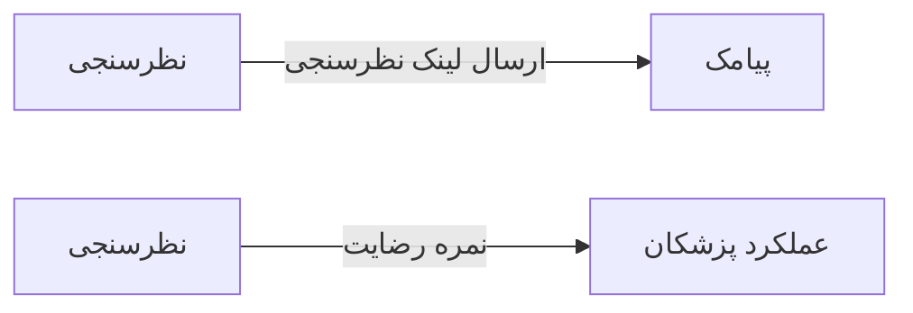

# 📣 نظرسنجی — `SurveyView`

> [ارتباطات] · کهن‌الگوی `detail-tabs` (جزئیاتِ تب‌دار) · آیکون `Icon.Star`

| پیوند | نشانی |
|---|---|
| وایرفریمِ زنده | [`01-wireframes-html/SurveyView.html`](../01-wireframes-html/SurveyView.html) |
| View | [`03-views/SurveyView.xaml`](../03-views/SurveyView.xaml) |
| ViewModel | [`04-viewmodels/SurveyViewModel.cs`](../04-viewmodels/SurveyViewModel.cs) |

**طراحی پرسشنامه و تحلیل پاسخ‌ها**

## 🖼 چیدمان

```
┌──────────────────────────────────────────────────────────────────┐
│  سربرگ: نظرسنجی                                                    │
├──────────────────────────────────────────────────────────────────┤
│  فیلدهای سربرگ روی شبکه‌ی ۱۲ ستونه                                │
├──────────────────────────────────────────────────────────────────┤
│  تب ۱  │  تب ۲  │  تب ۳  │  تب ۴  │  تب ۵  │  تب ۶  │             │
├────────┴────────┴────────┴────────┴────────┴────────┴───────────┤
│                                                                  │
│  محتوای تب                                                       │
│  ┌──────────────────────────────────────────────────────────┐    │
│  │ جدول یا فرمِ مربوط به تب                                 │    │
│  └──────────────────────────────────────────────────────────┘    │
└──────────────────────────────────────────────────────────────────┘
```

## 📊 شاخص‌های کلیدی

| آیکون | شاخص | مقدار | روند | رنگِ تاکیدی |
|---|:--:|:--:|:--:|---|
| `Icon.Star` | میانگین امتیاز | **۴٫۵** | +۰٫۲ | amber |
| `Icon.Users` | پاسخ‌دهندگان | **۳۱۸** | +۴۴ | teal |
| `Icon.MessageSquare` | نظرات متنی | **۹۲** | — | blue |

## 🗂 تب‌ها

| # | عنوان | آیکون | شمارنده |
|:--:|---|---|:--:|
| 1 | پرسش‌ها | `Icon.ListChecks` | — |
| 2 | پاسخ‌ها | `Icon.MessageSquare` | — |
| 3 | تحلیل | `Icon.ChartBar` | — |
| 4 | تنظیمات | `Icon.Settings` | — |

## 📐 ستون‌های جدول

| # | عنوان | اتصال | نوع | عرض | تراز |
|:--:|---|---|---|:--:|:--:|
| 1 | پرسش | `Question` | متن | * | Right |
| 2 | نوع | `Type` | متن | 130px | Right |
| 3 | پاسخ‌ها | `Answers` | عدد | 92px | Center |
| 4 | میانگین | `Avg` | عدد | 96px | Center |
| 5 | وضعیت | `Status` | نشان | 104px | Center |

## 🧪 دادهٔ نمونه

| 1 | 2 | 3 | 4 | 5 |
|:--:|:--:|:--:|:--:|:--:|
| میزان رضایت از برخورد پرسنل پذیرش | امتیاز ۱ تا ۵ | ۳۱۸ | ۴٫۷ | `فعال` |
| زمان انتظار تا ویزیت | امتیاز ۱ تا ۵ | ۳۱۸ | ۳٫۹ | `فعال` |
| وضوح توضیحات پزشک | امتیاز ۱ تا ۵ | ۳۱۶ | ۴٫۵ | `فعال` |
| پیشنهاد یا انتقاد شما | متن آزاد | ۹۲ | — | `فعال` |

## ⚡ اقدام‌ها

| فرمان | برچسب | آیکون | سبک |
|---|---|---|---|
| `NewCommand` | پرسش جدید | `Icon.Plus` | اصلی |
| `ExportCommand` | خروجی | `Icon.FileSpreadsheet` | ثانویه |

## 🔗 ارتباطات

| مبدأ | مقصد | نوعِ پیوند |
|---|---|---|
| نظرسنجی | پیامک | ارسال لینک نظرسنجی |
| نظرسنجی | عملکرد پزشکان | نمره رضایت |



---

این فایل با `tools/gen_wireframes_md.py` ساخته شده است.
