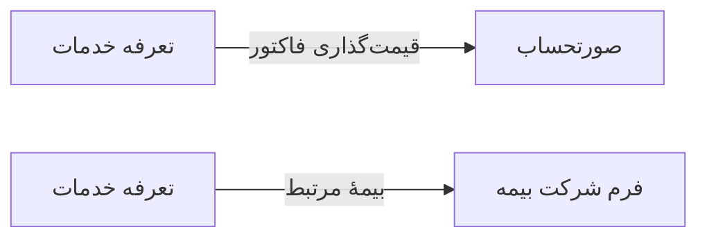

# 💰 تعرفه خدمات — `TariffFormWindow`

> [مالی] · کهن‌الگوی `form-std` (فرم استاندارد) · آیکون `Icon.Tags`

| پیوند | نشانی |
|---|---|
| وایرفریمِ زنده | [`01-wireframes-html/TariffFormWindow.html`](../01-wireframes-html/TariffFormWindow.html) |
| View | [`03-views/TariffFormWindow.xaml`](../03-views/TariffFormWindow.xaml) |
| ViewModel | [`04-viewmodels/TariffFormViewModel.cs`](../04-viewmodels/TariffFormViewModel.cs) |

**تعریف تعرفه خدمات برای بیمه‌های مختلف**

## 🖼 چیدمان

```
┌──────────────────────────────────────────────────────────────────┐
│  سربرگ: تعرفه خدمات                                                │
├──────────────────────────────────────────────────────────────────┤
│  شبکه‌ی ۱۲ ستونه — پهنای هر فیلد متناسب با کارکردش                │
  │ ServiceId        │ Insuran │ Year    │
  │ BasePri │ Insuran │ Patient │ DoctorS │
  │ Active                             │
  │ Notes                              │

├──────────────────────────────────────────────────────────────────┤
│                                    [انصراف]  [ذخیره]             │
└──────────────────────────────────────────────────────────────────┘
```

## 📋 فیلدها

> پهنا بر پایه‌ی شبکه‌ی ۱۲ ستونه است: «بزرگیِ عنصر متناسب با کارکرد».

| بخش | آیکون | فیلد | برچسب | نوع | پهنا (از ۱۲) | الزامی | مقدارِ نمونه |
|---|---|---|---|---|:--:|:--:|---|
| **تعرفه** | `Icon.Tags` | `ServiceId` | خدمت | ComboBox | 6/۱۲ | بله | ویزیت عمومی |
|  | `Icon.Tags` | `InsuranceId` | بیمه | ComboBox | 3/۱۲ | بله | تأمین اجتماعی |
|  | `Icon.Tags` | `Year` | سال | ComboBox | 3/۱۲ | بله | ۱۴۰۴ |
|  | `Icon.Tags` | `BasePrice` | تعرفه پایه | TextBox | 3/۱۲ | بله | ۲۵۰,۰۰۰ |
|  | `Icon.Tags` | `InsuranceShare` | سهم بیمه | TextBox | 3/۱۲ | خیر | ۱۷۵,۰۰۰ |
|  | `Icon.Tags` | `PatientShare` | سهم بیمار | TextBox | 3/۱۲ | بله | ۷۵,۰۰۰ |
|  | `Icon.Tags` | `DoctorShare` | سهم پزشک | TextBox | 3/۱۲ | خیر | ۱۲۵,۰۰۰ |
|  | `Icon.Tags` | `Active` | فعال | CheckBox | 6/۱۲ | خیر | True |
|  | `Icon.Tags` | `Notes` | توضیحات | TextBox (چندخطی) | 12/۱۲ | خیر | — |

## ⚡ اقدام‌ها

| فرمان | برچسب | آیکون | سبک |
|---|---|---|---|
| `SaveCommand` | ذخیره | `Icon.Save` | اصلی |
| `CopyCommand` | رونوشت از سال قبل | `Icon.Copy` | ثانویه |
| `CancelCommand` | انصراف | `—` | بی‌زمینه |

## 🔗 ارتباطات

| مبدأ | مقصد | نوعِ پیوند |
|---|---|---|
| تعرفه خدمات | صورتحساب | قیمت‌گذاری فاکتور |
| تعرفه خدمات | فرم شرکت بیمه | بیمهٔ مرتبط |



---

این فایل با `tools/gen_wireframes_md.py` ساخته شده است.
