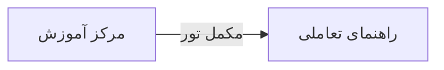

# 🏠 مرکز آموزش — `TrainingCenterView`

> [پیشخوان] · کهن‌الگوی `list-cards` (لیستِ کارتی) · آیکون `Icon.GraduationCap`

| پیوند | نشانی |
|---|---|
| وایرفریمِ زنده | [`01-wireframes-html/TrainingCenterView.html`](../01-wireframes-html/TrainingCenterView.html) |
| View | [`03-views/TrainingCenterView.xaml`](../03-views/TrainingCenterView.xaml) |
| ViewModel | [`04-viewmodels/TrainingCenterViewModel.cs`](../04-viewmodels/TrainingCenterViewModel.cs) |

**محتوای آموزشی و ویدئوهای راهنما**

## 🖼 چیدمان

```
┌──────────────────────────────────────────────────────────────────┐
│  سربرگ: مرکز آموزش                                                 │
├──────────────────────────────────────────────────────────────────┤
│  ┌───────────────┐ ┌───────────────┐ ┌───────────────┐           │
│  │ عنوان         │ │ عنوان         │ │ عنوان         │           │
│  │ زیرعنوان      │ │ زیرعنوان      │ │ زیرعنوان      │           │
│  │      [نشان]   │ │      [نشان]   │ │      [نشان]   │           │
│  └───────────────┘ └───────────────┘ └───────────────┘           │
└──────────────────────────────────────────────────────────────────┘
```

## 🔍 فیلترها

| # | برچسب | نوع | پهنا | مقدارِ نمونه | گزینه‌ها |
|:--:|---|---|:--:|---|---|
| 1 | جستجو | `search` | w-lg | عنوان دوره… | — |
| 2 | دسته | `combo` | w-md | همه | همه، مقدماتی، مالی، پزشکی |

## 🧪 دادهٔ نمونه


## ⚡ اقدام‌ها

| فرمان | برچسب | آیکون | سبک |
|---|---|---|---|
| `NewCommand` | دوره جدید | `Icon.Plus` | اصلی |

## 🔗 ارتباطات

| مبدأ | مقصد | نوعِ پیوند |
|---|---|---|
| مرکز آموزش | راهنمای تعاملی | مکمل تور |



---

این فایل با `tools/gen_wireframes_md.py` ساخته شده است.
