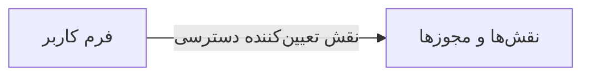

# 🧑‍💼 فرم کاربر — `UserFormWindow`

> [منابع انسانی] · کهن‌الگوی `form-narrow` (فرمِ باریک) · آیکون `Icon.UserCog`

| پیوند | نشانی |
|---|---|
| وایرفریمِ زنده | [`01-wireframes-html/UserFormWindow.html`](../01-wireframes-html/UserFormWindow.html) |
| View | [`03-views/UserFormWindow.xaml`](../03-views/UserFormWindow.xaml) |
| ViewModel | [`04-viewmodels/UserFormViewModel.cs`](../04-viewmodels/UserFormViewModel.cs) |

**ایجاد یا ویرایش کاربر**

## 🖼 چیدمان

```
            ┌──────────────────────────────┐
            │                  آیکون          │
            │            فرم کاربر            │
            ├──────────────────────────────┤
            │  ✓ ویژگیِ ۱                  │
            │  ✓ ویژگیِ ۲                  │
            │  ✓ ویژگیِ ۳                  │
            ├──────────────────────────────┤
            │  ┌────────────────────────┐  │
            │  │ فیلد                  │  │
            │  └────────────────────────┘  │
            │  ┌────────────────────────┐  │
            │  │ فیلد                  │  │
            │  └────────────────────────┘  │
            │  ☐ به خاطر بسپار             │
            ├──────────────────────────────┤
            │  [        ورود        ]      │
            └──────────────────────────────┘
```

## 📋 فیلدها

> پهنا بر پایه‌ی شبکه‌ی ۱۲ ستونه است: «بزرگیِ عنصر متناسب با کارکرد».

| بخش | آیکون | فیلد | برچسب | نوع | پهنا (از ۱۲) | الزامی | مقدارِ نمونه |
|---|---|---|---|---|:--:|:--:|---|
| **حساب کاربری** | `Icon.UserCog` | `PersonnelId` | پرسنل | ComboBox | 12/۱۲ | بله | مریم نوری — E-۱۰۰۱ |
|  | `Icon.UserCog` | `UserName` | نام کاربری | TextBox | 6/۱۲ | بله | mnouri |
|  | `Icon.UserCog` | `Password` | رمز عبور | PasswordBox | 6/۱۲ | بله | •••••••• |
|  | `Icon.UserCog` | `RoleId` | نقش | ComboBox | 6/۱۲ | بله | پذیرش |
|  | `Icon.UserCog` | `BranchId` | شعبه | ComboBox | 6/۱۲ | خیر | مرکزی |
|  | `Icon.UserCog` | `MustChangePassword` | تغییر رمز در نخستین ورود | CheckBox | 12/۱۲ | خیر | True |
|  | `Icon.UserCog` | `IsActive` | فعال | CheckBox | 12/۱۲ | خیر | True |

## ⚡ اقدام‌ها

| فرمان | برچسب | آیکون | سبک |
|---|---|---|---|
| `SaveCommand` | ذخیره | `Icon.Save` | اصلی |
| `CancelCommand` | انصراف | `—` | بی‌زمینه |

## 🔗 ارتباطات

| مبدأ | مقصد | نوعِ پیوند |
|---|---|---|
| فرم کاربر | نقش‌ها و مجوزها | نقش تعیین‌کننده دسترسی |



---

این فایل با `tools/gen_wireframes_md.py` ساخته شده است.
