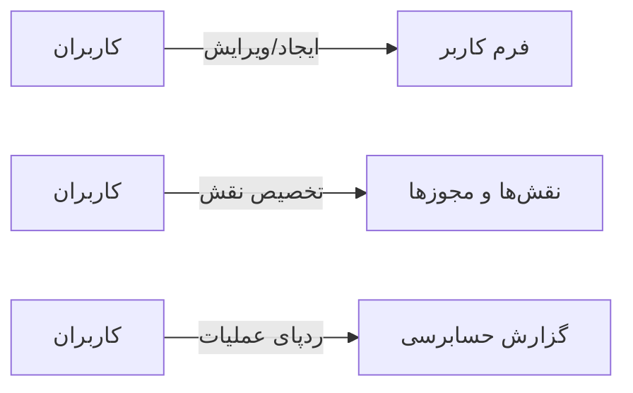

# 🧑‍💼 کاربران — `UsersView`

> [منابع انسانی] · کهن‌الگوی `list-dense` (لیستِ فشرده) · آیکون `Icon.UserCog`

| پیوند | نشانی |
|---|---|
| وایرفریمِ زنده | [`01-wireframes-html/UsersView.html`](../01-wireframes-html/UsersView.html) |
| View | [`03-views/UsersView.xaml`](../03-views/UsersView.xaml) |
| ViewModel | [`04-viewmodels/UsersViewModel.cs`](../04-viewmodels/UsersViewModel.cs) |

**مدیریت کاربران و دسترسی‌ها**

## 🖼 چیدمان

```
┌──────────────────────────────────────────────────────────────────┐
│  سربرگ: کاربران                                                    │
├──────────────────────────────────────────────────────────────────┤
├──────────────────────────────────────────────────────────────────┤
│  [جستجو…………] [فیلتر ▾] [فیلتر ▾]        [＋ جدید] [⟳] [⤓]      │
├──────────────────────────────────────────────────────────────────┤
│  جدول                                                            │
│  ┌──────────┬────────────────────┬────────┬────────┬────────┐    │
│  │ ستون     │ ستون               │ ستون   │ ستون   │ وضعیت  │    │
│  ├──────────┼────────────────────┼────────┼────────┼────────┤    │
│  │ دادهٔ ۱   │ …                  │ …      │ …      │ نشان   │    │
│  │ دادهٔ ۲   │ …                  │ …      │ …      │ نشان   │    │
│  └──────────┴────────────────────┴────────┴────────┴────────┘    │
├──────────────────────────────────────────────────────────────────┤
│  نمایش ۱ تا ۲۵ از ۱۲۴۵                         [◀] [▶]           │
└──────────────────────────────────────────────────────────────────┘
```

## 🔍 فیلترها

| # | برچسب | نوع | پهنا | مقدارِ نمونه | گزینه‌ها |
|:--:|---|---|:--:|---|---|
| 1 | جستجو | `search` | w-xl | نام کاربری یا نام… | — |
| 2 | نقش | `combo` | w-md | همه | — |
| 3 | وضعیت | `combo` | w-sm | فعال | — |

## 📐 ستون‌های جدول

| # | عنوان | اتصال | نوع | عرض | تراز |
|:--:|---|---|---|:--:|:--:|
| 1 | کاربر | `User` | شخص | * | Right |
| 2 | نقش | `Role` | متن | 140px | Right |
| 3 | آخرین ورود | `LastLogin` | تاریخ | 150px | Right |
| 4 | شعبه | `Branch` | متن | 110px | Right |
| 5 | وضعیت | `Status` | نشان | 104px | Center |

## 🧪 دادهٔ نمونه

| 1 | 2 | 3 | 4 | 5 |
|:--:|:--:|:--:|:--:|:--:|
| admin | مدیر سیستم | ۱۴۰۴/۰۷/۱۹ ۰۸:۱۲ | مرکزی | `فعال` |
| mnouri | پذیرش | ۱۴۰۴/۰۷/۱۹ ۰۸:۰۵ | مرکزی | `فعال` |
| lhasani | حسابدار | ۱۴۰۴/۰۷/۱۸ ۱۶:۴۰ | مرکزی | `فعال` |

## ⚡ اقدام‌ها

| فرمان | برچسب | آیکون | سبک |
|---|---|---|---|
| `NewCommand` | کاربر جدید | `Icon.UserPlus` | اصلی |
| `PermissionsCommand` | مجوزها | `Icon.KeyRound` | ثانویه |
| `ResetPassCommand` | بازنشانی رمز | `Icon.RotateCcw` | ثانویه |

## 🔗 ارتباطات

| مبدأ | مقصد | نوعِ پیوند |
|---|---|---|
| کاربران | فرم کاربر | ایجاد/ویرایش |
| کاربران | نقش‌ها و مجوزها | تخصیص نقش |
| کاربران | گزارش حسابرسی | ردپای عملیات |



---

این فایل با `tools/gen_wireframes_md.py` ساخته شده است.
