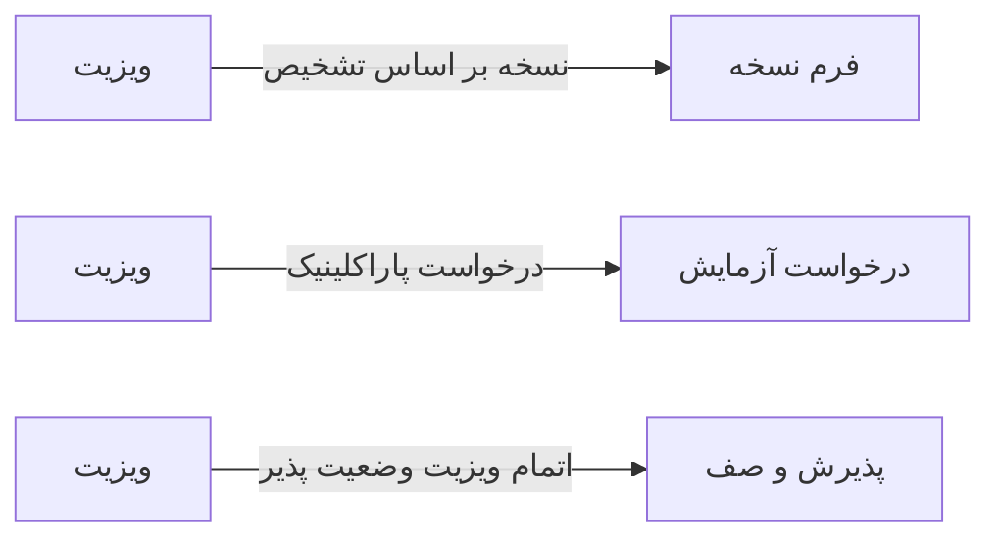

# 🩺 ویزیت (SOAP) — `VisitWindow`

> [ویزیت] · کهن‌الگوی `form-std` (فرم استاندارد) · آیکون `Icon.Stethoscope`

| پیوند | نشانی |
|---|---|
| وایرفریمِ زنده | [`01-wireframes-html/VisitWindow.html`](../01-wireframes-html/VisitWindow.html) |
| View | [`03-views/VisitWindow.xaml`](../03-views/VisitWindow.xaml) |
| ViewModel | [`04-viewmodels/VisitViewModel.cs`](../04-viewmodels/VisitViewModel.cs) |

**ثبت ویزیت با ساختار SOAP و تشخیص ICD-10**

## 📝 شرح

فیلدهای علائم حیاتی در یک ردیفِ شش‌تاییِ کم‌عرض — چون مقدارهای کوتاه عددی هستند؛ بخش‌های متنی عرض کامل.

## 🖼 چیدمان

```
┌──────────────────────────────────────────────────────────────────┐
│  سربرگ: ویزیت (SOAP)                                               │
├──────────────────────────────────────────────────────────────────┤
│  شبکه‌ی ۱۲ ستونه — پهنای هر فیلد متناسب با کارکردش                │
  │ BP   │ Puls │ Temp │ RR   │ O2Sa │ Weig │
  │ Subjective                         │
  │ Objective                          │
  │ IcdCode          │ Assessment       │
  │ Plan                   │ FollowUp   │
  │ Referral         │ RestDays         │

├──────────────────────────────────────────────────────────────────┤
│                                    [انصراف]  [ذخیره]             │
└──────────────────────────────────────────────────────────────────┘
```

## 📋 فیلدها

> پهنا بر پایه‌ی شبکه‌ی ۱۲ ستونه است: «بزرگیِ عنصر متناسب با کارکرد».

| بخش | آیکون | فیلد | برچسب | نوع | پهنا (از ۱۲) | الزامی | مقدارِ نمونه |
|---|---|---|---|---|:--:|:--:|---|
| **علائم حیاتی** | `Icon.Activity` | `BP` | فشار خون | TextBox | 2/۱۲ | خیر | ۱۲۰/۸۰ |
|  | `Icon.Activity` | `Pulse` | نبض | TextBox (عددی) | 2/۱۲ | خیر | ۷۸ |
|  | `Icon.Activity` | `Temp` | دما | TextBox (عددی) | 2/۱۲ | خیر | ۳۶٫۷ |
|  | `Icon.Activity` | `RR` | تنفس | TextBox (عددی) | 2/۱۲ | خیر | ۱۶ |
|  | `Icon.Activity` | `O2Sat` | اشباع O₂ | TextBox (عددی) | 2/۱۲ | خیر | ۹۸ |
|  | `Icon.Activity` | `Weight` | وزن | TextBox (عددی) | 2/۱۲ | خیر | ۶۵ |
| **S — شرح‌حال (Subjective)** | `Icon.MessageSquare` | `Subjective` | شرح‌حال از زبان بیمار | TextBox (چندخطی) | 12/۱۲ | بله | درد مبهم شکم از سه روز پیش که پس از صرف غذا تشدید می‌شود؛ تهوع بدون استفراغ… |
| **O — یافته‌ها (Objective)** | `Icon.Search` | `Objective` | یافته‌های معاینه | TextBox (چندخطی) | 12/۱۲ | خیر | حساسیت خفیف در اپی‌گاستر، بدون دفاع عضلانی؛ صداهای روده‌ای طبیعی… |
| **A — ارزیابی (Assessment)** | `Icon.CircleCheck` | `IcdCode` | کد ICD-10 | ComboBox | 6/۱۲ | بله | K21.9 — رفلاکس معده |
|  | `Icon.CircleCheck` | `Assessment` | تشخیص | TextBox (چندخطی) | 6/۱۲ | خیر | رفلاکس معدی‌مروی بدون ازوفاژیت |
| **P — برنامه (Plan)** | `Icon.ClipboardCheck` | `Plan` | برنامه درمان | TextBox (چندخطی) | 8/۱۲ | خیر | امپرازول ۲۰ میلی‌گرم هر شب… |
|  | `Icon.ClipboardCheck` | `FollowUp` | پیگیری | ComboBox | 4/۱۲ | خیر | ۲ هفته دیگر |
|  | `Icon.ClipboardCheck` | `Referral` | ارجاع | ComboBox | 6/۱۲ | خیر | ندارد |
|  | `Icon.ClipboardCheck` | `RestDays` | روز استراحت | TextBox (عددی) | 6/۱۲ | خیر | ۰ |

## ⚡ اقدام‌ها

| فرمان | برچسب | آیکون | سبک |
|---|---|---|---|
| `SaveCommand` | ذخیره | `Icon.Save` | اصلی |
| `SaveVisitCommand` | تکمیل ویزیت | `Icon.Check` | ok |
| `PrescribeCommand` | نسخه | `Icon.FileText` | ثانویه |
| `CancelCommand` | انصراف | `—` | بی‌زمینه |

## 🔗 ارتباطات

| مبدأ | مقصد | نوعِ پیوند |
|---|---|---|
| ویزیت | فرم نسخه | نسخه بر اساس تشخیص |
| ویزیت | درخواست آزمایش | درخواست پاراکلینیک |
| ویزیت | پذیرش و صف | اتمام ویزیت وضعیت پذیرش را عوض می‌کند |



---

این فایل با `tools/gen_wireframes_md.py` ساخته شده است.
