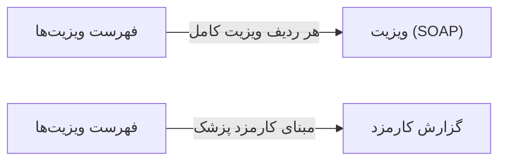

# 🩺 فهرست ویزیت‌ها — `VisitsView`

> [ویزیت] · کهن‌الگوی `list-dense` (لیستِ فشرده) · آیکون `Icon.ClipboardCheck`

| پیوند | نشانی |
|---|---|
| وایرفریمِ زنده | [`01-wireframes-html/VisitsView.html`](../01-wireframes-html/VisitsView.html) |
| View | [`03-views/VisitsView.xaml`](../03-views/VisitsView.xaml) |
| ViewModel | [`04-viewmodels/VisitsViewModel.cs`](../04-viewmodels/VisitsViewModel.cs) |

**گزارش ویزیت‌های انجام‌شده**

## 🖼 چیدمان

```
┌──────────────────────────────────────────────────────────────────┐
│  سربرگ: فهرست ویزیت‌ها                                             │
├──────────────────────────────────────────────────────────────────┤
├──────────────────────────────────────────────────────────────────┤
│  [جستجو…………] [فیلتر ▾] [فیلتر ▾]        [＋ جدید] [⟳] [⤓]      │
├──────────────────────────────────────────────────────────────────┤
│  جدول                                                            │
│  ┌──────────┬────────────────────┬────────┬────────┬────────┐    │
│  │ ستون     │ ستون               │ ستون   │ ستون   │ وضعیت  │    │
│  ├──────────┼────────────────────┼────────┼────────┼────────┤    │
│  │ دادهٔ ۱   │ …                  │ …      │ …      │ نشان   │    │
│  │ دادهٔ ۲   │ …                  │ …      │ …      │ نشان   │    │
│  └──────────┴────────────────────┴────────┴────────┴────────┘    │
├──────────────────────────────────────────────────────────────────┤
│  نمایش ۱ تا ۲۵ از ۱۲۴۵                         [◀] [▶]           │
└──────────────────────────────────────────────────────────────────┘
```

## 🔍 فیلترها

| # | برچسب | نوع | پهنا | مقدارِ نمونه | گزینه‌ها |
|:--:|---|---|:--:|---|---|
| 1 | جستجو | `search` | w-xl | نام بیمار یا کد… | — |
| 2 | پزشک | `combo` | w-md | همه پزشکان | — |
| 3 | از تاریخ | `date` | w-md | ۱۴۰۴/۰۷/۰۱ | — |
| 4 | تا تاریخ | `date` | w-md | ۱۴۰۴/۰۷/۱۹ | — |

## 📐 ستون‌های جدول

| # | عنوان | اتصال | نوع | عرض | تراز |
|:--:|---|---|---|:--:|:--:|
| 1 | کد | `Code` | متن | 96px | Right |
| 2 | بیمار | `Patient` | شخص | * | Right |
| 3 | پزشک | `Doctor` | متن | 148px | Right |
| 4 | تاریخ | `Date` | تاریخ | 112px | Right |
| 5 | ICD-10 | `Icd` | متن | 180px | Right |
| 6 | مبلغ | `Amount` | مبلغ | 108px | Left |
| 7 | وضعیت | `Status` | نشان | 96px | Center |

## 🧪 دادهٔ نمونه

| 1 | 2 | 3 | 4 | 5 | 6 | 7 |
|:--:|:--:|:--:|:--:|:--:|:--:|:--:|
| V-۴۱۲۰ | سارا احمدی | دکتر موسوی | ۱۴۰۴/۰۷/۱۲ | K21.9 | ۲۵۰,۰۰۰ | `تکمیل` |
| V-۴۱۲۱ | محمد رضایی | دکتر رضایی | ۱۴۰۴/۰۷/۱۲ | J06.9 | ۴۰۰,۰۰۰ | `تکمیل` |
| V-۴۱۲۲ | فاطمه کریمی | دکتر موسوی | ۱۴۰۴/۰۷/۱۱ | Z00.0 | ۱۵۰,۰۰۰ | `تکمیل` |
| V-۴۱۲۳ | علی حسینی | دکتر کریمی | ۱۴۰۴/۰۷/۱۰ | I10 | ۲۵۰,۰۰۰ | `پیش‌نویس` |

## ⚡ اقدام‌ها

| فرمان | برچسب | آیکون | سبک |
|---|---|---|---|
| `ExportCommand` | خروجی Excel | `Icon.FileSpreadsheet` | ثانویه |
| `PrintCommand` | چاپ | `Icon.Printer` | ثانویه |

## 🔗 ارتباطات

| مبدأ | مقصد | نوعِ پیوند |
|---|---|---|
| فهرست ویزیت‌ها | ویزیت (SOAP) | هر ردیف ویزیت کامل |
| فهرست ویزیت‌ها | گزارش کارمزد | مبنای کارمزد پزشک |



---

این فایل با `tools/gen_wireframes_md.py` ساخته شده است.
