# 🖼 ۰۳-ویوها — ۸۱ View

> هر View مستقیماً از وایرفریمِ HTMLِ همان فرم مشتق شده است؛
> برای هر کهن‌الگو یک چیدمانِ مستقل نوشته شده، نه یک قالبِ تکراری.

## 📊 آمار

| دسته | تعداد |
|---|:---:|
| مجموعِ Viewها | **81** |
| مجموعِ خطوط | **21,836** |

### پراکندگی بر پایه‌ی کهن‌الگو

| کهن‌الگو | شرح | تعداد |
|---|---|:---:|
| `list-dense` | لیستِ فشرده | 15 |
| `dialog` | دیالوگ | 11 |
| `form-std` | فرم استاندارد | 10 |
| `detail-tabs` | جزئیاتِ تب‌دار | 10 |
| `form-narrow` | فرمِ باریک | 8 |
| `list-cards` | لیستِ کارتی | 4 |
| `form-lines` | فرمِ خطی | 4 |
| `settings` | تنظیمات | 3 |
| `list-detail` | لیست + جزئیات | 3 |
| `split` | دوپنلی | 3 |
| `viewer` | نمایشگر | 2 |
| `report` | گزارش | 2 |
| `dashboard` | پیشخوان | 1 |
| `splash` | آغازین | 1 |
| `shell` | پوسته | 1 |
| `detail-timeline` | جزئیاتِ خط‌زمان | 1 |
| `kanban` | کانبان | 1 |
| `pos` | صندوق فروش | 1 |

### پراکندگی بر پایه‌ی گروه

| گروه | تعداد |
|---|:---:|
| 💰 مالی | 11 |
| 🏠 پیشخوان | 10 |
| 🧑‍💼 منابع انسانی | 10 |
| 🎫 پذیرش | 9 |
| 🩺 ویزیت | 7 |
| 👥 بیماران | 5 |
| ⚙️ سیستم | 5 |
| 💊 نسخه | 4 |
| 🧪 داروخانه | 4 |
| 📊 گزارشات | 4 |
| 📅 نوبت‌دهی | 3 |
| 🔬 آزمایشگاه | 3 |
| 📷 تصویربرداری | 2 |
| 🏢 سازمانی | 2 |
| 📣 ارتباطات | 2 |

## 📋 فهرستِ Viewها

| صفحه | فایل | کهن‌الگو | گروه | وایرفریم | ViewModel |
|---|---|---|---|---|---|
| 🔬 آزمایشگاه | `LabView.xaml` | لیستِ فشرده | آزمایشگاه | [وایرفریم](../01-wireframes-html/LabView.html) | [ViewModel](../04-viewmodels/LabViewModel.cs) |
| 🔬 ثبت نتیجه آزمایش | `LabResultWindow.xaml` | فرمِ خطی | آزمایشگاه | [وایرفریم](../01-wireframes-html/LabResultWindow.html) | [ViewModel](../04-viewmodels/LabResultViewModel.cs) |
| 🔬 درخواست آزمایش | `LabOrderFormWindow.xaml` | فرم استاندارد | آزمایشگاه | [وایرفریم](../01-wireframes-html/LabOrderFormWindow.html) | [ViewModel](../04-viewmodels/LabOrderFormViewModel.cs) |
| 📣 نظرسنجی | `SurveyView.xaml` | جزئیاتِ تب‌دار | ارتباطات | [وایرفریم](../01-wireframes-html/SurveyView.html) | [ViewModel](../04-viewmodels/SurveyViewModel.cs) |
| 📣 پیامک | `SmsView.xaml` | جزئیاتِ تب‌دار | ارتباطات | [وایرفریم](../01-wireframes-html/SmsView.html) | [ViewModel](../04-viewmodels/SmsViewModel.cs) |
| 👥 بیماران | `PatientsView.xaml` | لیست + جزئیات | بیماران | [وایرفریم](../01-wireframes-html/PatientsView.html) | [ViewModel](../04-viewmodels/PatientsViewModel.cs) |
| 👥 فرم بیمار | `PatientFormWindow.xaml` | فرم استاندارد | بیماران | [وایرفریم](../01-wireframes-html/PatientFormWindow.html) | [ViewModel](../04-viewmodels/PatientFormViewModel.cs) |
| 👥 نمایش تصویر | `PhotoViewerWindow.xaml` | نمایشگر | بیماران | [وایرفریم](../01-wireframes-html/PhotoViewerWindow.html) | [ViewModel](../04-viewmodels/PhotoViewerViewModel.cs) |
| 👥 پرونده بالینی پیشرفته | `AdvancedEmrView.xaml` | جزئیاتِ تب‌دار | بیماران | [وایرفریم](../01-wireframes-html/AdvancedEmrView.html) | [ViewModel](../04-viewmodels/AdvancedEmrViewModel.cs) |
| 👥 پرونده‌ی بیمار | `PatientDetailWindow.xaml` | جزئیاتِ خط‌زمان | بیماران | [وایرفریم](../01-wireframes-html/PatientDetailWindow.html) | [ViewModel](../04-viewmodels/PatientDetailViewModel.cs) |
| 📷 تصویربرداری | `ImagingView.xaml` | لیستِ فشرده | تصویربرداری | [وایرفریم](../01-wireframes-html/ImagingView.html) | [ViewModel](../04-viewmodels/ImagingViewModel.cs) |
| 📷 نمایشگر تصاویر پزشکی | `DicomViewerWindow.xaml` | نمایشگر | تصویربرداری | [وایرفریم](../01-wireframes-html/DicomViewerWindow.html) | [ViewModel](../04-viewmodels/DicomViewerViewModel.cs) |
| 🧪 انبارگردانی | `StocktakingView.xaml` | لیستِ فشرده | داروخانه | [وایرفریم](../01-wireframes-html/StocktakingView.html) | [ViewModel](../04-viewmodels/StocktakingViewModel.cs) |
| 🧪 داروخانه | `PharmacyView.xaml` | صندوق فروش | داروخانه | [وایرفریم](../01-wireframes-html/PharmacyView.html) | [ViewModel](../04-viewmodels/PharmacyViewModel.cs) |
| 🧪 فرم قلم دارویی | `PharmacyItemFormWindow.xaml` | فرم استاندارد | داروخانه | [وایرفریم](../01-wireframes-html/PharmacyItemFormWindow.html) | [ViewModel](../04-viewmodels/PharmacyItemFormViewModel.cs) |
| 🧪 ورود کالا | `StockInFormWindow.xaml` | فرمِ خطی | داروخانه | [وایرفریم](../01-wireframes-html/StockInFormWindow.html) | [ViewModel](../04-viewmodels/StockInFormViewModel.cs) |
| 🏢 سامانه سپاس | `SepasView.xaml` | جزئیاتِ تب‌دار | سازمانی | [وایرفریم](../01-wireframes-html/SepasView.html) | [ViewModel](../04-viewmodels/SepasViewModel.cs) |
| 🏢 شعب | `BranchesView.xaml` | لیستِ کارتی | سازمانی | [وایرفریم](../01-wireframes-html/BranchesView.html) | [ViewModel](../04-viewmodels/BranchesViewModel.cs) |
| ⚙️ انتخاب رنگ | `ColorPickerWindow.xaml` | دیالوگ | سیستم | [وایرفریم](../01-wireframes-html/ColorPickerWindow.html) | [ViewModel](../04-viewmodels/ColorPickerViewModel.cs) |
| ⚙️ دیالوگ یکپارچه | `ThemedDialog.xaml` | دیالوگ | سیستم | [وایرفریم](../01-wireframes-html/ThemedDialog.html) | [ViewModel](../04-viewmodels/ThemedDialogViewModel.cs) |
| ⚙️ فعال‌سازی لایسنس | `LicenseActivationWindow.xaml` | فرمِ باریک | سیستم | [وایرفریم](../01-wireframes-html/LicenseActivationWindow.html) | [ViewModel](../04-viewmodels/LicenseActivationViewModel.cs) |
| ⚙️ وضعیت لایسنس | `LicenseStatusView.xaml` | جزئیاتِ تب‌دار | سیستم | [وایرفریم](../01-wireframes-html/LicenseStatusView.html) | [ViewModel](../04-viewmodels/LicenseStatusViewModel.cs) |
| ⚙️ پشتیبان‌گیری | `BackupView.xaml` | جزئیاتِ تب‌دار | سیستم | [وایرفریم](../01-wireframes-html/BackupView.html) | [ViewModel](../04-viewmodels/BackupViewModel.cs) |
| 💰 بیمه و مطالبات | `InsuranceView.xaml` | جزئیاتِ تب‌دار | مالی | [وایرفریم](../01-wireframes-html/InsuranceView.html) | [ViewModel](../04-viewmodels/InsuranceViewModel.cs) |
| 💰 تعرفه خدمات | `TariffFormWindow.xaml` | فرم استاندارد | مالی | [وایرفریم](../01-wireframes-html/TariffFormWindow.html) | [ViewModel](../04-viewmodels/TariffFormViewModel.cs) |
| 💰 جزئیات سند حسابداری | `JournalEntryDetailWindow.xaml` | دیالوگ | مالی | [وایرفریم](../01-wireframes-html/JournalEntryDetailWindow.html) | [ViewModel](../04-viewmodels/JournalEntryDetailViewModel.cs) |
| 💰 حسابداری | `AccountingView.xaml` | دوپنلی | مالی | [وایرفریم](../01-wireframes-html/AccountingView.html) | [ViewModel](../04-viewmodels/AccountingViewModel.cs) |
| 💰 حقوق و دستمزد | `PayrollView.xaml` | لیستِ فشرده | مالی | [وایرفریم](../01-wireframes-html/PayrollView.html) | [ViewModel](../04-viewmodels/PayrollViewModel.cs) |
| 💰 صورتحساب | `BillingView.xaml` | لیستِ فشرده | مالی | [وایرفریم](../01-wireframes-html/BillingView.html) | [ViewModel](../04-viewmodels/BillingViewModel.cs) |
| 💰 عملکرد پزشکان | `DoctorPerformanceWindow.xaml` | دیالوگ | مالی | [وایرفریم](../01-wireframes-html/DoctorPerformanceWindow.html) | [ViewModel](../04-viewmodels/DoctorPerformanceViewModel.cs) |
| 💰 فرم شرکت بیمه | `CompanyFormWindow.xaml` | فرمِ باریک | مالی | [وایرفریم](../01-wireframes-html/CompanyFormWindow.html) | [ViewModel](../04-viewmodels/CompanyFormViewModel.cs) |
| 💰 فرم صورتحساب | `InvoiceFormWindow.xaml` | فرمِ خطی | مالی | [وایرفریم](../01-wireframes-html/InvoiceFormWindow.html) | [ViewModel](../04-viewmodels/InvoiceFormViewModel.cs) |
| 💰 فیش حقوقی | `PayslipWindow.xaml` | دیالوگ | مالی | [وایرفریم](../01-wireframes-html/PayslipWindow.html) | [ViewModel](../04-viewmodels/PayslipViewModel.cs) |
| 💰 گزارش کارمزد | `CommissionReportWindow.xaml` | دیالوگ | مالی | [وایرفریم](../01-wireframes-html/CommissionReportWindow.html) | [ViewModel](../04-viewmodels/CommissionReportViewModel.cs) |
| 🧑‍💼 حضور و غیاب | `AttendanceView.xaml` | لیستِ فشرده | منابع انسانی | [وایرفریم](../01-wireframes-html/AttendanceView.html) | [ViewModel](../04-viewmodels/AttendanceViewModel.cs) |
| 🧑‍💼 فرم پزشک | `DoctorFormWindow.xaml` | فرم استاندارد | منابع انسانی | [وایرفریم](../01-wireframes-html/DoctorFormWindow.html) | [ViewModel](../04-viewmodels/DoctorFormViewModel.cs) |
| 🧑‍💼 فرم کاربر | `UserFormWindow.xaml` | فرمِ باریک | منابع انسانی | [وایرفریم](../01-wireframes-html/UserFormWindow.html) | [ViewModel](../04-viewmodels/UserFormViewModel.cs) |
| 🧑‍💼 فرم کارمند | `EmployeeFormWindow.xaml` | فرم استاندارد | منابع انسانی | [وایرفریم](../01-wireframes-html/EmployeeFormWindow.html) | [ViewModel](../04-viewmodels/EmployeeFormViewModel.cs) |
| 🧑‍💼 مدیریت سیستم | `AdminView.xaml` | تنظیمات | منابع انسانی | [وایرفریم](../01-wireframes-html/AdminView.html) | [ViewModel](../04-viewmodels/AdminViewModel.cs) |
| 🧑‍💼 نقش‌ها و مجوزها | `RolePermissionView.xaml` | دوپنلی | منابع انسانی | [وایرفریم](../01-wireframes-html/RolePermissionView.html) | [ViewModel](../04-viewmodels/RolePermissionViewModel.cs) |
| 🧑‍💼 ویرایش حقوق | `EmployeeSalaryEditWindow.xaml` | فرمِ باریک | منابع انسانی | [وایرفریم](../01-wireframes-html/EmployeeSalaryEditWindow.html) | [ViewModel](../04-viewmodels/EmployeeSalaryEditViewModel.cs) |
| 🧑‍💼 پرسنل | `PersonnelView.xaml` | لیست + جزئیات | منابع انسانی | [وایرفریم](../01-wireframes-html/PersonnelView.html) | [ViewModel](../04-viewmodels/PersonnelViewModel.cs) |
| 🧑‍💼 پزشکان | `DoctorsView.xaml` | لیستِ کارتی | منابع انسانی | [وایرفریم](../01-wireframes-html/DoctorsView.html) | [ViewModel](../04-viewmodels/DoctorsViewModel.cs) |
| 🧑‍💼 کاربران | `UsersView.xaml` | لیستِ فشرده | منابع انسانی | [وایرفریم](../01-wireframes-html/UsersView.html) | [ViewModel](../04-viewmodels/UsersViewModel.cs) |
| 💊 جزئیات نسخه | `PrescriptionDetailWindow.xaml` | دیالوگ | نسخه | [وایرفریم](../01-wireframes-html/PrescriptionDetailWindow.html) | [ViewModel](../04-viewmodels/PrescriptionDetailViewModel.cs) |
| 💊 فرم نسخه | `PrescriptionFormWindow.xaml` | فرمِ خطی | نسخه | [وایرفریم](../01-wireframes-html/PrescriptionFormWindow.html) | [ViewModel](../04-viewmodels/PrescriptionFormViewModel.cs) |
| 💊 نسخه الکترونیک | `EPrescriptionView.xaml` | لیستِ فشرده | نسخه | [وایرفریم](../01-wireframes-html/EPrescriptionView.html) | [ViewModel](../04-viewmodels/EPrescriptionViewModel.cs) |
| 💊 نسخه‌ها | `PrescriptionsView.xaml` | لیستِ فشرده | نسخه | [وایرفریم](../01-wireframes-html/PrescriptionsView.html) | [ViewModel](../04-viewmodels/PrescriptionsViewModel.cs) |
| 📅 فرم نوبت | `AppointmentFormWindow.xaml` | فرم استاندارد | نوبت‌دهی | [وایرفریم](../01-wireframes-html/AppointmentFormWindow.html) | [ViewModel](../04-viewmodels/AppointmentFormViewModel.cs) |
| 📅 نوبت‌دهی | `AppointmentsView.xaml` | کانبان | نوبت‌دهی | [وایرفریم](../01-wireframes-html/AppointmentsView.html) | [ViewModel](../04-viewmodels/AppointmentsViewModel.cs) |
| 📅 ویزیت پزشک | `DoctorVisitView.xaml` | دوپنلی | نوبت‌دهی | [وایرفریم](../01-wireframes-html/DoctorVisitView.html) | [ViewModel](../04-viewmodels/DoctorVisitViewModel.cs) |
| 🩺 خدمات تکمیلی | `ComplementaryView.xaml` | لیستِ فشرده | ویزیت | [وایرفریم](../01-wireframes-html/ComplementaryView.html) | [ViewModel](../04-viewmodels/ComplementaryViewModel.cs) |
| 🩺 دندانپزشکی | `DentistryView.xaml` | جزئیاتِ تب‌دار | ویزیت | [وایرفریم](../01-wireframes-html/DentistryView.html) | [ViewModel](../04-viewmodels/DentistryViewModel.cs) |
| 🩺 فهرست ویزیت‌ها | `VisitsView.xaml` | لیستِ فشرده | ویزیت | [وایرفریم](../01-wireframes-html/VisitsView.html) | [ViewModel](../04-viewmodels/VisitsViewModel.cs) |
| 🩺 فیزیوتراپی | `PhysiotherapyView.xaml` | جزئیاتِ تب‌دار | ویزیت | [وایرفریم](../01-wireframes-html/PhysiotherapyView.html) | [ViewModel](../04-viewmodels/PhysiotherapyViewModel.cs) |
| 🩺 لوازم مصرفی | `ConsumablesView.xaml` | لیستِ فشرده | ویزیت | [وایرفریم](../01-wireframes-html/ConsumablesView.html) | [ViewModel](../04-viewmodels/ConsumablesViewModel.cs) |
| 🩺 ویزیت (SOAP) | `VisitWindow.xaml` | فرم استاندارد | ویزیت | [وایرفریم](../01-wireframes-html/VisitWindow.html) | [ViewModel](../04-viewmodels/VisitViewModel.cs) |
| 🩺 چشم‌پزشکی | `OphthalmologyView.xaml` | جزئیاتِ تب‌دار | ویزیت | [وایرفریم](../01-wireframes-html/OphthalmologyView.html) | [ViewModel](../04-viewmodels/OphthalmologyViewModel.cs) |
| 🎫 اتاق‌ها | `RoomsView.xaml` | لیستِ کارتی | پذیرش | [وایرفریم](../01-wireframes-html/RoomsView.html) | [ViewModel](../04-viewmodels/RoomsViewModel.cs) |
| 🎫 بستن شیفت | `ShiftCloseWindow.xaml` | فرم استاندارد | پذیرش | [وایرفریم](../01-wireframes-html/ShiftCloseWindow.html) | [ViewModel](../04-viewmodels/ShiftCloseViewModel.cs) |
| 🎫 دریافت وجه | `ReceptionPayWindow.xaml` | فرمِ باریک | پذیرش | [وایرفریم](../01-wireframes-html/ReceptionPayWindow.html) | [ViewModel](../04-viewmodels/ReceptionPayViewModel.cs) |
| 🎫 شیفت‌ها | `ShiftsView.xaml` | لیستِ فشرده | پذیرش | [وایرفریم](../01-wireframes-html/ShiftsView.html) | [ViewModel](../04-viewmodels/ShiftsViewModel.cs) |
| 🎫 فرم پذیرش | `ReceptionFormWindow.xaml` | فرم استاندارد | پذیرش | [وایرفریم](../01-wireframes-html/ReceptionFormWindow.html) | [ViewModel](../04-viewmodels/ReceptionFormViewModel.cs) |
| 🎫 مدیریت اتاق‌ها | `RoomsManagerWindow.xaml` | دیالوگ | پذیرش | [وایرفریم](../01-wireframes-html/RoomsManagerWindow.html) | [ViewModel](../04-viewmodels/RoomsManagerViewModel.cs) |
| 🎫 پذیرش و صف | `ReceptionsView.xaml` | لیست + جزئیات | پذیرش | [وایرفریم](../01-wireframes-html/ReceptionsView.html) | [ViewModel](../04-viewmodels/ReceptionsViewModel.cs) |
| 🎫 پرداخت | `PaymentWindow.xaml` | فرمِ باریک | پذیرش | [وایرفریم](../01-wireframes-html/PaymentWindow.html) | [ViewModel](../04-viewmodels/PaymentViewModel.cs) |
| 🎫 پیش‌نمایش رسید شیفت | `ShiftReceiptPreviewWindow.xaml` | دیالوگ | پذیرش | [وایرفریم](../01-wireframes-html/ShiftReceiptPreviewWindow.html) | [ViewModel](../04-viewmodels/ShiftReceiptPreviewViewModel.cs) |
| 🏠 اعلان‌ها | `NotificationsView.xaml` | لیستِ فشرده | پیشخوان | [وایرفریم](../01-wireframes-html/NotificationsView.html) | [ViewModel](../04-viewmodels/NotificationsViewModel.cs) |
| 🏠 انتخاب میانبر | `ShortcutPickerWindow.xaml` | دیالوگ | پیشخوان | [وایرفریم](../01-wireframes-html/ShortcutPickerWindow.html) | [ViewModel](../04-viewmodels/ShortcutPickerViewModel.cs) |
| 🏠 تغییر رمز عبور | `ChangePasswordWindow.xaml` | فرمِ باریک | پیشخوان | [وایرفریم](../01-wireframes-html/ChangePasswordWindow.html) | [ViewModel](../04-viewmodels/ChangePasswordViewModel.cs) |
| 🏠 تنظیمات | `SettingsView.xaml` | تنظیمات | پیشخوان | [وایرفریم](../01-wireframes-html/SettingsView.html) | [ViewModel](../04-viewmodels/SettingsViewModel.cs) |
| 🏠 در حال بارگذاری | `SplashWindow.xaml` | آغازین | پیشخوان | [وایرفریم](../01-wireframes-html/SplashWindow.html) | [ViewModel](../04-viewmodels/SplashViewModel.cs) |
| 🏠 راهنمای تعاملی | `GuidedTourWindow.xaml` | دیالوگ | پیشخوان | [وایرفریم](../01-wireframes-html/GuidedTourWindow.html) | [ViewModel](../04-viewmodels/GuidedTourViewModel.cs) |
| 🏠 مرکز آموزش | `TrainingCenterView.xaml` | لیستِ کارتی | پیشخوان | [وایرفریم](../01-wireframes-html/TrainingCenterView.html) | [ViewModel](../04-viewmodels/TrainingCenterViewModel.cs) |
| 🏠 ورود به برنامه | `LoginWindow.xaml` | فرمِ باریک | پیشخوان | [وایرفریم](../01-wireframes-html/LoginWindow.html) | [ViewModel](../04-viewmodels/LoginViewModel.cs) |
| 🏠 پنجره‌ی اصلی | `MainWindow.xaml` | پوسته | پیشخوان | [وایرفریم](../01-wireframes-html/MainWindow.html) | [ViewModel](../04-viewmodels/MainViewModel.cs) |
| 🏠 پیشخوان | `DashboardView.xaml` | پیشخوان | پیشخوان | [وایرفریم](../01-wireframes-html/DashboardView.html) | [ViewModel](../04-viewmodels/DashboardViewModel.cs) |
| 📊 مرورگر گزارشات | `ReportBrowserView.xaml` | گزارش | گزارشات | [وایرفریم](../01-wireframes-html/ReportBrowserView.html) | [ViewModel](../04-viewmodels/ReportBrowserViewModel.cs) |
| 📊 گزارش حسابرسی | `AuditLogView.xaml` | لیستِ فشرده | گزارشات | [وایرفریم](../01-wireframes-html/AuditLogView.html) | [ViewModel](../04-viewmodels/AuditLogViewModel.cs) |
| 📊 گزارشات | `ReportsView.xaml` | تنظیمات | گزارشات | [وایرفریم](../01-wireframes-html/ReportsView.html) | [ViewModel](../04-viewmodels/ReportsViewModel.cs) |
| 📊 گزارش‌ساز پویا | `AdhocReportWindow.xaml` | گزارش | گزارشات | [وایرفریم](../01-wireframes-html/AdhocReportWindow.html) | [ViewModel](../04-viewmodels/AdhocReportViewModel.cs) |

## 🔗 نمودارِ ارتباطاتِ صفحات

```mermaid
graph LR
    n0["🔬 آزمایشگاه"]
    n1["🎫 اتاق‌ها"]
    n2["🏠 اعلان‌ها"]
    n3["🧪 انبارگردانی"]
    n4["🎫 بستن شیفت"]
    n5["👥 بیماران"]
    n6["💰 بیمه و مطالبات"]
    n7["📷 تصویربرداری"]
    n8["💰 تعرفه خدمات"]
    n9["• تغییر رمز"]
    n10["🏠 تغییر رمز عبور"]
    n11["🏠 تنظیمات"]
    n12["🔬 ثبت نتیجه آزمایش"]
    n13["💰 جزئیات سند حسابداری"]
    n14["💊 جزئیات نسخه"]
    n15["💰 حسابداری"]
    n16["🧑‍💼 حضور و غیاب"]
    n17["💰 حقوق و دستمزد"]
    n18["🩺 خدمات تکمیلی"]
    n19["🧪 داروخانه"]
    n20["🔬 درخواست آزمایش"]
    n21["🎫 دریافت وجه"]
    n22["🩺 دندانپزشکی"]
    n23["🏠 راهنمای تعاملی"]
    n24["🏢 سامانه سپاس"]
    n25["🏢 شعب"]
    n26["🎫 شیفت‌ها"]
    n27["💰 صورتحساب"]
    n28["💰 عملکرد پزشکان"]
    n29["👥 فرم بیمار"]
    n30["💰 فرم شرکت بیمه"]
    n31["💰 فرم صورتحساب"]
    n32["🧪 فرم قلم دارویی"]
    n33["💊 فرم نسخه"]
    n34["📅 فرم نوبت"]
    n35["🎫 فرم پذیرش"]
    n36["🧑‍💼 فرم پزشک"]
    n37["🧑‍💼 فرم کاربر"]
    n38["🧑‍💼 فرم کارمند"]
    n39["⚙️ فعال‌سازی لایسنس"]
    n40["🩺 فهرست ویزیت‌ها"]
    n41["🩺 فیزیوتراپی"]
    n42["💰 فیش حقوقی"]
    n43["🩺 لوازم مصرفی"]
    n44["🎫 مدیریت اتاق‌ها"]
    n45["🧑‍💼 مدیریت سیستم"]
    n46["📊 مرورگر گزارشات"]
    n47["🏠 مرکز آموزش"]
    n48["💊 نسخه الکترونیک"]
    n49["💊 نسخه‌ها"]
    n50["📣 نظرسنجی"]
    n51["🧑‍💼 نقش‌ها و مجوزها"]
    n52["📷 نمایشگر تصاویر پزشکی"]
    n53["📅 نوبت‌دهی"]
    n54["• ورود"]
    n55["🧪 ورود کالا"]
    n56["⚙️ وضعیت لایسنس"]
    n57["🧑‍💼 ویرایش حقوق"]
    n58["• ویزیت"]
    n59["🩺 ویزیت (SOAP)"]
    n60["📅 ویزیت پزشک"]
    n61["🎫 پذیرش و صف"]
    n62["🧑‍💼 پرسنل"]
    n63["• پرونده بالینی"]
    n64["• پرونده بیمار"]
    n65["👥 پرونده‌ی بیمار"]
    n66["🧑‍💼 پزشکان"]
    n67["⚙️ پشتیبان‌گیری"]
    n68["• پنجره اصلی"]
    n69["📣 پیامک"]
    n70["🏠 پیشخوان"]
    n71["🎫 پیش‌نمایش رسید شیفت"]
    n72["🩺 چشم‌پزشکی"]
    n73["🧑‍💼 کاربران"]
    n74["📊 گزارش حسابرسی"]
    n75["💰 گزارش کارمزد"]
    n76["📊 گزارشات"]
    n77["📊 گزارش‌ساز پویا"]
    n70 -->|"پذیرش جدید می‌سازد"| n61
    n70 -->|"نوبت امروز را نشان می‌ده"| n53
    n70 -->|"درآمد از فاکتورها می‌آید"| n27
    n54 -->|"پس از احراز هویت"| n68
    n54 -->|"در صورت MustChangePasswo"| n10
    n9 -->|"پس از تغییر، نشست بسته م"| n54
    n11 -->|"تنظیمات بکاپ در این‌جا"| n67
    n11 -->|"نام شعبهٔ اصلی"| n25
    n2 -->|"هشدار کمبود موجودی"| n19
    n2 -->|"هشدار نوبت تأیید‌نشده"| n53
    n2 -->|"هشدار انقضا"| n56
    n47 -->|"مکمل تور"| n23
    n5 -->|"هر ردیف به پرونده می‌رود"| n65
    n5 -->|"بیمار پذیرش می‌شود"| n61
    n5 -->|"نوبت برای بیمار ثبت می‌ش"| n53
    n5 -->|"مانده حساب از فاکتورها"| n27
    n29 -->|"پس از ذخیره به فهرست باز"| n5
    n29 -->|"بیمه از پرونده می‌آید"| n35
    n29 -->|"حساسیت‌ها در ویزیت نمایش"| n59
    n64 -->|"هر ویزیت در خط زمان"| n59
    n64 -->|"مانده از فاکتورها"| n27
    n64 -->|"نتایج آزمایش"| n0
    n63 -->|"بخشی از ویزیت"| n59
    n63 -->|"زیرمجموعه پرونده"| n65
    n53 -->|"نوبت برای بیمار"| n5
    n53 -->|"تأیید نوبت → پذیرش"| n61
    n53 -->|"ظرفیت برنامه هفتگی"| n66
    n34 -->|"اتاق از فهرست اتاق‌ها"| n1
    n34 -->|"یادآوری پیامکی"| n69
    n60 -->|"بیمار از صف می‌آید"| n61
    n60 -->|"فرم ویزیت باز می‌شود"| n59
    n60 -->|"پس از ویزیت"| n33
    n61 -->|"بیمار انتخاب می‌شود"| n5
    n61 -->|"از نوبت تأییدشده"| n53
    n61 -->|"پس از فراخوانی"| n59
    n61 -->|"فاکتور صادر می‌شود"| n27
    n61 -->|"تحویل در پایان شیفت"| n26
    n35 -->|"قیمت از تعرفه"| n8
    n35 -->|"درصد از قرارداد بیمه"| n6
    n21 -->|"فاکتور صادر می‌شود"| n27
    n21 -->|"در پایان شیفت جمع‌بندی م"| n4
    n26 -->|"جمع‌بندی مالی"| n4
    n26 -->|"پذیرش‌های دوره شیفت"| n61
    n4 -->|"رسید چاپ می‌شود"| n71
    n4 -->|"سند حسابداری صادر می‌شود"| n15
    n1 -->|"ویرایش گروهی"| n44
    n1 -->|"تخصیص اتاق به نوبت"| n53
    n58 -->|"نسخه بر اساس تشخیص"| n33
    n58 -->|"درخواست پاراکلینیک"| n20
    n58 -->|"اتمام ویزیت وضعیت پذیرش "| n61
    n40 -->|"هر ردیف ویزیت کامل"| n59
    n40 -->|"مبنای کارمزد پزشک"| n75
    n22 -->|"بخشی از ویزیت تخصصی"| n59
    n22 -->|"خدمات فاکتور می‌شود"| n27
    n72 -->|"ویزیت تخصصی"| n59
    n41 -->|"ویزیت تخصصی"| n59
    n18 -->|"خدمت فاکتور می‌شود"| n27
    n43 -->|"تأمین موجودی"| n55
    n43 -->|"شمارش دوره‌ای"| n3
    n49 -->|"تحویل از داروخانه"| n19
    n49 -->|"ارسال به سامانه"| n48
    n33 -->|"موجودی دارو بررسی می‌شود"| n19
    n33 -->|"ارسال به سامانه کشوری"| n48
    n33 -->|"حساسیت‌ها در تداخل لحاظ "| n65
    n14 -->|"تحویل دارو"| n19
    n48 -->|"منبع نسخه‌ها"| n49
    n19 -->|"تعریف قلم"| n32
    n19 -->|"تأمین موجودی"| n55
    n19 -->|"شمارش"| n3
    n19 -->|"تحویل بر اساس نسخه"| n49
    n32 -->|"بچ برای این قلم"| n55
    n55 -->|"موجودی به‌روز می‌شود"| n19
    n55 -->|"سند خرید صادر می‌شود"| n15
    n3 -->|"موجودی اصلاح می‌شود"| n19
    n0 -->|"ثبت درخواست"| n20
    n0 -->|"ورود نتایج"| n12
    n0 -->|"اطلاع‌رسانی نتیجه"| n69
    n0 -->|"نتایج در پرونده"| n65
    n20 -->|"در فهرست درخواست‌ها"| n0
    n12 -->|"وضعیت به «آماده» تغییر م"| n0
    n12 -->|"نتیجه در پرونده ثبت می‌ش"| n65
    n7 -->|"مشاهده DICOM"| n52
    n7 -->|"تصاویر در پرونده"| n65
    n27 -->|"ایجاد/ویرایش"| n31
    n27 -->|"سند دوبلِ خودکار"| n15
    n27 -->|"مطالبات دوره‌ای"| n6
    n27 -->|"از پذیرش می‌آید"| n61
    n31 -->|"قیمت از تعرفه"| n8
    n31 -->|"سند خودکارِ متوازن"| n15
    n15 -->|"سطرهای سند"| n13
    n15 -->|"سند خودکارِ فاکتور"| n27
    n15 -->|"سند حقوق"| n17
    n13 -->|"سند اصلی"| n15
    n8 -->|"قیمت‌گذاری فاکتور"| n27
    n8 -->|"بیمهٔ مرتبط"| n30
    n30 -->|"در فهرست بیمه‌ها"| n6
    n30 -->|"تعرفه برای این بیمه"| n8
    n6 -->|"فاکتورهای دوره"| n27
    n6 -->|"شرکت‌های طرف قرارداد"| n30
    n17 -->|"حقوق پایه از پرونده"| n38
    n17 -->|"تغییر حقوق"| n57
    n17 -->|"صدور فیش"| n42
    n17 -->|"سند حقوق"| n15
    n75 -->|"مبنای محاسبه"| n40
    n75 -->|"درصد قرارداد"| n66
    n28 -->|"محاسبه مالی"| n75
    n28 -->|"نمره رضایت"| n50
    n62 -->|"ایجاد/ویرایش"| n38
    n62 -->|"ساعات کاری"| n16
    n62 -->|"پرداخت"| n17
    n62 -->|"پزشک از میان پرسنل"| n66
    n38 -->|"حقوق پایه مبنای محاسبه"| n17
    n38 -->|"تخصیص به شیفت"| n26
    n57 -->|"در دوره بعد اعمال می‌شود"| n17
    n16 -->|"تردد پرسنل"| n62
    n16 -->|"مبنای اضافه‌کار"| n17
    n66 -->|"ایجاد/ویرایش"| n36
    n66 -->|"ظرفیت برنامه"| n53
    n66 -->|"کارمزد"| n75
    n36 -->|"ظرفیت برنامه هفتگی"| n53
    n36 -->|"پزشک از میان پرسنل"| n62
    n73 -->|"ایجاد/ویرایش"| n37
    n73 -->|"تخصیص نقش"| n51
    n73 -->|"ردپای عملیات"| n74
    n37 -->|"نقش تعیین‌کننده دسترسی"| n51
    n51 -->|"تخصیص نقش به کاربر"| n73
    n51 -->|"بخشی از مدیریت"| n45
    n45 -->|"مدیریت دسترسی"| n51
    n45 -->|"ردپای عملیات"| n74
    n25 -->|"انتساب پرسنل به شعبه"| n62
    n25 -->|"فیلتر بر اساس شعبه"| n5
    n24 -->|"ارسال داده"| n48
    n24 -->|"منبع داده"| n65
    n69 -->|"یادآوری نوبت"| n53
    n69 -->|"اطلاع‌رسانی نتیجه"| n0
    n69 -->|"دریافت‌کنندگان"| n5
    n50 -->|"ارسال لینک نظرسنجی"| n69
    n50 -->|"نمره رضایت"| n28
    n76 -->|"مشاهده خروجی"| n46
    n76 -->|"ساخت گزارش جدید"| n77
    n46 -->|"انتخاب از کتابخانه"| n76
    n46 -->|"ساخت گزارش سفارشی"| n77
    n77 -->|"ذخیره در کتابخانه"| n46
    n74 -->|"عامل عملیات"| n73
    n74 -->|"بخشی از مدیریت"| n45
    n67 -->|"تنظیمات بکاپ در تنظیمات"| n11
    n67 -->|"ابزار مدیریتی"| n45
    n56 -->|"ورود کلید مجوز"| n39
    n56 -->|"تنظیمات پنل لایسنس"| n11
    n39 -->|"پس از فعال‌سازی"| n56
```

## 🧩 کنترل‌های بازاستفاده‌شده

| کنترل | نقش | محل |
|---|---|---|
| `PageHeader` | سربرگِ یکپارچه‌ی همه‌ی صفحات | `00-foundation/Controls/PageHeader.xaml` |
| `StatCard` | کارتِ شاخصِ کلیدی با روند | `00-foundation/Controls/StatCard.xaml` |
| `SearchBox` | جستجو با تأخیر و دکمه‌ی پاک‌کردن | `00-foundation/Controls/SearchBox.xaml` |
| `EmptyState` | وضعیتِ تهی برای جدول و لیست | `00-foundation/Controls/EmptyState.xaml` |
| `StatusBadge` | نشانِ رنگیِ وضعیت | `00-foundation/Controls/StatusBadge.xaml` |
| `PasswordHelper` | اتصالِ امنِ `PasswordBox` به ViewModel | `00-foundation/Controls/PasswordHelper.cs` |

---

این فایل با `tools/gen_docs.py` ساخته شده است؛ آن را دستی ویرایش نکنید.
