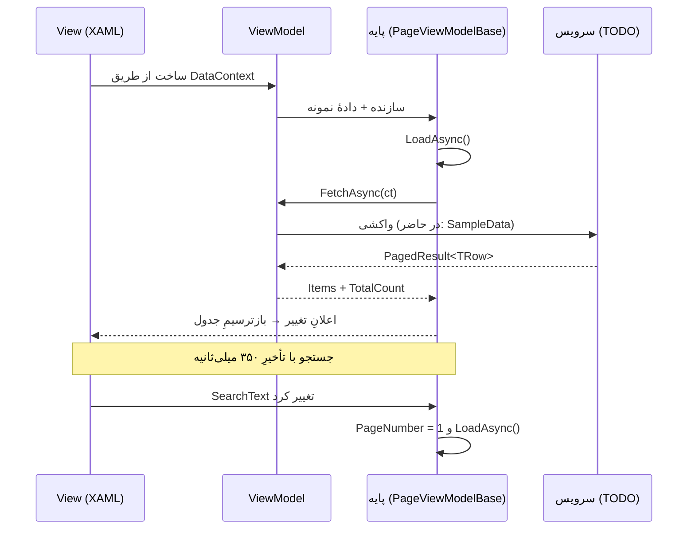

# 🧠 ۰۴-ویومدل‌ها — ۸۱ ViewModel

> هر ViewModel از همان مشخصاتی ساخته شده که وایرفریمِ همان فرم را ساخت؛
> بنابراین دادهٔ نمونه‌ی آن دقیقاً همان چیزی است که در وایرفریم دیده می‌شود.

## 🧬 انتخابِ پایه

| شرط | پایه | امکاناتِ دریافت‌شده |
|---|---|---|
| فرم ستون دارد | `PageViewModelBase<TRow>` | جستجوی تأخیری، صفحه‌بندی، انتخاب، ایجاد/ویرایش/حذف |
| فرم یا دیالوگ است | `FormViewModelBase` | ردیابیِ تغییر، حالتِ فقط‌خواندنی، ذخیره/انصراف، اعتبارسنجی |
| در غیر این صورت | `ViewModelBase` | وضعیتِ بارگذاری، پیام، اجرای ایمن، `INotifyDataErrorInfo` |

## 📋 فهرست

| صفحه | فایل | پایه | بخش‌ها | ستون‌ها | سطرِ نمونه | اقدام‌ها | View |
|---|---|---|:--:|:--:|:--:|:--:|---|
| آزمایشگاه | `LabViewModel.cs` | `PageViewModelBase&lt;TRow&gt;` | 0 | 6 | 3 | 4 | [View](../03-views/LabView.xaml) |
| ثبت نتیجه آزمایش | `LabResultViewModel.cs` | `FormViewModelBase` | 1 | 0 | 0 | 3 | [View](../03-views/LabResultWindow.xaml) |
| درخواست آزمایش | `LabOrderFormViewModel.cs` | `FormViewModelBase` | 1 | 0 | 0 | 3 | [View](../03-views/LabOrderFormWindow.xaml) |
| نظرسنجی | `SurveyViewModel.cs` | `PageViewModelBase&lt;TRow&gt;` | 0 | 5 | 4 | 2 | [View](../03-views/SurveyView.xaml) |
| پیامک | `SmsViewModel.cs` | `PageViewModelBase&lt;TRow&gt;` | 1 | 5 | 3 | 3 | [View](../03-views/SmsView.xaml) |
| بیماران | `PatientsViewModel.cs` | `PageViewModelBase&lt;TRow&gt;` | 0 | 9 | 5 | 3 | [View](../03-views/PatientsView.xaml) |
| فرم بیمار | `PatientFormViewModel.cs` | `FormViewModelBase` | 3 | 0 | 0 | 3 | [View](../03-views/PatientFormWindow.xaml) |
| نمایش تصویر | `PhotoViewerViewModel.cs` | `FormViewModelBase` | 0 | 0 | 0 | 0 | [View](../03-views/PhotoViewerWindow.xaml) |
| پرونده بالینی پیشرفته | `AdvancedEmrViewModel.cs` | `ViewModelBase` | 1 | 0 | 0 | 2 | [View](../03-views/AdvancedEmrView.xaml) |
| پرونده‌ی بیمار | `PatientDetailViewModel.cs` | `ViewModelBase` | 0 | 0 | 0 | 3 | [View](../03-views/PatientDetailWindow.xaml) |
| تصویربرداری | `ImagingViewModel.cs` | `PageViewModelBase&lt;TRow&gt;` | 0 | 7 | 2 | 3 | [View](../03-views/ImagingView.xaml) |
| نمایشگر تصاویر پزشکی | `DicomViewerViewModel.cs` | `FormViewModelBase` | 0 | 0 | 0 | 0 | [View](../03-views/DicomViewerWindow.xaml) |
| انبارگردانی | `StocktakingViewModel.cs` | `PageViewModelBase&lt;TRow&gt;` | 0 | 6 | 3 | 2 | [View](../03-views/StocktakingView.xaml) |
| داروخانه | `PharmacyViewModel.cs` | `PageViewModelBase&lt;TRow&gt;` | 0 | 8 | 4 | 3 | [View](../03-views/PharmacyView.xaml) |
| فرم قلم دارویی | `PharmacyItemFormViewModel.cs` | `FormViewModelBase` | 2 | 0 | 0 | 2 | [View](../03-views/PharmacyItemFormWindow.xaml) |
| ورود کالا | `StockInFormViewModel.cs` | `FormViewModelBase` | 1 | 0 | 0 | 3 | [View](../03-views/StockInFormWindow.xaml) |
| سامانه سپاس | `SepasViewModel.cs` | `PageViewModelBase&lt;TRow&gt;` | 1 | 4 | 3 | 3 | [View](../03-views/SepasView.xaml) |
| شعب | `BranchesViewModel.cs` | `PageViewModelBase&lt;TRow&gt;` | 0 | 5 | 3 | 2 | [View](../03-views/BranchesView.xaml) |
| انتخاب رنگ | `ColorPickerViewModel.cs` | `FormViewModelBase` | 0 | 0 | 0 | 0 | [View](../03-views/ColorPickerWindow.xaml) |
| دیالوگ یکپارچه | `ThemedDialogViewModel.cs` | `FormViewModelBase` | 0 | 0 | 0 | 0 | [View](../03-views/ThemedDialog.xaml) |
| فعال‌سازی لایسنس | `LicenseActivationViewModel.cs` | `FormViewModelBase` | 1 | 0 | 0 | 3 | [View](../03-views/LicenseActivationWindow.xaml) |
| وضعیت لایسنس | `LicenseStatusViewModel.cs` | `PageViewModelBase&lt;TRow&gt;` | 0 | 4 | 12 | 3 | [View](../03-views/LicenseStatusView.xaml) |
| پشتیبان‌گیری | `BackupViewModel.cs` | `PageViewModelBase&lt;TRow&gt;` | 1 | 5 | 4 | 2 | [View](../03-views/BackupView.xaml) |
| بیمه و مطالبات | `InsuranceViewModel.cs` | `PageViewModelBase&lt;TRow&gt;` | 0 | 6 | 3 | 3 | [View](../03-views/InsuranceView.xaml) |
| تعرفه خدمات | `TariffFormViewModel.cs` | `FormViewModelBase` | 1 | 0 | 0 | 3 | [View](../03-views/TariffFormWindow.xaml) |
| جزئیات سند حسابداری | `JournalEntryDetailViewModel.cs` | `FormViewModelBase` | 0 | 0 | 0 | 2 | [View](../03-views/JournalEntryDetailWindow.xaml) |
| حسابداری | `AccountingViewModel.cs` | `PageViewModelBase&lt;TRow&gt;` | 0 | 6 | 4 | 4 | [View](../03-views/AccountingView.xaml) |
| حقوق و دستمزد | `PayrollViewModel.cs` | `PageViewModelBase&lt;TRow&gt;` | 0 | 8 | 3 | 4 | [View](../03-views/PayrollView.xaml) |
| صورتحساب | `BillingViewModel.cs` | `PageViewModelBase&lt;TRow&gt;` | 0 | 8 | 3 | 4 | [View](../03-views/BillingView.xaml) |
| عملکرد پزشکان | `DoctorPerformanceViewModel.cs` | `PageViewModelBase&lt;TRow&gt;` | 0 | 5 | 2 | 2 | [View](../03-views/DoctorPerformanceWindow.xaml) |
| فرم شرکت بیمه | `CompanyFormViewModel.cs` | `FormViewModelBase` | 1 | 0 | 0 | 2 | [View](../03-views/CompanyFormWindow.xaml) |
| فرم صورتحساب | `InvoiceFormViewModel.cs` | `FormViewModelBase` | 1 | 0 | 0 | 4 | [View](../03-views/InvoiceFormWindow.xaml) |
| فیش حقوقی | `PayslipViewModel.cs` | `FormViewModelBase` | 0 | 0 | 0 | 0 | [View](../03-views/PayslipWindow.xaml) |
| گزارش کارمزد | `CommissionReportViewModel.cs` | `PageViewModelBase&lt;TRow&gt;` | 0 | 5 | 2 | 2 | [View](../03-views/CommissionReportWindow.xaml) |
| حضور و غیاب | `AttendanceViewModel.cs` | `PageViewModelBase&lt;TRow&gt;` | 0 | 7 | 3 | 3 | [View](../03-views/AttendanceView.xaml) |
| فرم پزشک | `DoctorFormViewModel.cs` | `FormViewModelBase` | 2 | 0 | 0 | 2 | [View](../03-views/DoctorFormWindow.xaml) |
| فرم کاربر | `UserFormViewModel.cs` | `FormViewModelBase` | 1 | 0 | 0 | 2 | [View](../03-views/UserFormWindow.xaml) |
| فرم کارمند | `EmployeeFormViewModel.cs` | `FormViewModelBase` | 4 | 0 | 0 | 3 | [View](../03-views/EmployeeFormWindow.xaml) |
| مدیریت سیستم | `AdminViewModel.cs` | `ViewModelBase` | 1 | 0 | 0 | 2 | [View](../03-views/AdminView.xaml) |
| نقش‌ها و مجوزها | `RolePermissionViewModel.cs` | `PageViewModelBase&lt;TRow&gt;` | 0 | 4 | 9 | 2 | [View](../03-views/RolePermissionView.xaml) |
| ویرایش حقوق | `EmployeeSalaryEditViewModel.cs` | `FormViewModelBase` | 1 | 0 | 0 | 2 | [View](../03-views/EmployeeSalaryEditWindow.xaml) |
| پرسنل | `PersonnelViewModel.cs` | `PageViewModelBase&lt;TRow&gt;` | 0 | 7 | 4 | 4 | [View](../03-views/PersonnelView.xaml) |
| پزشکان | `DoctorsViewModel.cs` | `PageViewModelBase&lt;TRow&gt;` | 0 | 5 | 3 | 2 | [View](../03-views/DoctorsView.xaml) |
| کاربران | `UsersViewModel.cs` | `PageViewModelBase&lt;TRow&gt;` | 0 | 5 | 3 | 3 | [View](../03-views/UsersView.xaml) |
| جزئیات نسخه | `PrescriptionDetailViewModel.cs` | `FormViewModelBase` | 0 | 0 | 0 | 0 | [View](../03-views/PrescriptionDetailWindow.xaml) |
| فرم نسخه | `PrescriptionFormViewModel.cs` | `FormViewModelBase` | 1 | 0 | 0 | 4 | [View](../03-views/PrescriptionFormWindow.xaml) |
| نسخه الکترونیک | `EPrescriptionViewModel.cs` | `PageViewModelBase&lt;TRow&gt;` | 0 | 5 | 2 | 2 | [View](../03-views/EPrescriptionView.xaml) |
| نسخه‌ها | `PrescriptionsViewModel.cs` | `PageViewModelBase&lt;TRow&gt;` | 0 | 7 | 3 | 3 | [View](../03-views/PrescriptionsView.xaml) |
| فرم نوبت | `AppointmentFormViewModel.cs` | `FormViewModelBase` | 2 | 0 | 0 | 2 | [View](../03-views/AppointmentFormWindow.xaml) |
| نوبت‌دهی | `AppointmentsViewModel.cs` | `PageViewModelBase&lt;TRow&gt;` | 0 | 5 | 9 | 3 | [View](../03-views/AppointmentsView.xaml) |
| ویزیت پزشک | `DoctorVisitViewModel.cs` | `PageViewModelBase&lt;TRow&gt;` | 0 | 5 | 4 | 3 | [View](../03-views/DoctorVisitView.xaml) |
| خدمات تکمیلی | `ComplementaryViewModel.cs` | `PageViewModelBase&lt;TRow&gt;` | 0 | 6 | 2 | 2 | [View](../03-views/ComplementaryView.xaml) |
| دندانپزشکی | `DentistryViewModel.cs` | `PageViewModelBase&lt;TRow&gt;` | 0 | 5 | 4 | 2 | [View](../03-views/DentistryView.xaml) |
| فهرست ویزیت‌ها | `VisitsViewModel.cs` | `PageViewModelBase&lt;TRow&gt;` | 0 | 7 | 4 | 2 | [View](../03-views/VisitsView.xaml) |
| فیزیوتراپی | `PhysiotherapyViewModel.cs` | `PageViewModelBase&lt;TRow&gt;` | 1 | 5 | 4 | 2 | [View](../03-views/PhysiotherapyView.xaml) |
| لوازم مصرفی | `ConsumablesViewModel.cs` | `PageViewModelBase&lt;TRow&gt;` | 0 | 7 | 4 | 3 | [View](../03-views/ConsumablesView.xaml) |
| ویزیت (SOAP) | `VisitViewModel.cs` | `FormViewModelBase` | 5 | 0 | 0 | 4 | [View](../03-views/VisitWindow.xaml) |
| چشم‌پزشکی | `OphthalmologyViewModel.cs` | `PageViewModelBase&lt;TRow&gt;` | 1 | 5 | 2 | 2 | [View](../03-views/OphthalmologyView.xaml) |
| اتاق‌ها | `RoomsViewModel.cs` | `PageViewModelBase&lt;TRow&gt;` | 0 | 4 | 4 | 2 | [View](../03-views/RoomsView.xaml) |
| بستن شیفت | `ShiftCloseViewModel.cs` | `FormViewModelBase` | 1 | 0 | 0 | 3 | [View](../03-views/ShiftCloseWindow.xaml) |
| دریافت وجه | `ReceptionPayViewModel.cs` | `FormViewModelBase` | 1 | 0 | 0 | 3 | [View](../03-views/ReceptionPayWindow.xaml) |
| شیفت‌ها | `ShiftsViewModel.cs` | `PageViewModelBase&lt;TRow&gt;` | 0 | 7 | 3 | 3 | [View](../03-views/ShiftsView.xaml) |
| فرم پذیرش | `ReceptionFormViewModel.cs` | `FormViewModelBase` | 2 | 0 | 0 | 3 | [View](../03-views/ReceptionFormWindow.xaml) |
| مدیریت اتاق‌ها | `RoomsManagerViewModel.cs` | `FormViewModelBase` | 0 | 0 | 0 | 0 | [View](../03-views/RoomsManagerWindow.xaml) |
| پذیرش و صف | `ReceptionsViewModel.cs` | `PageViewModelBase&lt;TRow&gt;` | 0 | 9 | 5 | 4 | [View](../03-views/ReceptionsView.xaml) |
| پرداخت | `PaymentViewModel.cs` | `FormViewModelBase` | 1 | 0 | 0 | 2 | [View](../03-views/PaymentWindow.xaml) |
| پیش‌نمایش رسید شیفت | `ShiftReceiptPreviewViewModel.cs` | `FormViewModelBase` | 0 | 0 | 0 | 0 | [View](../03-views/ShiftReceiptPreviewWindow.xaml) |
| اعلان‌ها | `NotificationsViewModel.cs` | `PageViewModelBase&lt;TRow&gt;` | 0 | 4 | 4 | 2 | [View](../03-views/NotificationsView.xaml) |
| انتخاب میانبر | `ShortcutPickerViewModel.cs` | `FormViewModelBase` | 0 | 0 | 0 | 0 | [View](../03-views/ShortcutPickerWindow.xaml) |
| تغییر رمز عبور | `ChangePasswordViewModel.cs` | `FormViewModelBase` | 1 | 0 | 0 | 2 | [View](../03-views/ChangePasswordWindow.xaml) |
| تنظیمات | `SettingsViewModel.cs` | `ViewModelBase` | 2 | 0 | 0 | 2 | [View](../03-views/SettingsView.xaml) |
| در حال بارگذاری | `SplashViewModel.cs` | `ViewModelBase` | 0 | 0 | 0 | 0 | [View](../03-views/SplashWindow.xaml) |
| راهنمای تعاملی | `GuidedTourViewModel.cs` | `FormViewModelBase` | 0 | 0 | 0 | 0 | [View](../03-views/GuidedTourWindow.xaml) |
| مرکز آموزش | `TrainingCenterViewModel.cs` | `ViewModelBase` | 0 | 0 | 4 | 1 | [View](../03-views/TrainingCenterView.xaml) |
| ورود به برنامه | `LoginViewModel.cs` | `FormViewModelBase` | 1 | 0 | 0 | 2 | [View](../03-views/LoginWindow.xaml) |
| پنجره‌ی اصلی | `MainViewModel.cs` | `ViewModelBase` | 0 | 0 | 0 | 0 | [View](../03-views/MainWindow.xaml) |
| پیشخوان | `DashboardViewModel.cs` | `ViewModelBase` | 0 | 0 | 0 | 3 | [View](../03-views/DashboardView.xaml) |
| مرورگر گزارشات | `ReportBrowserViewModel.cs` | `PageViewModelBase&lt;TRow&gt;` | 0 | 5 | 4 | 3 | [View](../03-views/ReportBrowserView.xaml) |
| گزارش حسابرسی | `AuditLogViewModel.cs` | `PageViewModelBase&lt;TRow&gt;` | 0 | 6 | 4 | 2 | [View](../03-views/AuditLogView.xaml) |
| گزارشات | `ReportsViewModel.cs` | `PageViewModelBase&lt;TRow&gt;` | 0 | 5 | 6 | 2 | [View](../03-views/ReportsView.xaml) |
| گزارش‌ساز پویا | `AdhocReportViewModel.cs` | `ViewModelBase` | 1 | 0 | 0 | 3 | [View](../03-views/AdhocReportWindow.xaml) |

## 🔁 چرخه‌ی حیاتِ یک صفحه

## 🧱 مدل‌های مشترک (`_Shared.cs`)

| مدل | کاربرد |
|---|---|
| `KpiItem` | کارتِ شاخص (عنوان، مقدار، روند، آیکون، رنگ) |
| `RelationItem` | پیوندِ ارتباطی (مبدأ، مقصد، دلیل) |
| `TabItemModel` | تب (عنوان، آیکون، شمارنده) |
| `KeyValueItem` | زوجِ کلید-مقدار در پانلِ خلاصه |
| `CardItem` | کارت در چیدمانِ کارتی |
| `TimelineItem` | رخدادِ خطِ زمان |
| `KanbanColumn` | ستونِ بوردِ کانبان |
| `CartLine` | قلمِ سبدِ فروش |
| `HeroModel` | سربرگِ برجسته‌ی صفحاتِ جزئیات |
| `FeatureItem` | ویژگیِ برجسته در صفحه‌ی ورود |
| `MenuGroup` / `MenuItemModel` | منوی کناریِ پوسته |

---

این فایل با `tools/gen_docs.py` ساخته شده است؛ آن را دستی ویرایش نکنید.
