# 🔗 ارتباطاتِ صفحات — نقشه‌ی حرکتِ کاربر

> 150 پیوندِ یکتا میانِ 81 صفحه، استخراج‌شده از وایرفریم‌ها.

## 🗺 نمودارِ سراسری

```mermaid
graph LR
    n0["🔬 آزمایشگاه"]
    n1["🎫 اتاق‌ها"]
    n2["🏠 اعلان‌ها"]
    n3["🧪 انبارگردانی"]
    n4["🎫 بستن شیفت"]
    n5["👥 بیماران"]
    n6["💰 بیمه و مطالبات"]
    n7["📷 تصویربرداری"]
    n8["💰 تعرفه خدمات"]
    n9["• تغییر رمز"]
    n10["🏠 تغییر رمز عبور"]
    n11["🏠 تنظیمات"]
    n12["🔬 ثبت نتیجه آزمایش"]
    n13["💰 جزئیات سند حسابداری"]
    n14["💊 جزئیات نسخه"]
    n15["💰 حسابداری"]
    n16["🧑‍💼 حضور و غیاب"]
    n17["💰 حقوق و دستمزد"]
    n18["🩺 خدمات تکمیلی"]
    n19["🧪 داروخانه"]
    n20["🔬 درخواست آزمایش"]
    n21["🎫 دریافت وجه"]
    n22["🩺 دندانپزشکی"]
    n23["🏠 راهنمای تعاملی"]
    n24["🏢 سامانه سپاس"]
    n25["🏢 شعب"]
    n26["🎫 شیفت‌ها"]
    n27["💰 صورتحساب"]
    n28["💰 عملکرد پزشکان"]
    n29["👥 فرم بیمار"]
    n30["💰 فرم شرکت بیمه"]
    n31["💰 فرم صورتحساب"]
    n32["🧪 فرم قلم دارویی"]
    n33["💊 فرم نسخه"]
    n34["📅 فرم نوبت"]
    n35["🎫 فرم پذیرش"]
    n36["🧑‍💼 فرم پزشک"]
    n37["🧑‍💼 فرم کاربر"]
    n38["🧑‍💼 فرم کارمند"]
    n39["⚙️ فعال‌سازی لایسنس"]
    n40["🩺 فهرست ویزیت‌ها"]
    n41["🩺 فیزیوتراپی"]
    n42["💰 فیش حقوقی"]
    n43["🩺 لوازم مصرفی"]
    n44["🎫 مدیریت اتاق‌ها"]
    n45["🧑‍💼 مدیریت سیستم"]
    n46["📊 مرورگر گزارشات"]
    n47["🏠 مرکز آموزش"]
    n48["💊 نسخه الکترونیک"]
    n49["💊 نسخه‌ها"]
    n50["📣 نظرسنجی"]
    n51["🧑‍💼 نقش‌ها و مجوزها"]
    n52["📷 نمایشگر تصاویر پزشکی"]
    n53["📅 نوبت‌دهی"]
    n54["• ورود"]
    n55["🧪 ورود کالا"]
    n56["⚙️ وضعیت لایسنس"]
    n57["🧑‍💼 ویرایش حقوق"]
    n58["• ویزیت"]
    n59["🩺 ویزیت (SOAP)"]
    n60["📅 ویزیت پزشک"]
    n61["🎫 پذیرش و صف"]
    n62["🧑‍💼 پرسنل"]
    n63["• پرونده بالینی"]
    n64["• پرونده بیمار"]
    n65["👥 پرونده‌ی بیمار"]
    n66["🧑‍💼 پزشکان"]
    n67["⚙️ پشتیبان‌گیری"]
    n68["• پنجره اصلی"]
    n69["📣 پیامک"]
    n70["🏠 پیشخوان"]
    n71["🎫 پیش‌نمایش رسید شیفت"]
    n72["🩺 چشم‌پزشکی"]
    n73["🧑‍💼 کاربران"]
    n74["📊 گزارش حسابرسی"]
    n75["💰 گزارش کارمزد"]
    n76["📊 گزارشات"]
    n77["📊 گزارش‌ساز پویا"]
    n70 -->|"پذیرش جدید می‌سازد"| n61
    n70 -->|"نوبت امروز را نشان می‌ده"| n53
    n70 -->|"درآمد از فاکتورها می‌آید"| n27
    n54 -->|"پس از احراز هویت"| n68
    n54 -->|"در صورت MustChangePasswo"| n10
    n9 -->|"پس از تغییر، نشست بسته م"| n54
    n11 -->|"تنظیمات بکاپ در این‌جا"| n67
    n11 -->|"نام شعبهٔ اصلی"| n25
    n2 -->|"هشدار کمبود موجودی"| n19
    n2 -->|"هشدار نوبت تأیید‌نشده"| n53
    n2 -->|"هشدار انقضا"| n56
    n47 -->|"مکمل تور"| n23
    n5 -->|"هر ردیف به پرونده می‌رود"| n65
    n5 -->|"بیمار پذیرش می‌شود"| n61
    n5 -->|"نوبت برای بیمار ثبت می‌ش"| n53
    n5 -->|"مانده حساب از فاکتورها"| n27
    n29 -->|"پس از ذخیره به فهرست باز"| n5
    n29 -->|"بیمه از پرونده می‌آید"| n35
    n29 -->|"حساسیت‌ها در ویزیت نمایش"| n59
    n64 -->|"هر ویزیت در خط زمان"| n59
    n64 -->|"مانده از فاکتورها"| n27
    n64 -->|"نتایج آزمایش"| n0
    n63 -->|"بخشی از ویزیت"| n59
    n63 -->|"زیرمجموعه پرونده"| n65
    n53 -->|"نوبت برای بیمار"| n5
    n53 -->|"تأیید نوبت → پذیرش"| n61
    n53 -->|"ظرفیت برنامه هفتگی"| n66
    n34 -->|"اتاق از فهرست اتاق‌ها"| n1
    n34 -->|"یادآوری پیامکی"| n69
    n60 -->|"بیمار از صف می‌آید"| n61
    n60 -->|"فرم ویزیت باز می‌شود"| n59
    n60 -->|"پس از ویزیت"| n33
    n61 -->|"بیمار انتخاب می‌شود"| n5
    n61 -->|"از نوبت تأییدشده"| n53
    n61 -->|"پس از فراخوانی"| n59
    n61 -->|"فاکتور صادر می‌شود"| n27
    n61 -->|"تحویل در پایان شیفت"| n26
    n35 -->|"قیمت از تعرفه"| n8
    n35 -->|"درصد از قرارداد بیمه"| n6
    n21 -->|"فاکتور صادر می‌شود"| n27
    n21 -->|"در پایان شیفت جمع‌بندی م"| n4
    n26 -->|"جمع‌بندی مالی"| n4
    n26 -->|"پذیرش‌های دوره شیفت"| n61
    n4 -->|"رسید چاپ می‌شود"| n71
    n4 -->|"سند حسابداری صادر می‌شود"| n15
    n1 -->|"ویرایش گروهی"| n44
    n1 -->|"تخصیص اتاق به نوبت"| n53
    n58 -->|"نسخه بر اساس تشخیص"| n33
    n58 -->|"درخواست پاراکلینیک"| n20
    n58 -->|"اتمام ویزیت وضعیت پذیرش "| n61
    n40 -->|"هر ردیف ویزیت کامل"| n59
    n40 -->|"مبنای کارمزد پزشک"| n75
    n22 -->|"بخشی از ویزیت تخصصی"| n59
    n22 -->|"خدمات فاکتور می‌شود"| n27
    n72 -->|"ویزیت تخصصی"| n59
    n41 -->|"ویزیت تخصصی"| n59
    n18 -->|"خدمت فاکتور می‌شود"| n27
    n43 -->|"تأمین موجودی"| n55
    n43 -->|"شمارش دوره‌ای"| n3
    n49 -->|"تحویل از داروخانه"| n19
    n49 -->|"ارسال به سامانه"| n48
    n33 -->|"موجودی دارو بررسی می‌شود"| n19
    n33 -->|"ارسال به سامانه کشوری"| n48
    n33 -->|"حساسیت‌ها در تداخل لحاظ "| n65
    n14 -->|"تحویل دارو"| n19
    n48 -->|"منبع نسخه‌ها"| n49
    n19 -->|"تعریف قلم"| n32
    n19 -->|"تأمین موجودی"| n55
    n19 -->|"شمارش"| n3
    n19 -->|"تحویل بر اساس نسخه"| n49
    n32 -->|"بچ برای این قلم"| n55
    n55 -->|"موجودی به‌روز می‌شود"| n19
    n55 -->|"سند خرید صادر می‌شود"| n15
    n3 -->|"موجودی اصلاح می‌شود"| n19
    n0 -->|"ثبت درخواست"| n20
    n0 -->|"ورود نتایج"| n12
    n0 -->|"اطلاع‌رسانی نتیجه"| n69
    n0 -->|"نتایج در پرونده"| n65
    n20 -->|"در فهرست درخواست‌ها"| n0
    n12 -->|"وضعیت به «آماده» تغییر م"| n0
    n12 -->|"نتیجه در پرونده ثبت می‌ش"| n65
    n7 -->|"مشاهده DICOM"| n52
    n7 -->|"تصاویر در پرونده"| n65
    n27 -->|"ایجاد/ویرایش"| n31
    n27 -->|"سند دوبلِ خودکار"| n15
    n27 -->|"مطالبات دوره‌ای"| n6
    n27 -->|"از پذیرش می‌آید"| n61
    n31 -->|"قیمت از تعرفه"| n8
    n31 -->|"سند خودکارِ متوازن"| n15
    n15 -->|"سطرهای سند"| n13
    n15 -->|"سند خودکارِ فاکتور"| n27
    n15 -->|"سند حقوق"| n17
    n13 -->|"سند اصلی"| n15
    n8 -->|"قیمت‌گذاری فاکتور"| n27
    n8 -->|"بیمهٔ مرتبط"| n30
    n30 -->|"در فهرست بیمه‌ها"| n6
    n30 -->|"تعرفه برای این بیمه"| n8
    n6 -->|"فاکتورهای دوره"| n27
    n6 -->|"شرکت‌های طرف قرارداد"| n30
    n17 -->|"حقوق پایه از پرونده"| n38
    n17 -->|"تغییر حقوق"| n57
    n17 -->|"صدور فیش"| n42
    n17 -->|"سند حقوق"| n15
    n75 -->|"مبنای محاسبه"| n40
    n75 -->|"درصد قرارداد"| n66
    n28 -->|"محاسبه مالی"| n75
    n28 -->|"نمره رضایت"| n50
    n62 -->|"ایجاد/ویرایش"| n38
    n62 -->|"ساعات کاری"| n16
    n62 -->|"پرداخت"| n17
    n62 -->|"پزشک از میان پرسنل"| n66
    n38 -->|"حقوق پایه مبنای محاسبه"| n17
    n38 -->|"تخصیص به شیفت"| n26
    n57 -->|"در دوره بعد اعمال می‌شود"| n17
    n16 -->|"تردد پرسنل"| n62
    n16 -->|"مبنای اضافه‌کار"| n17
    n66 -->|"ایجاد/ویرایش"| n36
    n66 -->|"ظرفیت برنامه"| n53
    n66 -->|"کارمزد"| n75
    n36 -->|"ظرفیت برنامه هفتگی"| n53
    n36 -->|"پزشک از میان پرسنل"| n62
    n73 -->|"ایجاد/ویرایش"| n37
    n73 -->|"تخصیص نقش"| n51
    n73 -->|"ردپای عملیات"| n74
    n37 -->|"نقش تعیین‌کننده دسترسی"| n51
    n51 -->|"تخصیص نقش به کاربر"| n73
    n51 -->|"بخشی از مدیریت"| n45
    n45 -->|"مدیریت دسترسی"| n51
    n45 -->|"ردپای عملیات"| n74
    n25 -->|"انتساب پرسنل به شعبه"| n62
    n25 -->|"فیلتر بر اساس شعبه"| n5
    n24 -->|"ارسال داده"| n48
    n24 -->|"منبع داده"| n65
    n69 -->|"یادآوری نوبت"| n53
    n69 -->|"اطلاع‌رسانی نتیجه"| n0
    n69 -->|"دریافت‌کنندگان"| n5
    n50 -->|"ارسال لینک نظرسنجی"| n69
    n50 -->|"نمره رضایت"| n28
    n76 -->|"مشاهده خروجی"| n46
    n76 -->|"ساخت گزارش جدید"| n77
    n46 -->|"انتخاب از کتابخانه"| n76
    n46 -->|"ساخت گزارش سفارشی"| n77
    n77 -->|"ذخیره در کتابخانه"| n46
    n74 -->|"عامل عملیات"| n73
    n74 -->|"بخشی از مدیریت"| n45
    n67 -->|"تنظیمات بکاپ در تنظیمات"| n11
    n67 -->|"ابزار مدیریتی"| n45
    n56 -->|"ورود کلید مجوز"| n39
    n56 -->|"تنظیمات پنل لایسنس"| n11
    n39 -->|"پس از فعال‌سازی"| n56
```

## 📋 جدولِ پیوندها

| مبدأ | مقصد | نوعِ پیوند |
|---|---|---|
| آزمایشگاه | ثبت نتیجه آزمایش | ورود نتایج |
| آزمایشگاه | درخواست آزمایش | ثبت درخواست |
| آزمایشگاه | پرونده‌ی بیمار | نتایج در پرونده |
| آزمایشگاه | پیامک | اطلاع‌رسانی نتیجه |
| اتاق‌ها | مدیریت اتاق‌ها | ویرایش گروهی |
| اتاق‌ها | نوبت‌دهی | تخصیص اتاق به نوبت |
| اعلان‌ها | داروخانه | هشدار کمبود موجودی |
| اعلان‌ها | نوبت‌دهی | هشدار نوبت تأیید‌نشده |
| اعلان‌ها | وضعیت لایسنس | هشدار انقضا |
| انبارگردانی | داروخانه | موجودی اصلاح می‌شود |
| بستن شیفت | حسابداری | سند حسابداری صادر می‌شود |
| بستن شیفت | پیش‌نمایش رسید شیفت | رسید چاپ می‌شود |
| بیماران | صورتحساب | مانده حساب از فاکتورها |
| بیماران | نوبت‌دهی | نوبت برای بیمار ثبت می‌شود |
| بیماران | پذیرش و صف | بیمار پذیرش می‌شود |
| بیماران | پرونده‌ی بیمار | هر ردیف به پرونده می‌رود |
| بیمه و مطالبات | صورتحساب | فاکتورهای دوره |
| بیمه و مطالبات | فرم شرکت بیمه | شرکت‌های طرف قرارداد |
| تصویربرداری | نمایشگر تصاویر پزشکی | مشاهده DICOM |
| تصویربرداری | پرونده‌ی بیمار | تصاویر در پرونده |
| تعرفه خدمات | صورتحساب | قیمت‌گذاری فاکتور |
| تعرفه خدمات | فرم شرکت بیمه | بیمهٔ مرتبط |
| تغییر رمز | ورود | پس از تغییر، نشست بسته می‌شود |
| تنظیمات | شعب | نام شعبهٔ اصلی |
| تنظیمات | پشتیبان‌گیری | تنظیمات بکاپ در این‌جا |
| ثبت نتیجه آزمایش | آزمایشگاه | وضعیت به «آماده» تغییر می‌کند |
| ثبت نتیجه آزمایش | پرونده‌ی بیمار | نتیجه در پرونده ثبت می‌شود |
| جزئیات سند حسابداری | حسابداری | سند اصلی |
| جزئیات نسخه | داروخانه | تحویل دارو |
| حسابداری | جزئیات سند حسابداری | سطرهای سند |
| حسابداری | حقوق و دستمزد | سند حقوق |
| حسابداری | صورتحساب | سند خودکارِ فاکتور |
| حضور و غیاب | حقوق و دستمزد | مبنای اضافه‌کار |
| حضور و غیاب | پرسنل | تردد پرسنل |
| حقوق و دستمزد | حسابداری | سند حقوق |
| حقوق و دستمزد | فرم کارمند | حقوق پایه از پرونده |
| حقوق و دستمزد | فیش حقوقی | صدور فیش |
| حقوق و دستمزد | ویرایش حقوق | تغییر حقوق |
| خدمات تکمیلی | صورتحساب | خدمت فاکتور می‌شود |
| داروخانه | انبارگردانی | شمارش |
| داروخانه | فرم قلم دارویی | تعریف قلم |
| داروخانه | نسخه‌ها | تحویل بر اساس نسخه |
| داروخانه | ورود کالا | تأمین موجودی |
| درخواست آزمایش | آزمایشگاه | در فهرست درخواست‌ها |
| دریافت وجه | بستن شیفت | در پایان شیفت جمع‌بندی می‌شود |
| دریافت وجه | صورتحساب | فاکتور صادر می‌شود |
| دندانپزشکی | صورتحساب | خدمات فاکتور می‌شود |
| دندانپزشکی | ویزیت (SOAP) | بخشی از ویزیت تخصصی |
| سامانه سپاس | نسخه الکترونیک | ارسال داده |
| سامانه سپاس | پرونده‌ی بیمار | منبع داده |
| شعب | بیماران | فیلتر بر اساس شعبه |
| شعب | پرسنل | انتساب پرسنل به شعبه |
| شیفت‌ها | بستن شیفت | جمع‌بندی مالی |
| شیفت‌ها | پذیرش و صف | پذیرش‌های دوره شیفت |
| صورتحساب | بیمه و مطالبات | مطالبات دوره‌ای |
| صورتحساب | حسابداری | سند دوبلِ خودکار |
| صورتحساب | فرم صورتحساب | ایجاد/ویرایش |
| صورتحساب | پذیرش و صف | از پذیرش می‌آید |
| عملکرد پزشکان | نظرسنجی | نمره رضایت |
| عملکرد پزشکان | گزارش کارمزد | محاسبه مالی |
| فرم بیمار | بیماران | پس از ذخیره به فهرست بازمی‌گردد |
| فرم بیمار | فرم پذیرش | بیمه از پرونده می‌آید |
| فرم بیمار | ویزیت (SOAP) | حساسیت‌ها در ویزیت نمایش داده می‌شود |
| فرم شرکت بیمه | بیمه و مطالبات | در فهرست بیمه‌ها |
| فرم شرکت بیمه | تعرفه خدمات | تعرفه برای این بیمه |
| فرم صورتحساب | تعرفه خدمات | قیمت از تعرفه |
| فرم صورتحساب | حسابداری | سند خودکارِ متوازن |
| فرم قلم دارویی | ورود کالا | بچ برای این قلم |
| فرم نسخه | داروخانه | موجودی دارو بررسی می‌شود |
| فرم نسخه | نسخه الکترونیک | ارسال به سامانه کشوری |
| فرم نسخه | پرونده‌ی بیمار | حساسیت‌ها در تداخل لحاظ می‌شود |
| فرم نوبت | اتاق‌ها | اتاق از فهرست اتاق‌ها |
| فرم نوبت | پیامک | یادآوری پیامکی |
| فرم پذیرش | بیمه و مطالبات | درصد از قرارداد بیمه |
| فرم پذیرش | تعرفه خدمات | قیمت از تعرفه |
| فرم پزشک | نوبت‌دهی | ظرفیت برنامه هفتگی |
| فرم پزشک | پرسنل | پزشک از میان پرسنل |
| فرم کاربر | نقش‌ها و مجوزها | نقش تعیین‌کننده دسترسی |
| فرم کارمند | حقوق و دستمزد | حقوق پایه مبنای محاسبه |
| فرم کارمند | شیفت‌ها | تخصیص به شیفت |
| فعال‌سازی لایسنس | وضعیت لایسنس | پس از فعال‌سازی |
| فهرست ویزیت‌ها | ویزیت (SOAP) | هر ردیف ویزیت کامل |
| فهرست ویزیت‌ها | گزارش کارمزد | مبنای کارمزد پزشک |
| فیزیوتراپی | ویزیت (SOAP) | ویزیت تخصصی |
| لوازم مصرفی | انبارگردانی | شمارش دوره‌ای |
| لوازم مصرفی | ورود کالا | تأمین موجودی |
| مدیریت سیستم | نقش‌ها و مجوزها | مدیریت دسترسی |
| مدیریت سیستم | گزارش حسابرسی | ردپای عملیات |
| مرورگر گزارشات | گزارشات | انتخاب از کتابخانه |
| مرورگر گزارشات | گزارش‌ساز پویا | ساخت گزارش سفارشی |
| مرکز آموزش | راهنمای تعاملی | مکمل تور |
| نسخه الکترونیک | نسخه‌ها | منبع نسخه‌ها |
| نسخه‌ها | داروخانه | تحویل از داروخانه |
| نسخه‌ها | نسخه الکترونیک | ارسال به سامانه |
| نظرسنجی | عملکرد پزشکان | نمره رضایت |
| نظرسنجی | پیامک | ارسال لینک نظرسنجی |
| نقش‌ها و مجوزها | مدیریت سیستم | بخشی از مدیریت |
| نقش‌ها و مجوزها | کاربران | تخصیص نقش به کاربر |
| نوبت‌دهی | بیماران | نوبت برای بیمار |
| نوبت‌دهی | پذیرش و صف | تأیید نوبت → پذیرش |
| نوبت‌دهی | پزشکان | ظرفیت برنامه هفتگی |
| ورود | تغییر رمز عبور | در صورت MustChangePassword |
| ورود | پنجره اصلی | پس از احراز هویت |
| ورود کالا | حسابداری | سند خرید صادر می‌شود |
| ورود کالا | داروخانه | موجودی به‌روز می‌شود |
| وضعیت لایسنس | تنظیمات | تنظیمات پنل لایسنس |
| وضعیت لایسنس | فعال‌سازی لایسنس | ورود کلید مجوز |
| ویرایش حقوق | حقوق و دستمزد | در دوره بعد اعمال می‌شود |
| ویزیت | درخواست آزمایش | درخواست پاراکلینیک |
| ویزیت | فرم نسخه | نسخه بر اساس تشخیص |
| ویزیت | پذیرش و صف | اتمام ویزیت وضعیت پذیرش را عوض می‌کند |
| ویزیت پزشک | فرم نسخه | پس از ویزیت |
| ویزیت پزشک | ویزیت (SOAP) | فرم ویزیت باز می‌شود |
| ویزیت پزشک | پذیرش و صف | بیمار از صف می‌آید |
| پذیرش و صف | بیماران | بیمار انتخاب می‌شود |
| پذیرش و صف | شیفت‌ها | تحویل در پایان شیفت |
| پذیرش و صف | صورتحساب | فاکتور صادر می‌شود |
| پذیرش و صف | نوبت‌دهی | از نوبت تأییدشده |
| پذیرش و صف | ویزیت (SOAP) | پس از فراخوانی |
| پرسنل | حضور و غیاب | ساعات کاری |
| پرسنل | حقوق و دستمزد | پرداخت |
| پرسنل | فرم کارمند | ایجاد/ویرایش |
| پرسنل | پزشکان | پزشک از میان پرسنل |
| پرونده بالینی | ویزیت (SOAP) | بخشی از ویزیت |
| پرونده بالینی | پرونده‌ی بیمار | زیرمجموعه پرونده |
| پرونده بیمار | آزمایشگاه | نتایج آزمایش |
| پرونده بیمار | صورتحساب | مانده از فاکتورها |
| پرونده بیمار | ویزیت (SOAP) | هر ویزیت در خط زمان |
| پزشکان | فرم پزشک | ایجاد/ویرایش |
| پزشکان | نوبت‌دهی | ظرفیت برنامه |
| پزشکان | گزارش کارمزد | کارمزد |
| پشتیبان‌گیری | تنظیمات | تنظیمات بکاپ در تنظیمات |
| پشتیبان‌گیری | مدیریت سیستم | ابزار مدیریتی |
| پیامک | آزمایشگاه | اطلاع‌رسانی نتیجه |
| پیامک | بیماران | دریافت‌کنندگان |
| پیامک | نوبت‌دهی | یادآوری نوبت |
| پیشخوان | صورتحساب | درآمد از فاکتورها می‌آید |
| پیشخوان | نوبت‌دهی | نوبت امروز را نشان می‌دهد |
| پیشخوان | پذیرش و صف | پذیرش جدید می‌سازد |
| چشم‌پزشکی | ویزیت (SOAP) | ویزیت تخصصی |
| کاربران | فرم کاربر | ایجاد/ویرایش |
| کاربران | نقش‌ها و مجوزها | تخصیص نقش |
| کاربران | گزارش حسابرسی | ردپای عملیات |
| گزارش حسابرسی | مدیریت سیستم | بخشی از مدیریت |
| گزارش حسابرسی | کاربران | عامل عملیات |
| گزارش کارمزد | فهرست ویزیت‌ها | مبنای محاسبه |
| گزارش کارمزد | پزشکان | درصد قرارداد |
| گزارشات | مرورگر گزارشات | مشاهده خروجی |
| گزارشات | گزارش‌ساز پویا | ساخت گزارش جدید |
| گزارش‌ساز پویا | مرورگر گزارشات | ذخیره در کتابخانه |

## 🌟 پرپیوندترین صفحات

| صفحه | تعدادِ پیوند |
|---|:---:|
| صورتحساب | 14 |
| پذیرش و صف | 12 |
| نوبت‌دهی | 11 |
| داروخانه | 10 |
| بیماران | 9 |
| ویزیت (SOAP) | 9 |
| حسابداری | 9 |
| حقوق و دستمزد | 9 |
| آزمایشگاه | 8 |
| پرونده‌ی بیمار | 7 |
| پرسنل | 7 |
| پزشکان | 6 |

---

این فایل با `tools/gen_docs.py` ساخته شده است؛ آن را دستی ویرایش نکنید.
