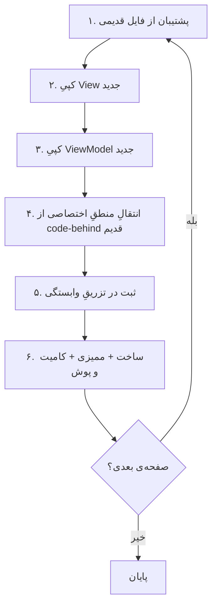

# 🔄 راهنمای جایگزینی — از رابطِ کنونی به `redesign2`

> این سند برای مخزن در نگارشِ `f8d5656` نوشته شده است.
> 81 از 81 صفحه‌ی تازه، هم‌نامِ یک صفحه‌ی موجود است؛ بقیه تازه‌اند.

---

## ۰. پیش‌نیازها

### ۰/۱ بسته‌های NuGet

| بسته | نسخه | دلیل |
|---|---|---|
| `CommunityToolkit.Mvvm` | ۸.۲ یا بالاتر | `ObservableObject`، `RelayCommand`، `AsyncRelayCommand` |
| `Microsoft.Extensions.Logging.Abstractions` | ۸.۰ | `ILogger` در سازنده‌ی ViewModelها |
| `MaterialDesignThemes` | ۵.۳.۲ (موجود) | فقط برای گذار؛ رابطِ تازه از توکن‌های خودش استفاده می‌کند |

### ۰/۲ قلمِ وزیرمتن

قلم در `redesign2/assets/Vazirmatn[wght].woff2` موجود است. برای نصب روی ویندوز:

```powershell
# اجرا با دسترسیِ مدیر
Copy-Item .\redesign2\assets\'Vazirmatn[wght].woff2' "$env:WINDIR\Fonts\"
```

> اگر قلم نصب نباشد، `AppFontFamily` به `Segoe UI`/`Tahoma` سقوط می‌کند و
> رابط همچنان کار می‌کند (فقط کمتر یکدست).

### ۰/۳ شاخه و پشتیبان

```bash
git pull --rebase                          # قاعده ۳
git switch -c feat/redesign2-views         # شاخه‌ی کار
```

---

## ۱. جایگذاریِ فایل‌ها

### ۱/۱ پوشه‌های مقصد

```
src/Sahand.ClinicPro.Desktop/
├── Views/            ← ۳-ویوها                (۸۱ فایل .xaml)
├── ViewModels/       ← ۴-ویومدل‌ها             (۸۱ فایل .cs + _Shared.cs)
├── Controls/         ← ۰۰-پایه/Controls       (۶ کنترل + PasswordHelper)
├── Converters/       ← ۰۰-پایه/Converters     (۷ مبدل)
├── Themes/           ← ۰۰-پایه/Themes         (رنگ، توکن، تایپوگرافی، سبک‌ها)
├── Localization/     ← ۰۰-پایه/Localization   (۱۱۵۱ کلید × ۲ زبان)
├── Assets/Icons.xaml ← ۰۰-پایه/Assets         (۱۷۴ آیکون)
└── Base/             ← ۰۰-پایه/ViewModels/Base (۴ کلاسِ پایه)
```

### ۱/۲ دستورهای کپی

```bash
SRC=redesign2/00-foundation
DST=src/Sahand.ClinicPro.Desktop

# کنترل‌ها، مبدل‌ها، تم‌ها، زبان، پایه‌ها
cp -r $SRC/Controls/*     $DST/Controls/
cp -r $SRC/Converters/*   $DST/Converters/
cp -r $SRC/Themes/*       $DST/Themes/
cp -r $SRC/Localization/* $DST/Localization/
mkdir -p $DST/Assets && cp $SRC/Assets/Icons.xaml $DST/Assets/
mkdir -p $DST/Base && cp $SRC/ViewModels/Base/* $DST/Base/

# Viewها و ViewModelها
cp redesign2/03-views/*.xaml       $DST/Views/
cp redesign2/04-viewmodels/*.cs    $DST/ViewModels/
```

> ⚠ پیش از کپی، از پوشه‌های مقصد پشتیبان بگیرید:
> `git stash` یا یک شاخه‌ی `backup/old-ui`.

---

## ۲. تغییراتِ `App.xaml`

واژه‌نامه‌های ادغامی را به ترتیبِ زیر جایگزین کنید (ترتیب مهم است —
هر لایه به لایه‌ی پیش از خود ارجاع می‌دهد):

```xml
<Application.Resources>
    <ResourceDictionary>
        <ResourceDictionary.MergedDictionaries>
            <!-- ۱. پالتِ رنگ: برای تمِ تاریک این یک خط را عوض کنید -->
            <ResourceDictionary Source="Themes/Colors.Light.xaml" />

            <!-- ۲. توکن‌های معنایی -->
            <ResourceDictionary Source="Themes/Tokens.xaml" />

            <!-- ۳. تایپوگرافی -->
            <ResourceDictionary Source="Themes/Typography.xaml" />

            <!-- ۴. کتابخانه‌ی آیکون -->
            <ResourceDictionary Source="Assets/Icons.xaml" />

            <!-- ۵. سبک‌های کنترل‌ها -->
            <ResourceDictionary Source="Themes/Controls/Buttons.xaml" />
            <ResourceDictionary Source="Themes/Controls/Inputs.xaml" />
            <ResourceDictionary Source="Themes/Controls/DataDisplay.xaml" />

            <!-- ۶. مبدل‌ها -->
            <ResourceDictionary Source="Converters/Converters.xaml" />
        </ResourceDictionary.MergedDictionaries>
    </ResourceDictionary>
</Application.Resources>
```

> `Converters.xaml` را اگر در `Controls/` گذاشتید، مسیر را همان‌جا اصلاح کنید.

---

## ۳. نگاشتِ فایل‌ها (۸۱ صفحه)

| نام | View قدیم | ViewModel قدیم | View جدید | ViewModel جدید |
|---|:--:|:--:|---|---|
| `AccountingView` | ✅ | ✅ | `03-views/AccountingView.xaml` | `04-viewmodels/AccountingViewModel.cs` |
| `AdhocReportWindow` | ✅ | ✅ | `03-views/AdhocReportWindow.xaml` | `04-viewmodels/AdhocReportViewModel.cs` |
| `AdminView` | ✅ | ✅ | `03-views/AdminView.xaml` | `04-viewmodels/AdminViewModel.cs` |
| `AdvancedEmrView` | ✅ | ✅ | `03-views/AdvancedEmrView.xaml` | `04-viewmodels/AdvancedEmrViewModel.cs` |
| `AppointmentFormWindow` | ✅ | ✅ | `03-views/AppointmentFormWindow.xaml` | `04-viewmodels/AppointmentFormViewModel.cs` |
| `AppointmentsView` | ✅ | ✅ | `03-views/AppointmentsView.xaml` | `04-viewmodels/AppointmentsViewModel.cs` |
| `AttendanceView` | ✅ | ✅ | `03-views/AttendanceView.xaml` | `04-viewmodels/AttendanceViewModel.cs` |
| `AuditLogView` | ✅ | ✅ | `03-views/AuditLogView.xaml` | `04-viewmodels/AuditLogViewModel.cs` |
| `BackupView` | ✅ | ✅ | `03-views/BackupView.xaml` | `04-viewmodels/BackupViewModel.cs` |
| `BillingView` | ✅ | ✅ | `03-views/BillingView.xaml` | `04-viewmodels/BillingViewModel.cs` |
| `BranchesView` | ✅ | ✅ | `03-views/BranchesView.xaml` | `04-viewmodels/BranchesViewModel.cs` |
| `ChangePasswordWindow` | ✅ | ✅ | `03-views/ChangePasswordWindow.xaml` | `04-viewmodels/ChangePasswordViewModel.cs` |
| `ColorPickerWindow` | ✅ | ➕ جدید | `03-views/ColorPickerWindow.xaml` | `04-viewmodels/ColorPickerViewModel.cs` |
| `CommissionReportWindow` | ✅ | ✅ | `03-views/CommissionReportWindow.xaml` | `04-viewmodels/CommissionReportViewModel.cs` |
| `CompanyFormWindow` | ✅ | ✅ | `03-views/CompanyFormWindow.xaml` | `04-viewmodels/CompanyFormViewModel.cs` |
| `ComplementaryView` | ✅ | ✅ | `03-views/ComplementaryView.xaml` | `04-viewmodels/ComplementaryViewModel.cs` |
| `ConsumablesView` | ✅ | ✅ | `03-views/ConsumablesView.xaml` | `04-viewmodels/ConsumablesViewModel.cs` |
| `DashboardView` | ✅ | ✅ | `03-views/DashboardView.xaml` | `04-viewmodels/DashboardViewModel.cs` |
| `DentistryView` | ✅ | ✅ | `03-views/DentistryView.xaml` | `04-viewmodels/DentistryViewModel.cs` |
| `DicomViewerWindow` | ✅ | ➕ جدید | `03-views/DicomViewerWindow.xaml` | `04-viewmodels/DicomViewerViewModel.cs` |
| `DoctorFormWindow` | ✅ | ➕ جدید | `03-views/DoctorFormWindow.xaml` | `04-viewmodels/DoctorFormViewModel.cs` |
| `DoctorPerformanceWindow` | ✅ | ➕ جدید | `03-views/DoctorPerformanceWindow.xaml` | `04-viewmodels/DoctorPerformanceViewModel.cs` |
| `DoctorVisitView` | ✅ | ✅ | `03-views/DoctorVisitView.xaml` | `04-viewmodels/DoctorVisitViewModel.cs` |
| `DoctorsView` | ✅ | ✅ | `03-views/DoctorsView.xaml` | `04-viewmodels/DoctorsViewModel.cs` |
| `EPrescriptionView` | ✅ | ✅ | `03-views/EPrescriptionView.xaml` | `04-viewmodels/EPrescriptionViewModel.cs` |
| `EmployeeFormWindow` | ✅ | ✅ | `03-views/EmployeeFormWindow.xaml` | `04-viewmodels/EmployeeFormViewModel.cs` |
| `EmployeeSalaryEditWindow` | ✅ | ✅ | `03-views/EmployeeSalaryEditWindow.xaml` | `04-viewmodels/EmployeeSalaryEditViewModel.cs` |
| `GuidedTourWindow` | ✅ | ➕ جدید | `03-views/GuidedTourWindow.xaml` | `04-viewmodels/GuidedTourViewModel.cs` |
| `ImagingView` | ✅ | ✅ | `03-views/ImagingView.xaml` | `04-viewmodels/ImagingViewModel.cs` |
| `InsuranceView` | ✅ | ✅ | `03-views/InsuranceView.xaml` | `04-viewmodels/InsuranceViewModel.cs` |
| `InvoiceFormWindow` | ✅ | ➕ جدید | `03-views/InvoiceFormWindow.xaml` | `04-viewmodels/InvoiceFormViewModel.cs` |
| `JournalEntryDetailWindow` | ✅ | ➕ جدید | `03-views/JournalEntryDetailWindow.xaml` | `04-viewmodels/JournalEntryDetailViewModel.cs` |
| `LabOrderFormWindow` | ✅ | ✅ | `03-views/LabOrderFormWindow.xaml` | `04-viewmodels/LabOrderFormViewModel.cs` |
| `LabResultWindow` | ✅ | ✅ | `03-views/LabResultWindow.xaml` | `04-viewmodels/LabResultViewModel.cs` |
| `LabView` | ✅ | ✅ | `03-views/LabView.xaml` | `04-viewmodels/LabViewModel.cs` |
| `LicenseActivationWindow` | ✅ | ➕ جدید | `03-views/LicenseActivationWindow.xaml` | `04-viewmodels/LicenseActivationViewModel.cs` |
| `LicenseStatusView` | ✅ | ✅ | `03-views/LicenseStatusView.xaml` | `04-viewmodels/LicenseStatusViewModel.cs` |
| `LoginWindow` | ✅ | ✅ | `03-views/LoginWindow.xaml` | `04-viewmodels/LoginViewModel.cs` |
| `MainWindow` | ✅ | ➕ جدید | `03-views/MainWindow.xaml` | `04-viewmodels/MainViewModel.cs` |
| `NotificationsView` | ✅ | ✅ | `03-views/NotificationsView.xaml` | `04-viewmodels/NotificationsViewModel.cs` |
| `OphthalmologyView` | ✅ | ✅ | `03-views/OphthalmologyView.xaml` | `04-viewmodels/OphthalmologyViewModel.cs` |
| `PatientDetailWindow` | ✅ | ✅ | `03-views/PatientDetailWindow.xaml` | `04-viewmodels/PatientDetailViewModel.cs` |
| `PatientFormWindow` | ✅ | ➕ جدید | `03-views/PatientFormWindow.xaml` | `04-viewmodels/PatientFormViewModel.cs` |
| `PatientsView` | ✅ | ✅ | `03-views/PatientsView.xaml` | `04-viewmodels/PatientsViewModel.cs` |
| `PaymentWindow` | ✅ | ➕ جدید | `03-views/PaymentWindow.xaml` | `04-viewmodels/PaymentViewModel.cs` |
| `PayrollView` | ✅ | ✅ | `03-views/PayrollView.xaml` | `04-viewmodels/PayrollViewModel.cs` |
| `PayslipWindow` | ✅ | ➕ جدید | `03-views/PayslipWindow.xaml` | `04-viewmodels/PayslipViewModel.cs` |
| `PersonnelView` | ✅ | ✅ | `03-views/PersonnelView.xaml` | `04-viewmodels/PersonnelViewModel.cs` |
| `PharmacyItemFormWindow` | ✅ | ✅ | `03-views/PharmacyItemFormWindow.xaml` | `04-viewmodels/PharmacyItemFormViewModel.cs` |
| `PharmacyView` | ✅ | ✅ | `03-views/PharmacyView.xaml` | `04-viewmodels/PharmacyViewModel.cs` |
| `PhotoViewerWindow` | ✅ | ➕ جدید | `03-views/PhotoViewerWindow.xaml` | `04-viewmodels/PhotoViewerViewModel.cs` |
| `PhysiotherapyView` | ✅ | ✅ | `03-views/PhysiotherapyView.xaml` | `04-viewmodels/PhysiotherapyViewModel.cs` |
| `PrescriptionDetailWindow` | ✅ | ✅ | `03-views/PrescriptionDetailWindow.xaml` | `04-viewmodels/PrescriptionDetailViewModel.cs` |
| `PrescriptionFormWindow` | ✅ | ✅ | `03-views/PrescriptionFormWindow.xaml` | `04-viewmodels/PrescriptionFormViewModel.cs` |
| `PrescriptionsView` | ✅ | ✅ | `03-views/PrescriptionsView.xaml` | `04-viewmodels/PrescriptionsViewModel.cs` |
| `ReceptionFormWindow` | ✅ | ✅ | `03-views/ReceptionFormWindow.xaml` | `04-viewmodels/ReceptionFormViewModel.cs` |
| `ReceptionPayWindow` | ✅ | ✅ | `03-views/ReceptionPayWindow.xaml` | `04-viewmodels/ReceptionPayViewModel.cs` |
| `ReceptionsView` | ✅ | ✅ | `03-views/ReceptionsView.xaml` | `04-viewmodels/ReceptionsViewModel.cs` |
| `ReportBrowserView` | ✅ | ✅ | `03-views/ReportBrowserView.xaml` | `04-viewmodels/ReportBrowserViewModel.cs` |
| `ReportsView` | ✅ | ✅ | `03-views/ReportsView.xaml` | `04-viewmodels/ReportsViewModel.cs` |
| `RolePermissionView` | ✅ | ➕ جدید | `03-views/RolePermissionView.xaml` | `04-viewmodels/RolePermissionViewModel.cs` |
| `RoomsManagerWindow` | ✅ | ✅ | `03-views/RoomsManagerWindow.xaml` | `04-viewmodels/RoomsManagerViewModel.cs` |
| `RoomsView` | ✅ | ➕ جدید | `03-views/RoomsView.xaml` | `04-viewmodels/RoomsViewModel.cs` |
| `SepasView` | ✅ | ✅ | `03-views/SepasView.xaml` | `04-viewmodels/SepasViewModel.cs` |
| `SettingsView` | ✅ | ✅ | `03-views/SettingsView.xaml` | `04-viewmodels/SettingsViewModel.cs` |
| `ShiftCloseWindow` | ✅ | ✅ | `03-views/ShiftCloseWindow.xaml` | `04-viewmodels/ShiftCloseViewModel.cs` |
| `ShiftReceiptPreviewWindow` | ✅ | ➕ جدید | `03-views/ShiftReceiptPreviewWindow.xaml` | `04-viewmodels/ShiftReceiptPreviewViewModel.cs` |
| `ShiftsView` | ✅ | ✅ | `03-views/ShiftsView.xaml` | `04-viewmodels/ShiftsViewModel.cs` |
| `ShortcutPickerWindow` | ✅ | ➕ جدید | `03-views/ShortcutPickerWindow.xaml` | `04-viewmodels/ShortcutPickerViewModel.cs` |
| `SmsView` | ✅ | ✅ | `03-views/SmsView.xaml` | `04-viewmodels/SmsViewModel.cs` |
| `SplashWindow` | ✅ | ➕ جدید | `03-views/SplashWindow.xaml` | `04-viewmodels/SplashViewModel.cs` |
| `StockInFormWindow` | ✅ | ✅ | `03-views/StockInFormWindow.xaml` | `04-viewmodels/StockInFormViewModel.cs` |
| `StocktakingView` | ✅ | ✅ | `03-views/StocktakingView.xaml` | `04-viewmodels/StocktakingViewModel.cs` |
| `SurveyView` | ✅ | ✅ | `03-views/SurveyView.xaml` | `04-viewmodels/SurveyViewModel.cs` |
| `TariffFormWindow` | ✅ | ✅ | `03-views/TariffFormWindow.xaml` | `04-viewmodels/TariffFormViewModel.cs` |
| `ThemedDialog` | ✅ | ➕ جدید | `03-views/ThemedDialog.xaml` | `04-viewmodels/ThemedDialogViewModel.cs` |
| `TrainingCenterView` | ✅ | ✅ | `03-views/TrainingCenterView.xaml` | `04-viewmodels/TrainingCenterViewModel.cs` |
| `UserFormWindow` | ✅ | ✅ | `03-views/UserFormWindow.xaml` | `04-viewmodels/UserFormViewModel.cs` |
| `UsersView` | ✅ | ✅ | `03-views/UsersView.xaml` | `04-viewmodels/UsersViewModel.cs` |
| `VisitWindow` | ✅ | ➕ جدید | `03-views/VisitWindow.xaml` | `04-viewmodels/VisitViewModel.cs` |
| `VisitsView` | ✅ | ✅ | `03-views/VisitsView.xaml` | `04-viewmodels/VisitsViewModel.cs` |

---

## ۴. فضای نام و قراردادها

| موضوع | قدیم | جدید |
|---|---|---|
| فضای نامِ View | `Sahand.ClinicPro.Desktop.Views` | **بدون تغییر** |
| فضای نامِ ViewModel | `Sahand.ClinicPro.Desktop.ViewModels` | **بدون تغییر** |
| فضای نامِ کنترل‌ها | `…Desktop.Controls` | **بدون تغییر** |
| فضای نامِ پایه‌ها | `…Desktop.ViewModels` | `…Desktop.Base` (پوشه‌ی `Base/`) |
| سطرِ `using` در هر ViewModel | — | `using Sahand.ClinicPro.Desktop.Base;` |

### ۴/۱ چیزهایی که حذف می‌شوند

| چیز | چرا |
|---|---|
| کلیدهای Material Design در XAML | رابطِ تازه هیچ وابستگی به MD ندارد |
| `MessageBox.Show` | قاعدهٔ ۱۳ — پیام از `ShowError`/`ShowSuccess` می‌آید |
| شکلک در متنِ رابط | قاعدهٔ ۲۰ — جایگزین با `Icon.*` |
| رنگِ هگزِ ثابت | الزامِ ۲۲ — همه از توکن‌های معنایی |
| منطق در code-behind | الزامِ MVVM — همه به ViewModel منتقل می‌شود |

### ۴/۲ چیزهایی که اضافه می‌شوند

| چیز | محل |
|---|---|
| `StatusToneConverter` | `Converters/Converters.cs` + ثبت در `Converters.xaml` |
| `RelayCommand` محلی | `Base/RelayCommand.cs` — در پایه‌ها با نامِ مستعار به نسخه‌ی CommunityToolkit ارجاع داده شده |
| ۱۷۴ آیکون | `Assets/Icons.xaml` |
| ۱۱۵۱ کلیدِ زبان | `Localization/Strings.resx` و `Strings.en.resx` |

---

## ۵. گام‌های جایگزینی برای هر صفحه

برای هر یک از ۸۱ صفحه، این شش گام را به ترتیب انجام دهید و **پس از هر صفحه
کامیت و پوش کنید** (قاعدهٔ ۱):



### گام ۱ — پشتیبان

```bash
mkdir -p .migration-backup
cp src/Sahand.ClinicPro.Desktop/Views/PatientsView.xaml .migration-backup/
cp src/Sahand.ClinicPro.Desktop/ViewModels/PatientsViewModel.cs .migration-backup/
```

### گام ۲ — View

فایل جدید را کپی کنید و namespaceِ `x:Class` را بررسی کنید (در صورت تغییرِ
ساختارِ پوشه‌ها):

```xml
<UserControl x:Class="Sahand.ClinicPro.Desktop.Views.PatientsView"
             FlowDirection="RightToLeft"
             FontFamily="{DynamicResource AppFontFamily}">
```

### گام ۳ — ViewModel

مدلِ ردیف (`PatientsRow`) در همان فایلِ ViewModel است؛ اگر در لایه‌ی Domain
معادل دارد، آن را حذف و به مدلِ دامنه ارجاع دهید.

### گام ۴ — انتقالِ منطقِ اختصاصی

هرچه در code-behind قدیم بود (رویدادها، تبدیل‌ها، فراخوانیِ سرویس) باید به
یک فرمان در ViewModel منتقل شود. نقاطِ `// TODO` در ViewModelهای تازه دقیقاً
همان جاهایی‌اند که باید پر شوند:

```csharp
// TODO: جایگزینی با فراخوانیِ سرویسِ واقعی، برای نمونه:
//   var result = await _service.GetAsync(SearchText, PageNumber, PageSize, ct);
```

### گام ۵ — تزریقِ وابستگی

```csharp
// در App.xaml.cs یا CompositionRoot
services.AddTransient<PatientsViewModel>();
services.AddTransient<PatientsView>();
```

### گام ۶ — ساخت و کامیت

```bash
dotnet build src/Sahand.ClinicPro.Desktop -warnaserror
python3 redesign2/tools/audit_bindings.py
git add -A && git commit -m '🔄 [Step PatientsView]: جایگزینیِ صفحه‌ی بیماران'
git push
```

---

## ۶. نمونه‌ی کامل — صفحه‌ی بیماران

```diff
- <!-- قدیم: ۸۰۰ خط XAML با کلیدهای Material Design -->
- <DataGrid md:DataGridAssist.CellPadding="8" ItemsSource="{Binding Patients}">
-   <DataGridTextColumn Header="نام" Binding="{Binding FullName}" />
- </DataGrid>
+ <!-- جدید: توکن‌های معنایی + ستونِ نوع‌محور -->
+ <DataGrid Style="{DynamicResource Grid.Modern}"
+           ItemsSource="{Binding Items}"
+           SelectedItem="{Binding SelectedItem, Mode=TwoWay}">
+   <DataGridTemplateColumn Header="نام بیمار" Width="*">
+     <!-- نشانِ تصویری + نام + زیرنویس -->
+   </DataGridTemplateColumn>
+ </DataGrid>
```

```diff
- private void OnSearchClick(object sender, RoutedEventArgs e)
- {
-     MessageBox.Show("...");
- }
+ // جدید: هیچ منطقی در code-behind
+ public string SearchText { get; set; }   // در پایه، با تأخیرِ ۳۵۰ms
+ protected override Task<PagedResult<PatientsRow>?> FetchAsync(CancellationToken ct)
```

---

## ۷. چک‌لیستِ پذیرش

| # | معیار | ابزار | وضعیتِ هدف |
|:--:|---|---|---|
| ۱ | همه‌ی XAMLها معتبر | تجزیه‌گر XML | ۸۱/۸۱ ✅ |
| ۲ | همه‌ی C#ها متوازن | شمارشِ آکولاد | ۸۲/۸۲ ✅ |
| ۳ | هیچ رنگِ هگزِ ثابت در Viewها | اسکن | ۰ ✅ |
| ۴ | هیچ شکلک در رابط | اسکنِ بازه‌ی ایموجی | ۰ ✅ |
| ۵ | هیچ نویسهٔ CJK | اسکن | ۰ ✅ |
| ۶ | هیچ اتصالِ یتیم | `tools/audit_bindings.py` | ۰ از ۱٬۳۲۳ ✅ |
| ۷ | هیچ کلیدِ منبعِ گم‌شده | ممیزیِ واژه‌نامه | ۰ ✅ |
| ۸ | دو زبان هم‌تراز | `tools/resx_sync.py` | ۱۱۵۱/۱۱۵۱ ✅ |
| ۹ | ساختِ بدون هشدار | `dotnet build -warnaserror` | ۰ هشدار |
| ۱۰ | کامیت و پوش پس از هر واحد | `git log` | ✅ |

---

## ۸. بازگشت

اگر در هر مرحله نیاز به بازگشت بود:

```bash
cp .migration-backup/* src/Sahand.ClinicPro.Desktop/Views/
git revert HEAD --no-edit
git push
```

---

این فایل با `tools/gen_guide.py` ساخته شده است؛ آن را دستی ویرایش نکنید.
