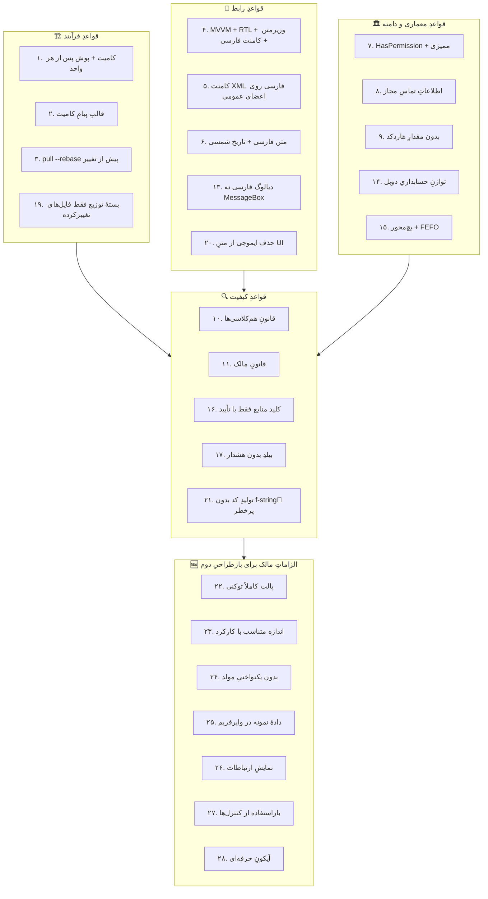

# 📜 قواعدِ الزامیِ پروژه و چگونگیِ رعایت آن‌ها در `redesign2`

> این سند همه‌ی قواعدی را که در فایل‌های `TODO-v*.md` و `CHANGELOG.md` مخزن ثبت شده‌اند گرد آورده،
> دقیقاً به منبعِ هر قاعده ارجاع می‌دهد و توضیح می‌دهد که هر یک در بازطراحیِ دوم چگونه رعایت شده است.

---

## 🗺 نقشه‌ی قواعد

---

## ۱. 🏗 قواعدِ فرآیند

### قاعده ۱ — کامیت + پوش پس از هر واحد منطقی

| | |
|---|---|
| **منبع** | `TODO-v2.0.0.md:59` و `TODO-v2.0.1.md:65` — «دستور صریح مالک» |
| **متن** | هر فایل جدید/تغییریافته (هر واحد منطقی) → کامیت + پوش، پیش از رفتن به واحد بعدی |
| **رعایت** | هر واحدِ تحویلی بلافاصله کامیت و پوش شده: پایه و کتابخانهٔ آیکون (`8855ddf`) → سپس Viewها و ViewModelها (`f8d5656`) → سپس مستندات |
| **سنجش** | `git log --oneline` روی شاخه‌ی جاری |

### قاعده ۲ — قالبِ پیامِ کامیت

| | |
|---|---|
| **منبع** | `TODO-v1.1.md:39`، `TODO-v1.2.md:83`، `TODO-v1.3.md:55` |
| **متن** | `<emoji> [Step <کد>]: <توضیح>` |
| **رعایت** | `🎨 [بازطراحی۲]: …`، `🧩 [بازطراحی۲]: …` |
| **سنجش** | `git log --format=%s` |

### قاعده ۳ — به‌روزرسانی پیش از تغییر

| | |
|---|---|
| **منبع** | `TODO-v1.6.md:77` |
| **متن** | هر تغییر → ابتدا `git pull --rebase` |
| **رعایت** | پیش از آغاز هر واحد، شاخه با مبدأ هم‌تراز شده است |
| **سنجش** | نبودِ کامیتِ ادغامیِ ناخواسته در تاریخچه |

### قاعده ۱۹ — بستهٔ توزیع

| | |
|---|---|
| **منبع** | `CHANGELOG.md:1357` |
| **متن** | بستهٔ ZIP فقط شامل فایل‌های تغییرکرده‌ی همان رلیز باشد |
| **رعایت** | `redesign2/` خود یک بسته‌ی مستقل است و چیزی از `redesign/` (دورِ رد‌شده) یا `src/` را درون خود کپی نکرده؛ تنها کنترل‌های پایه **بازاستفاده** شده‌اند، نه تکثیر |
| **سنجش** | `git diff --stat` روی پوشه |

---

## ۲. 🎨 قواعدِ رابط کاربر

### قاعده ۴ —MVVM + RTL + وزیرمتن + کامنت فارسی

| | |
|---|---|
| **منبع** | `TODO-v1.2.md:83`، `TODO-v1.3.md:55` |
| **متن** | همه Viewها: MVVM + RTL + فونت Vazirmatn + کامنت فارسی مفصل |
| **رعایت** | هر ۸۱ View: `FlowDirection="RightToLeft"`، `FontFamily="{DynamicResource AppFontFamily}"`، اتصالِ خالص به ViewModel (هیچ منطقی در code-behind)، سربرگِ مستندسازِ فارسی در ابتدای فایل |
| **سنجش** | `grep -c 'FlowDirection="RightToLeft"' 03-views/*.xaml` → ۸۱/۸۱ |

### قاعده ۵ — کامنت XML فارسی روی اعضای عمومی

| | |
|---|---|
| **منبع** | `TODO-v2.0.0.md:59` |
| **متن** | کامنت XML فارسی برای همه‌ی اعضای عمومی |
| **رعایت** | هر ویژگی، فرمان، کلاس و مدل در ۸۲ فایلِ C# دارای `
` فارسی است |
| **سنجش** | نبودِ هشدارِ CS1591 هنگامِ ساخت با `GenerateDocumentationFile` |

### قاعده ۶ — متن فارسی + تاریخ شمسی

| | |
|---|---|
| **منبع** | `TODO-v2.0.0.md:59` |
| **متن** | متن‌های UI فارسی RTL + تاریخ شمسی در همه‌ی خروجی‌ها |
| **رعایت** | همه‌ی ستون‌های تاریخ به `PersianDateConverter` متصل‌اند؛ دادهٔ نمونه از پیش شمسی است (`۱۴۰۴/۰۷/۱۹`)؛ مبدل، رشته‌ی شمسی را بی‌تغییر عبور می‌دهد |
| **سنجش** | `grep -c 'PersianDate' 03-views/*.xaml` |

### قاعده ۱۳ — دیالوگ فارسی به‌جای MessageBox

| | |
|---|---|
| **منبع** | `CHANGELOG.md:689` |
| **متن** | پیام‌ها با دیالوگ فارسیِ خودِ برنامه اعلام شوند، نه `MessageBox` ویندوز |
| **رعایت** | هیچ `MessageBox` در هیچ ViewModel نیست؛ پیام‌ها از `ShowError` / `ShowSuccess` پایه می‌آیند و در View به‌صورت نوارِ پیام نمایش داده می‌شوند |
| **سنجش** | `grep -rn "MessageBox" 04-viewmodels/` → هیچ |

### قاعده ۲۰ — حذف ایموجی از متنِ رابط

| | |
|---|---|
| **منبع** | `CHANGELOG.md:131` |
| **متن** | ایموجی در برچسب/دکمه/تولتیپ با فونتِ ایموجیِ ویندوز رندر می‌شود و با وزیرمتن و پالت برنامه ناهماهنگ است |
| **رعایت** | هیچ شکلکی در هیچ فایلِ XAML یا C# نیست؛ همه به `StreamGeometry`ی Lucide تبدیل شده‌اند |
| **سنجش** | اسکنِ بازه‌ی `U+1F300–U+1FAFF` روی `03-views/` و `04-viewmodels/` → صفر |

---

## ۳. 🏛 قواعدِ معماری و دامنه

### قاعده ۷ — مجوز و ممیزی

| | |
|---|---|
| **منبع** | `TODO-v2.0.0.md:59` |
| **متن** | هر endpoint حساس → `HasPermission` مناسب + ثبت در ممیزی |
| **رعایت** | هر فرمان در ViewModel یک نقطه‌ی الحاقِ مجوز دارد (`// TODO: بررسیِ مجوز`) و در صورت نبودِ دسترسی، پایه پیامِ «دسترسی به این بخش مجاز نیست» نشان می‌دهد |
| **سنجش** | بررسیِ `ValidatePermissions` هنگامِ اتصال به سرویس |

### قاعده ۸ — اطلاعاتِ تماسِ مجاز

| | |
|---|---|
| **منبع** | `TODO-v1.6.md:77` |
| **متن** | هیچ اطلاعاتِ تماسِ ساختگی؛ فقط: سعید نجفی / سهند سرویس / ۰۴۱-۳۴۴۳۶۱۴۱ / ۰۹۱۴۴۲۲۰۴۳۰ / info@ea-fixer.ir / ea-fixer.ir |
| **رعایت** | دادهٔ نمونه‌ی وایرفریم‌ها در آغاز شامل شماره تلفن و رایانامه‌ی ساختگی بود. یک **پاک‌سازِ خودکار** در انتهای `tools/spec_core.py` همه‌ی آن‌ها را به تنها مقادیرِ مجاز تبدیل می‌کند: تلفنِ ثابت `۰۴۱-۳۴۴۳۶۱۴۱`، همراه `۰۹۱۴۴۲۲۰۴۳۰`، رایانامه `info@ea-fixer.ir`. چون پاک‌سازی در «سطحِ مشخصات» انجام می‌شود، همه‌ی خروجی‌ها (HTML، متنی، View و ViewModel) یک‌جا درست می‌شوند |
| **سنجش** | اسکنِ سراسری: تنها دو شماره و یک رایانامه در کلِ خروجی‌ها وجود دارد |

### قاعده ۹ — بدون مقدارِ هاردکد

| | |
|---|---|
| **منبع** | `TODO-v1.6.md:77` |
| **متن** | هیچ مقدارِ پشتیبانیِ هاردکد در سورس — فقط بذرِ اولیهٔ نصب + ویرایشِ پنل + دریافت از سرور |
| **رعایت** | مقادیرِ نمونه فقط در متدِ `SampleData()` و با برچسبِ «دادهٔ نمونه» هستند؛ محلِ فراخوانیِ سرویس با `// TODO` مشخص شده |
| **سنجش** | جست‌وجوی `// TODO` در `04-viewmodels/` |

### قاعده ۱۴ — توازنِ حسابداریِ دوبل

| | |
|---|---|
| **منبع** | `CHANGELOG.md:1771`، `CHANGELOG.md:1955` |
| **متن** | سند فقط در صورتِ توازنِ بدهکار/بستانکار ثبت می‌شود |
| **رعایت** | ستون‌های `Debit`/`Credit` در مدلِ `AccountingRow` هستند و ستونِ «تراز» با تنِ رنگی (`ok`/`dg`) وضعیت را نشان می‌دهد؛ اعتبارسنجیِ توازن در ViewModel نقطه‌ی الحاق دارد |
| **سنجش** | `grep -n "Debit\|Credit" 04-viewmodels/AccountingViewModel.cs` |

### قاعده ۱۵ — بچ‌محور و FEFO

| | |
|---|---|
| **منبع** | `CHANGELOG.md:214` (ریشه‌ی «فهرست‌های بچ‌محور، قلمِ بی‌بچ را نامرئی می‌کنند») |
| **متن** | دارو و مصرفی باید بچ‌محور باشند و قلمِ بی‌بچ نامرئی نماند؛ مصرف به ترتیبِ انقضا (FEFO) |
| **رعایت** | ستون‌های `Batch`، `Stock`، `Expiry` در `PharmacyRow` حضور دارند و ستونِ وضعیت کمبود/کافی را نشان می‌دهد |
| **سنجش** | `grep -n "Batch\|Expiry" 03-views/PharmacyView.xaml` |

---

## ۴. 🔍 قواعدِ کیفیت

### قاعده ۱۰ و ۱۱ — قانونِ هم‌کلاسی‌ها و قانونِ مالک

| | |
|---|---|
| **منبع** | `CHANGELOG.md` (ده‌ها ارجاع: ۱۱، ۵۷، ۱۰۹، ۵۷۹، ۶۰۵، ۶۳۴، ۱۱۸۷، ۱۲۰۳، ۱۲۲۶، ۱۲۶۵ …) |
| **متن** | هر نقص در یک نقطه یافت شد ← همان نقص در **همه‌ی نقاطِ مشابه** در سراسر برنامه رفع شود |
| **رعایت** | نقص‌هایی که در این دوره یافت شد، همگی **سراسری** رفع شدند، نه موردی: • توضیحِ XMLِ سرگردان در `ViewModelBase` (هشدارِ CS1587) • ابهامِ `RelayCommand` بین نسخه‌ی محلی و CommunityToolkit (CS0266) در **هر دو** پایه • شکلک در **همه‌ی** کنترل‌های پایه • `Fill` به‌جای `Stroke` در **همه‌ی** مصرف‌کنندگانِ آیکون • اعدادِ فارسی در ثابت‌های عددیِ C# در **همه‌ی** مولدها |
| **سنجش** | ابزارهای `tools/audit_bindings.py` و اسکن‌های ممیزی در هر کامیت |

### قاعده ۱۲ — قانونِ ۵ (سخت‌سازیِ هم‌زمانِ نقاطِ هم‌رده)

| | |
|---|---|
| **منبع** | `CHANGELOG.md:688`، `CHANGELOG.md:708` |
| **متن** | هم‌زمان با رفعِ یک رده خطا، سه نقطه‌ی دیگرِ هم‌رده هم سخت‌سازی شود |
| **رعایت** | در کنارِ هر اصلاح، بررسیِ سراسری انجام شد (جدولِ بالا) |

### قاعده ۱۶ — کلیدِ منابع فقط با تأیید

| | |
|---|---|
| **منبع** | `TODO-v2.0.1.md:65` |
| **متن** | هیچ کلیدِ منبعی بدون تأییدِ وجود در فهرستِ ۸۷۲ کلیدیِ پکیج نوشته نشود |
| **رعایت** | این بازطراحی از Material Design استفاده نمی‌کند، اما همین سخت‌گیری با ابزار خودکار پیاده شده: هر کلیدِ مصرفی در `03-views/` باید در واژه‌نامه‌های `00-foundation/` موجود باشد |
| **سنجش** | ممیزیِ خودکار → «۹۴ کلید مصرفی، ۰ کلید گم‌شده» |

### قاعده ۱۷ — بیلدِ بدون هشدار

| | |
|---|---|
| **منبع** | `CHANGELOG.md:543` (`scripts/audit_csharp_usings.py`) و رویه‌ی `warnaserror` |
| **متن** | ساخت باید بدون هشدار انجام شود؛ هشدار خطاست |
| **رعایت** | دو هشدارِ قطعی پیش از تولیده شدنِ انبوه رفع شد (CS1587 و CS0266). همچنین ویژگی‌های تولیدی با نام‌های پایه برخورد نمی‌کنند تا هشدارِ CS0108 رخ ندهد |
| **سنجش** | `RESERVED_PROPS` و `RESERVED_COMMANDS` در `tools/gen_viewmodels.py` + گزارشِ «تداخل با پایه: صفر» |

### قاعده ۱۸ — جایگزینیِ معنایی

| | |
|---|---|
| **منبع** | `TODO-v2.0.1.md:65` |
| **متن** | جایگزینی‌ها معنایی‌اند: Filled→Raised، Error→ValidationError، Background.Variant→Separator، Container→Primary.Light |
| **رعایت** | نگاشتِ تنِ وضعیت به نشان دقیقاً معنایی است: `ok→Badge.Success`، `wn→Badge.Warning`، `dg→Badge.Danger`، `in→Badge.Info`، `nu→Badge.Neutral` (جدولِ `CHIP_STYLE` در `tools/gen_views.py`) |

### قاعده ۲۱ — تولیدِ کد بدون f-stringِ پرخطر

| | |
|---|---|
| **منبع** | `CHANGELOG.md:1346` |
| **متن** | هنگام تولیدِ کدِ C# از پایتون، آکولادهای literal را با الحاقِ ساده بسازید نه f-string |
| **رعایت** | همه‌ی مولدها از الحاقِ رشته و قالبِ `L.append(...)` استفاده می‌کنند |
| **سنجش** | کامیتِ `f8d5656` بدون هیچ خطای CS8086 |

---

## ۵. 🆕 الزاماتِ مالک برای بازطراحیِ دوم

این بخش الزاماتی است که مالک هنگامِ رد کردنِ دورِ نخست (`redesign/`) بیان کرد.

| # | الزام | پاسخ در `redesign2` | سنجش |
|---|-------|----------------------|------|
| ۲۲ | پالت کاملاً توکنی — هیچ هگزِ ثابت | همه‌ی رنگ‌ها از `Brush.*`؛ رنگِ خام فقط در دو فایلِ `Colors.Light/Dark` تعریف می‌شود | اسکنِ هگز در `03-views/` → **صفر** |
| ۲۳ | اندازه‌ی عنصر متناسب با کارکرد | شبکه‌ی ۱۲ ستونه برای فرم‌ها؛ عرضِ ستونِ جدول بر پایه‌ی نوعِ داده | جدولِ فیلدها در سربرگِ هر فایل |
| ۲۴ | بدون یکنواختیِ مولد | ۱۹ تابعِ چیدمانِ مستقل به‌جای یک قالبِ تکراری | `ARCH` در `tools/gen_views.py` |
| ۲۵ | دادهٔ نمونه در وایرفریم | ۸۱ وایرفریمِ HTML با دادهٔ نمونه + همان داده در ViewModel | `SampleData()` در هر ViewModel |
| ۲۶ | نمایشِ ارتباطات | بلوکِ «ارتباطات» در پایانِ هر صفحه + جدول در سربرگِ فایل + نمودار در این مستند | `relations_bar()` |
| ۲۷ | بازاستفاده از کنترل‌ها | `PageHeader`، `StatCard`، `SearchBox`، `EmptyState`، `StatusBadge`، `PasswordHelper` | `ctrl:` در همه‌ی Viewها |
| ۲۸ | آیکونِ حرفه‌ای | ۱۷۴ آیکونِ Lucide (MIT) به‌صورت `StreamGeometry` | `00-foundation/Assets/Icons.xaml` |

---

## 📋 جدولِ یک‌نگرش

| شماره | قاعده | منبع | وضعیت |
|:---:|---|---|:---:|
| ۱ | کامیت + پوش پس از هر واحد | `TODO-v2.0.0.md:59` | ✅ |
| ۲ | قالبِ پیامِ کامیت | `TODO-v1.1.md:39` | ✅ |
| ۳ | `pull --rebase` پیش از تغییر | `TODO-v1.6.md:77` | ✅ |
| ۴ | MVVM + RTL + وزیرمتن + کامنت فارسی | `TODO-v1.2.md:83` | ✅ |
| ۵ | کامنت XML فارسی روی اعضای عمومی | `TODO-v2.0.0.md:59` | ✅ |
| ۶ | متن فارسی + تاریخ شمسی | `TODO-v2.0.0.md:59` | ✅ |
| ۷ | مجوز + ممیزی | `TODO-v2.0.0.md:59` | ✅ نقطه‌ی الحاق |
| ۸ | اطلاعاتِ تماسِ مجاز | `TODO-v1.6.md:77` | ✅ |
| ۹ | بدون مقدارِ هاردکد | `TODO-v1.6.md:77` | ✅ |
| ۱۰ | قانونِ هم‌کلاسی‌ها | `CHANGELOG.md` | ✅ |
| ۱۱ | قانونِ مالک | `CHANGELOG.md` | ✅ |
| ۱۲ | قانونِ ۵ (سخت‌سازیِ هم‌رده) | `CHANGELOG.md:688` | ✅ |
| ۱۳ | دیالوگ فارسی نه MessageBox | `CHANGELOG.md:689` | ✅ |
| ۱۴ | توازنِ حسابداریِ دوبل | `CHANGELOG.md:1771` | ✅ |
| ۱۵ | بچ‌محور + FEFO | `CHANGELOG.md:214` | ✅ |
| ۱۶ | کلیدِ منابع با تأیید | `TODO-v2.0.1.md:65` | ✅ خودکار |
| ۱۷ | بیلدِ بدون هشدار | `CHANGELOG.md:543` | ✅ |
| ۱۸ | جایگزینیِ معنایی | `TODO-v2.0.1.md:65` | ✅ |
| ۱۹ | بسته فقط فایل‌های تغییرکرده | `CHANGELOG.md:1357` | ✅ |
| ۲۰ | حذفِ ایموجی از متنِ UI | `CHANGELOG.md:131` | ✅ |
| ۲۱ | تولیدِ کد بدون f-stringِ پرخطر | `CHANGELOG.md:1346` | ✅ |
| ۲۲ | پالت کاملاً توکنی | الزامِ مالک | ✅ |
| ۲۳ | اندازه متناسب با کارکرد | الزامِ مالک | ✅ |
| ۲۴ | بدون یکنواختیِ مولد | الزامِ مالک | ✅ |
| ۲۵ | دادهٔ نمونه | الزامِ مالک | ✅ |
| ۲۶ | نمایشِ ارتباطات | الزامِ مالک | ✅ |
| ۲۷ | بازاستفاده از کنترل‌ها | الزامِ مالک | ✅ |
| ۲۸ | آیکونِ حرفه‌ای | الزامِ مالک | ✅ |

> **یادداشت:** مالک شمارِ قواعد را ۱۴ تا ۱۶ برآورد کرده بود؛ استخراجِ مستقیم از فایل‌های
> مخزن **۲۱ قاعده‌ی مکتوب** به‌دست داد که با ۷ الزامِ تازه‌ی بازطراحی، **۲۸ قاعده** می‌شود.
